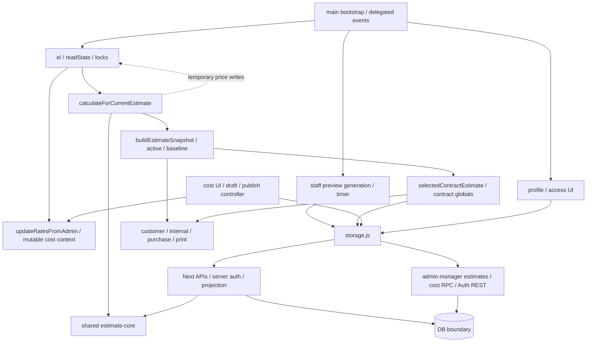
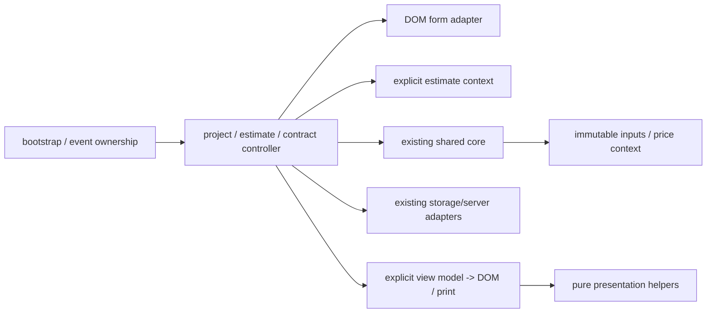
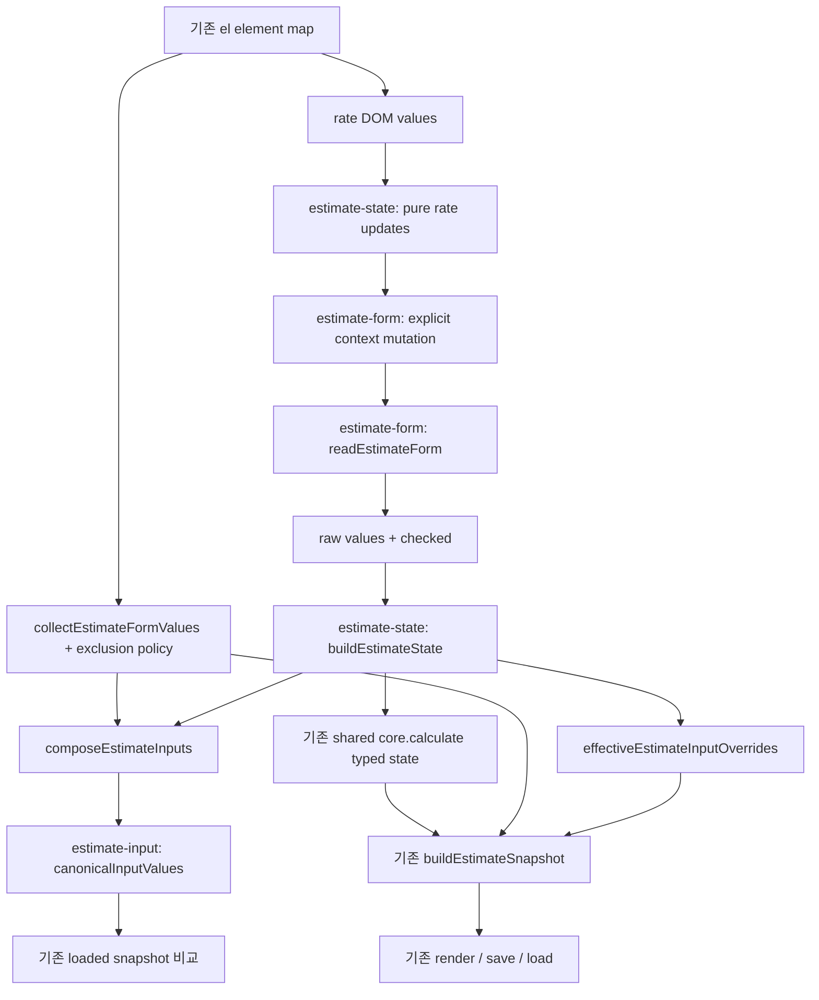

# AND OS Phase 3A: main.js Dependency Map And Extraction Plan

분석 기준: Phase 2 checkpoint `352ab18`, 2026-10-12, 저장소 `C:/Users/user/and-website`.
이번 산출물은 분석과 문서화다. runtime/API/SQL/DB/import-export 변경, Production 접근, commit/push/deploy는 없다.
기존 미추적 SQL 두 파일은 분석 및 변경 대상에서 제외했다.

## 1. Current Architecture

- 실제 파일은 **6,947줄**이다. 인수인계의 약 8,191줄은 현재 체크포인트와 다르다.
- `/os`는 iframe shell이고 실제 실행 root는 `public/os-app/src/main.js`다. URL router가 아니라 `.tab-button[data-tab]` 및 `.tab-panel` 전환이다.
- top-level function 248개 + major arrow 20개 = **268개**. anonymous event handler 33개 + timer callback 1개는 별도로 **34개** 기록한다.
- domain mutable global 51개, 별도 DOM binding `el` 1개다. const Map/객체도 실제 mutation이 있으면 mutable로 집계했다.
- named/arrow 함수 중 직접 DOM 의존 118개, 간접 포함 **155개**, network/storage/session adapter 간접 포함 **47개**, 정적 pure 후보 **53개**다.
- 숫자는 런타임 profiling 결과가 아니다. 전체 UTF-8 원문 AST와 lexical reference/call graph를 분석한 값이다. whitespace를 포함하고 마지막 newline 뒤의 빈 split 항목은 line count에 넣지 않는다.

### 분석 방법과 한계

espree AST + eslint-scope로 선언/참조를 resolve했다. imported symbol, module global R/W, DOM selector/속성,
호출/콜백 참조, 이벤트 등록, timer, clock, dialog, print, logging을 별도로 수집하고 transitive closure를 계산했다.
호출자는 같은 함수의 여러 호출 site가 아니라 **고유 호출자 함수 수**다. `<bootstrap/export>`는 top-level 사용 또는 기존 test export다.
event/timer는 owner가 등록하는 비동기 callback edge까지 포함한다. 함수 inventory의 R/W는 직접 lexical 참조이며,
간접 DOM/network와 side-effect closure는 별도로 표시한다. nested local callback은 기본적으로 enclosing named function에 귀속한다.

pure는 DOM/side effect/shared mutable state 읽기와 쓰기/미해결 identifier call이 없는 보수적 후보를 뜻한다.
고정 config 참조와 input 기반 HTML 문자열 생성은 허용한다. Locale/host timezone 의존 formatter와 throw validator도
후보에 들어가므로 deterministic timezone/예외 계약 테스트가 필요하다. 임의 property getter, parameter alias mutation,
DOM parameter provenance, 동적 dispatch를 완전히 증명하는 formal purity 분석은 아니다.
selector와 runtime 동적 ID는 정적 literal 또는 `<dynamic selector>`로 표시한다. branch별 실행 횟수/성능은 추정하지 않았다.

분석 스크립트 및 전체 machine-readable 결과는 thread workspace의 `phase3-analyze.cjs`, `phase3-main-analysis.json`에 있다.
runtime을 import/실행하지 않고 파일 원문만 읽는다. 새 분석 도구 dependency는 설치하지 않았다.

### 기능 영역별 Source Map

| 행 범위 | 영역 | 대표 함수 | global read | global write | DOM read/selector | DOM write literal | 외부 모듈/API | 직접 side effect | 호출 규모 |
|---|---|---|---|---|---|---|---|---|---|
| 1-45 | 외부 모듈/API adapter imports | - | - | - | - | - | - | - | 0개 고유 caller 참조 합계 (영역간 중복 포함) |
| 46-441 | 원가 default, input ID/정수 입력 config | - | - | - | - | - | - | - | 0개 고유 caller 참조 합계 (영역간 중복 포함) |
| 442-493 | DOM binding 및 공통 mutable state | - | - | - | - | - | - | - | 0개 고유 caller 참조 합계 (영역간 중복 포함) |
| 494-525 | 숫자/문자 formatter, core delegate, 원가 lookup | `won`, `floorThousand`, `customerWon`, `moneyAmount`, `numberValue` | `el` | - | `*` | - | `core.customerWon`, `core.floorThousand`, `core.isSlabMaterial`, `core.mText`, `core.markupRate`, `core.mmText`, `core.slabBaseCost` | - | 60개 고유 caller 참조 합계 (영역간 중복 포함) |
| 526-646 | DOM shell/query helper | `labelTextFor`, `optionTextFor`, `textFor`, `ensureEstimateStatusControl`, `ensureSaveButtons` | `el` | `el` | `#admin .admin-db-card`, `#estimateStatus`, `.project-info-grid`, `<dynamic selector>`, `admin`, `adminStandardSeparateItems`, `costSnapshotPanel`, `estimateStatus`, `saveAsNewEstimateButton`, `saveEstimateButton`, `saveRateDbButton`, `savedEstimateRows`, `span` | `estimateStatus` | - | `DOM write` | 8개 고유 caller 참조 합계 (영역간 중복 포함) |
| 647-1059 | 계약 옵션 form, 프로젝트-계약 연결/list | `ensureContractPackagePanel`, `selectedContractEstimate`, `contractStatus`, `contractOptionSource`, `contractNested` | `activeQuoteEstimate`, `allContractPackagesState`, `cachedEstimates`, `contractOptionsState`, `contractPackagesState`, `contractPreviewState`, `currentEditingEstimateId`, `loadedContractEstimateState`, `projectContractPackageMap`, `projectContractPackageMapLoaded` | - | `#contractOptionsForm input, #contractOptionsForm select, #contractOptionsForm textarea`, `<dynamic selector>`, `admin`, `allContractPackageRows`, `contractPackageListPanel`, `contractPackagePanel`, `contractPackageRows`, `contractPackageStatus`, `contractReadonlyNote`, `contractWriteActions`, `createContractPackageButton`, `savedEstimateRows` | `constructionType`, `contractAreaM2`, `contractAreaPyeong`, `contractCompletionDate`, `contractCustomerName`, `contractCustomerPhone`, `contractDate`, `contractNo`, `contractSiteAddress`, `contractStartDate`, `customerAddress`, `customerEmail`, `existingFinishProtectionIncluded`, `permitFilingIncluded`, `residentConsentIncluded`, `siteManagerName`, `siteManagerPhone`, `siteManagerTitle` | - | `DOM write` | 44개 고유 caller 참조 합계 (영역간 중복 포함) |
| 1060-1194 | JSON preview 및 계약 print formatting | `sanitizeContractPreviewValue`, `renderJsonHtml`, `renderContractSpecSnapshot`, `renderContractDocumentPreview`, `contractPrintValue` | `contractPreviewState`, `contractSelectedDocumentType` | - | `contractDocumentPreview`, `contractSpecSnapshot` | - | - | `DOM write`, `clock` | 24개 고유 caller 참조 합계 (영역간 중복 포함) |
| 1195-1508 | 48조 계약 fixed fallback config | - | - | - | - | - | - | - | 0개 고유 caller 참조 합계 (영역간 중복 포함) |
| 1509-1748 | 계약/견적/사양 HTML print/preview | `normalizeContractPaymentSchedule`, `renderContractDefinitionTable`, `renderContractAmountTable`, `renderContractPaymentTable`, `contractTermClassName` | `contractPreviewState`, `contractSelectedDocumentType` | - | `[data-contract-doc]`, `printQuoteSheet` | - | - | `DOM write`, `dialog` | 14개 고유 caller 참조 합계 (영역간 중복 포함) |
| 1749-1967 | 계약 조회/저장/확정/불러오기 controller | `renderContractPackagePanel`, `refreshContractPackagePanel`, `refreshAllContractPackages`, `saveContractOptionsFromForm`, `previewContractPackageFromForm` | `contractBusy`, `contractPackageSearchKeyword`, `contractPreviewState`, `loadedContractEstimateState` | `activeQuoteEstimate`, `allContractPackagesState`, `contractBusy`, `contractOptionsDirty`, `contractOptionsState`, `contractPackagesState`, `contractPreviewState`, `contractSelectedDocumentType`, `currentEditingEstimateId`, `lastRenderedEstimateSnapshot`, `loadedContractEstimateState`, `loadedEstimateBaseline` | `contractPackageEmpty`, `contractPackageWorkspace` | `clientTotal`, `contractEstimateMeta`, `contractEstimateTitle` | `confirmContractPackage`, `createContractPackage`, `loadContractOptions`, `loadContractPackage`, `loadContractPackages`, `previewContractPackage`, `saveContractOptions` | `logging`, `network/storage`, `state` | 17개 고유 caller 참조 합계 (영역간 중복 포함) |
| 1968-2016 | 권한 판별 및 원가 status | `setRateDbStatus`, `isAdmin`, `isManager`, `isStaff`, `canViewSystem` | `currentProfile` | - | `rateDbSaveStatus` | - | - | `DOM write` | 78개 고유 caller 참조 합계 (영역간 중복 포함) |
| 2017-2236 | 원가 snapshot/cache/load/save adapter | `setText`, `rateInputs`, `setRateDbInputsDisabled`, `rateNumber`, `costItemFromRow` | `costDbLoaded`, `currentProfile`, `dirtyItemCodes`, `editedCostItems`, `el`, `originalCostItems` | `costDbLoaded`, `dirtyItemCodes`, `editedCostItems`, `el`, `originalCostItems` | `*`, `.dirty-badge`, `<dynamic selector>`, `saveRateDbButton` | `*` | `COST_ITEM_DEFINITIONS`, `loadSystemCostItems`, `saveCostItemChanges` | `DOM write`, `clock`, `dialog`, `logging`, `network/storage`, `state` | 57개 고유 caller 참조 합계 (영역간 중복 포함) |
| 2237-2841 | 한국어 label 보정 및 레거시 UI 제거 | `sectionTextFor`, `repairStaticKoreanLabels`, `removeDuplicateManagementCriteriaBlock`, `removeLegacyAdminEstimatePanels` | - | - | `#admin .admin-db-card`, `#internal .cost-table tbody`, `#internal .detail-card, #admin .detail-card`, `#internalDetailRows, #adminInternalDetailRows`, `.check-title span`, `.excluded-work li`, `.section-heading h2`, `.section-heading p`, `.standard-check-grid h3`, `<dynamic selector>`, `admin`, `adminPrintActions`, `adminQuoteRows`, `adminStandardSelectedItems`, `carpentryArtwallM`, `p`, `purchaseOrderRows`, `savedEstimateRows`, `selectionCount`, `targetMargin`, `th`, `thead tr` | - | - | `DOM write` | 4개 고유 caller 참조 합계 (영역간 중복 포함) |
| 2842-3114 | DOM -> rate/state adapter | `updateRatesFromAdmin`, `normalizeIntegerInput`, `readState` | `PIPE_CLEANING_AMOUNT`, `el`, `flooringSheetGradeOptions`, `flooringWoodGradeOptions`, `rates` | `PIPE_CLEANING_AMOUNT`, `flooringSheetGradeOptions`, `flooringWoodGradeOptions`, `rates` | `baseCountertop`, `baseEpDepth`, `bathroomFanType`, `bathroomFixtureGrade`, `builtInDepth`, `carpentryCofferType`, `clientName`, `clientPhone`, `demolitionFloorMaterial`, `electricalAgeType`, `estimateStatus`, `filmPreset`, `flooringMaterialType`, `flooringSheetGrade`, `flooringWoodGrade`, `fridgeLaundryDepth`, `hangerDepth`, `homebarCountertop`, `homebarEpDepth`, `homebarMidway`, `islandCountertop`, `islandSideFinish`, `pantryDepth`, `projectName`, `shoeDepth`, `wallpaperPreset`, `wallpaperPublicMaterialGrade`, `wallpaperRoomMaterialGrade` | - | - | `DOM write`, `state` | 16개 고유 caller 참조 합계 (영역간 중복 포함) |
| 3115-3207 | 고객/인쇄 group config 및 grade defaults | `lightingText`, `countertopQuoteText`, `groupTotalFromDetails`, `carpentryCofferLabel` | - | - | - | - | `core.groupTotalFromDetails` | - | 1개 고유 caller 참조 합계 (영역간 중복 포함) |
| 3208-3332 | 계산 wrapper, 내부표/경고/date/input collect | `calculate`, `renderQuoteRows`, `renderInternalRows`, `renderWarnings`, `formatDateTime` | `el` | - | `adminInternalDetailRows`, `internalDetailRows`, `internalWarnings`, `quoteRows` | - | `core.calculate` | `DOM write` | 33개 고유 caller 참조 합계 (영역간 중복 포함) |
| 3333-3452 | 레거시 input restore, snapshot 생성, pipe wrapper/표시 | `restoreInputValues`, `groupedCustomerItems`, `buildEstimateSnapshot`, `applyExistingPipeCleaningAdjustment`, `currentPipeCleaningDerivedEstimate` | `activeQuoteEstimate`, `currentProfile`, `el`, `pipeCleaningAdjustmentDirty` | `el`, `lastRenderedEstimateSnapshot` | `*`, `bathroomFixtureGrade`, `bathroomPlumbingRelocationEnabled`, `existingPipeCleaningEnabled`, `targetMargin` | `bathroomFixtureGrade`, `bathroomPlumbingRelocationEnabled`, `clientTotal`, `targetMargin` | `core.applyExistingPipeCleaningAdjustment`, `core.groupedCustomerItems`, `getAuthSession` | `DOM write`, `clock`, `session`, `state` | 19개 고유 caller 참조 합계 (영역간 중복 포함) |
| 3453-3732 | 고객 견적표, 공정 합계/진단, 내부 아코디언 HTML | `renderCustomerQuoteTable`, `buildAdminMarginGroups`, `internalDetailCustomerAmount`, `storedEstimateSummary`, `hasPipeCleaningLegacyCostGap` | `PIPE_CLEANING_AMOUNT`, `expandedAdminTradeKey` | - | - | - | - | `DOM write` | 16개 고유 caller 참조 합계 (영역간 중복 포함) |
| 3733-3886 | 내부 summary/view 및 원가 snapshot 비교 | `renderAdminMarginTable`, `renderStoredInternalSummary`, `renderCostSnapshotInfo`, `renderCostSnapshotComparison` | `originalCostItems` | - | `adminQuoteGroupTotals`, `adminQuoteRows`, `compareCostSnapshotButton`, `costCompareStatus`, `costComparisonPanel` | `adminInternalCost`, `adminInternalMargin`, `adminInternalProfit`, `adminInternalRevenue`, `costBasisLabel`, `costBasisSavedAt`, `costDbLatestUpdatedAt`, `costSnapshotCapturedAt`, `costSnapshotStatus`, `internalCost`, `internalMargin`, `internalProfit`, `internalRevenue` | - | `DOM write` | 8개 고유 caller 참조 합계 (영역간 중복 포함) |
| 3887-4135 | 견적/내부/발주 인쇄와 구매발주 mapping | `renderPrintQuote`, `currentEstimateForPrint`, `renderAdminDetailPrint`, `renderAdminInternalPrint`, `purchaseOrderItems` | `activeQuoteEstimate`, `currentProfile`, `lastRenderedEstimateSnapshot` | - | `adminProcessTotals`, `printQuoteSheet`, `purchaseOrderRows`, `purchaseOrderSummary` | - | - | `DOM write`, `clock` | 17개 고유 caller 참조 합계 (영역간 중복 포함) |
| 4136-4259 | 고객 견적과 프로젝트 목록/계약 병합 | `renderCustomerQuote`, `renderSavedEstimateRow`, `renderSavedEstimateTableRows`, `renderSavedEstimateRows` | `adminEstimateDetailCache`, `cachedEstimates`, `expandedAdminEstimateId` | `cachedEstimates`, `expandedAdminEstimateId`, `expandedAdminTradeKey`, `projectContractPackageMap`, `projectContractPackageMapLoaded` | `.section-heading h2`, `.section-heading p`, `adminQuoteGroupTotals`, `adminQuoteRows`, `quoteGroupTotals`, `quoteRows`, `savedEstimateRows`, `thead tr` | `quoteArea`, `quoteDate`, `quoteProject`, `quoteTotal` | `loadContractPackages`, `loadEstimates` | `DOM write`, `dialog`, `logging`, `network/storage`, `state` | 16개 고유 caller 참조 합계 (영역간 중복 포함) |
| 4260-4405 | 선택 상태/section locks, 중앙 render/refresh | `renderStandardCheck`, `getSectionContentNodes`, `syncSectionLocks`, `syncBlockLocks`, `guardCheckboxLabelClicks` | `activeQuoteEstimate`, `currentProfile` | `lastRenderedEstimateSnapshot` | `.furniture-block > label.check-title input[type='checkbox']`, `.section-toggle input[type='checkbox']`, `<dynamic selector>`, `input, select, textarea, button`, `label.inline-check, label.check-title, label.section-toggle` | `adminDiscountRoom`, `adminInternalCost`, `adminInternalMargin`, `adminInternalProfit`, `adminInternalRevenue`, `adminMarginStatus`, `builtInSummary`, `cabinetSummary`, `clientTotal`, `demolitionSummary`, `discountRoom`, `electricalSummary`, `fridgeLaundrySummary`, `hangerSummary`, `homebarSummary`, `internalCost`, `internalMargin`, `internalProfit`, `internalRevenue`, `islandSummary`, `lightingSummary`, `marginStatus`, `pantrySummary`, `selectionCount`, `shoeSummary` | - | `DOM write`, `event registration`, `state` | 21개 고유 caller 참조 합계 (영역간 중복 포함) |
| 4406-4500 | staff preview/timer, 탭 전환, staff UI shell | `displayStaffEstimate`, `cancelStaffPreview`, `renderStaffEstimate`, `staffCurrentEstimateInputs`, `activateTab` | `currentEditingEstimateId`, `currentProfile`, `el`, `loadedEstimateBaseline`, `pipeCleaningAdjustmentDirty`, `staffAdminShellApplied`, `staffPreviewGeneration`, `staffPreviewTimer` | `activeQuoteEstimate`, `lastRenderedEstimateSnapshot`, `staffAdminShellApplied`, `staffPreviewGeneration`, `staffPreviewTimer` | `.tab-button`, `.tab-panel`, `admin`, `existingPipeCleaningEnabled` | `clientTotal` | `previewStaffEstimate` | `DOM write`, `network/storage`, `state`, `timer` | 20개 고유 caller 참조 합계 (영역간 중복 포함) |
| 4501-4667 | format/원가 category/filter/default helper | `escapeHtml`, `percentText`, `draftValue`, `hasDraft`, `changedCostItems` | `costItemFilters`, `originalCostItems`, `systemPublishLogs` | - | - | - | - | - | 69개 고유 caller 참조 합계 (영역간 중복 포함) |
| 4668-4811 | 입력 canonical/loaded snapshot 판단 및 감사 adapter | `canonicalInputValues`, `effectiveEstimateInputOverrides`, `currentEstimateInputValues`, `currentInputKey`, `loadedEstimateMatchesCurrentInputs` | `activeQuoteEstimate`, `el`, `loadedEstimateBaseline` | `activeQuoteEstimate`, `snapshotCalculationMissingItems` | `*` | - | `COST_ITEM_DEFINITIONS`, `createOsAuditLog` | `DOM write`, `logging`, `network/storage`, `state` | 31개 고유 caller 참조 합계 (영역간 중복 포함) |
| 4812-5338 | 시스템 원가 view/shell/편집/이력/원복 UI | `ensureSystemManagementShell`, `removeSystemManagementShell`, `setSystemStatus`, `renderSystemStatus`, `renderBulkMarginPanel` | `costItemActionBusy`, `costItemEditorMode`, `costItemEditorSourceCode`, `costItemFilters`, `expandedSystemCostCategory`, `originalCostItems`, `systemCostHistory`, `systemEstimateCount`, `systemPublishLogs` | `expandedSystemCostCategory` | `.tab-panel#admin`, `.tabs`, `[data-tab="system"]`, `system`, `systemBulkMarginPanel`, `systemCategoryCancelPanel`, `systemCostAccordion`, `systemCostItemEditor`, `systemCostItemTools`, `systemDraftRows`, `systemHistoryRows`, `systemPublishActions`, `systemPublishLogRows`, `systemPublishSummary`, `systemRollbackPanel`, `systemStatusMetrics`, `systemStatusText` | - | - | `DOM write`, `event registration`, `logging`, `state` | 37개 고유 caller 참조 합계 (영역간 중복 포함) |
| 5339-5746 | 사용자/감사 관리 helper/view/controller | `roleLabel`, `passwordStatusLabel`, `isValidEmail`, `isValidInitialPassword`, `setUserManagementStatus` | `editingUserId`, `osAuditLogs`, `osAuditLogsLoaded`, `osUserActionBusy`, `osUsers`, `osUsersLoaded`, `resettingUserId` | `editingUserId`, `osAuditLogs`, `osAuditLogsLoaded`, `osUserActionBusy`, `osUsers`, `osUsersLoaded`, `resettingUserId` | `.system-log-card`, `auditActionFilter`, `auditActorFilter`, `auditLogCard`, `auditLogRows`, `auditLogStatus`, `editUserActive`, `editUserName`, `editUserRole`, `newUserEmail`, `newUserName`, `newUserPassword`, `newUserPasswordConfirm`, `newUserRole`, `resetUserPassword`, `resetUserPasswordConfirm`, `system`, `userCreateForm`, `userEditPanel`, `userManagementCard`, `userManagementRows`, `userManagementStatus`, `userPasswordPanel` | - | `createOsUser`, `loadCurrentOsUser`, `loadOsAuditLogs`, `loadOsUsers`, `resetOsUserPassword`, `updateOsUser` | `DOM write`, `network/storage`, `state` | 46개 고유 caller 참조 합계 (영역간 중복 포함) |
| 5747-6162 | 원가 refresh/draft/cancel/publish/rollback controller | `renderSystemManagement`, `refreshSystemManagement`, `systemRowValue`, `saveSystemDraft`, `costItemFormPayload` | `cachedEstimates`, `costItemActionBusy`, `costItemEditorMode`, `costItemEditorSourceCode`, `costItemFilters`, `originalCostItems`, `systemCostHistory`, `systemDataLoaded` | `costItemActionBusy`, `costItemEditorMode`, `costItemEditorSourceCode`, `costItemFilters`, `expandedSystemCostCategory`, `systemCostHistory`, `systemDataLoaded`, `systemEstimateCount`, `systemPublishLogs` | `<dynamic selector>`, `bulkMarginActiveMode`, `bulkMarginCategory`, `bulkMarginDraftPolicy`, `bulkMarginPreview`, `bulkMarginRate`, `bulkMarginScope`, `cancelDraftCategory`, `costItemActive`, `costItemActiveFilter`, `costItemCalculationBasis`, `costItemCategory`, `costItemCode`, `costItemCostPrice`, `costItemCustomerName`, `costItemCustomerQuote`, `costItemInternalQuote`, `costItemLabor`, `costItemMarginRate`, `costItemMaterial`, `costItemMemo`, `costItemMinQuantity`, `costItemMultiplier`, `costItemName`, `costItemOrderName`, `costItemOrderSheet`, `costItemRounding`, `costItemSearch`, `costItemService`, `costItemSortFilter`, `costItemSortOrder`, `costItemStateFilter`, `costItemSubcategory`, `costItemSubcategoryFilter`, `costItemUnit`, `rollbackCategory`, `rollbackForceConflicts`, `rollbackItemCode`, `rollbackScope`, `system`, `systemCostItemEditor`, `systemPublishReason` | - | `cancelAllCostDrafts`, `cancelCostItemDraft`, `cloneCostItem`, `createCostItem`, `loadCostItemHistory`, `loadCostPublishLogs`, `loadEstimateCount`, `publishCostDrafts`, `saveCostItemChanges`, `updatePendingCostItem` | `DOM write`, `dialog`, `logging`, `network/storage`, `state` | 36개 고유 caller 참조 합계 (영역간 중복 포함) |
| 6163-6324 | password/auth/session/access/진입 orchestration | `ensurePasswordChangeShell`, `setPasswordChangeRequired`, `clearPasswordChangeInputs`, `validateOwnPassword`, `leavePasswordChangeFlow` | `currentProfile`, `passwordChangeBusy`, `staffAdminShellApplied` | `currentProfile`, `passwordChangeBusy` | `#admin .admin-db-card`, `.admin-only`, `appShell`, `internal`, `loginPassword`, `loginScreen`, `newOwnPassword`, `newOwnPasswordConfirm`, `passwordChangeForm`, `passwordChangeLogoutButton`, `passwordChangeScreen`, `passwordChangeStatus` | `currentUserLabel` | `changeOwnPassword`, `getAuthSession`, `loadCurrentOsUser`, `signOut` | `DOM write`, `event registration`, `location`, `logging`, `network/storage`, `session`, `state` | 23개 고유 caller 참조 합계 (영역간 중복 포함) |
| 6325-6587 | 프로젝트 검색/복원, 견적 input 및 저장 | `renderProjectSearchResults`, `loadEstimateIntoUi`, `setSaveStatus`, `handleEstimateInputChanged`, `handleExistingPipeCleaningChanged` | `activeQuoteEstimate`, `cachedEstimates`, `currentEditingEstimateId`, `currentProfile`, `el`, `expandedAdminEstimateId`, `lastRenderedEstimateSnapshot`, `loadedEstimateBaseline`, `saveEstimateInProgress`, `snapshotCalculationMissingItems`, `staffAdminShellApplied` | `activeQuoteEstimate`, `cachedEstimates`, `contractOptionsDirty`, `contractOptionsState`, `contractPackagesState`, `contractPreviewState`, `currentEditingEstimateId`, `currentProfile`, `el`, `expandedAdminEstimateId`, `expandedAdminTradeKey`, `lastRenderedEstimateSnapshot`, `loadedContractEstimateState`, `loadedEstimateBaseline`, `pipeCleaningAdjustmentDirty`, `saveEstimateInProgress` | `areaPyeong`, `clientName`, `clientPhone`, `estimateStatus`, `existingPipeCleaningEnabled`, `loginEmail`, `loginPassword`, `loginStatus`, `projectName`, `projectSearch`, `projectSearchResults`, `saveStatus`, `savedEstimateRows` | `areaPyeong`, `clientName`, `clientPhone`, `clientTotal`, `estimateStatus`, `projectName` | `getEstimate`, `saveEstimate`, `signIn`, `signOut`, `updateEstimate` | `DOM write`, `dialog`, `location`, `logging`, `network/storage`, `state` | 24개 고유 caller 참조 합계 (영역간 중복 포함) |
| 6588-6908 | delegated event routing 및 일반/pipe input binding | - | `activeQuoteEstimate`, `adminEstimateDetailCache`, `cachedEstimates`, `contractOptionsDirty`, `costItemFilters`, `currentProfile`, `expandedAdminEstimateId`, `expandedAdminTradeKey`, `expandedSystemCostCategory` | `activeQuoteEstimate`, `adminEstimateDetailCache`, `contractOptionsDirty`, `contractPackageSearchKeyword`, `contractSelectedDocumentType`, `costItemFilters`, `currentEditingEstimateId`, `expandedAdminEstimateId`, `expandedAdminTradeKey`, `expandedSystemCostCategory` | `contractPackageSearchInput`, `costItemSubcategory`, `savedEstimateRows` | - | `deleteEstimate`, `getEstimate` | `DOM write`, `dialog`, `logging`, `network/storage`, `print`, `state` | 25개 고유 caller 참조 합계 (영역간 중복 포함) |
| 6909-6944 | bootstrap/session restore/test exports | - | - | - | - | - | - | - | 0개 고유 caller 참조 합계 (영역간 중복 포함) |
| 6945-6947 | 현재 mutable context -> shared core factory | `currentCalculationCore` | `PIPE_CLEANING_AMOUNT`, `flooringSheetGradeOptions`, `flooringWoodGradeOptions`, `rates` | - | - | - | `createEstimateCalculation` | - | 11개 고유 caller 참조 합계 (영역간 중복 포함) |

변경견적은 main.js에 controller/event/UI가 없고 storage.js에도 해당 호출 adapter가 없다.
`app/api/os/change-orders/route.ts`, `[id]/approve/route.ts` 및 계약 server lib/SQL에만 구현되어 있다.
새 change-order UI를 모듈 분리 작업에 섞지 않는다. modal/dialog는 현재 alert/confirm과 inline user edit/reset 및 cost editor panel이다.
독립 modal state machine, 파일 다운로드/DOCX 생성 코드는 없다.

## 2. Function Inventory

### 본문이 가장 긴 함수 10개

행 수는 정의 시작부터 끝까지이며, 추출 우선순위와는 다르다.

| 함수 | 행 범위 | 행 수 |
|---|---|---|
| repairStaticKoreanLabels | 2242-2824 | 583 |
| readState | 2946-3114 | 169 |
| ensureContractPackagePanel | 647-778 | 132 |
| renderCostItemEditor | 5018-5118 | 101 |
| updateRatesFromAdmin | 2842-2935 | 94 |
| handleSaveEstimate | 6505-6586 | 82 |
| renderRollbackPanel | 5269-5337 | 69 |
| renderQuoteRows | 3211-3276 | 66 |
| renderPrintQuote | 3887-3951 | 65 |
| renderContractPrintDocument | 1587-1650 | 64 |

### 전체 인벤토리

아래 목록은 모든 top-level function/major arrow 및 주요 anonymous event/timer handler를 포함한다.
P=pure 후보, I=impure/context-dependent. DOM은 direct 토큰/selector와 transitive 의존을 구분한다.
R/W는 shared module state다. immutable config 참조는 side effect로 집계하지 않는다.
HTML 문자열 반환만 하는 render helper는 DOM write renderer와 구분한다.

| 함수/위치 | 역할 | pure | DOM | DOM R | DOM W | global R | global W | imported/core | callers | callees/callbacks | 직접 effect | 간접 포함 effect |
|---|---|---|---|---|---|---|---|---|---|---|---|---|
| won (494-494; arrow) | 숫자/문자 formatter, core delegate, 원가 lookup | P | 없음 | - | - | - | - | - | 19: `buildEstimateDiagnostics`, `draftChangeText`, `estimateFromContractPackage`, `render`, `renderAdminDetailPrint`, `renderAdminEstimateDetailPanel`, `renderAdminInternalPrint`, `renderAdminMarginTable`, `renderAdminTradeGroup`, `renderAllContractPackages`, `renderCostSnapshotComparison`, `renderInternalRows`, `renderPurchaseOrder`, `renderPurchaseOrderPrint`, `renderRollbackPanel`, `renderStoredInternalSummary`, `renderSystemDraftRows`, `renderSystemHistoryRows`, `systemCostRowHtml` | - | - | - |
| floorThousand (495-495; arrow) | 숫자/문자 formatter, core delegate, 원가 lookup | I | 없음 | - | - | - | - | `core.floorThousand` | 1: `internalDetailCustomerAmount` | `currentCalculationCore` | - | - |
| customerWon (497-497; arrow) | 숫자/문자 formatter, core delegate, 원가 lookup | I | 없음 | - | - | - | - | `core.customerWon` | 15: `buildEstimateDiagnostics`, `buildEstimateSnapshot`, `displayStaffEstimate`, `loadContractPackageToPreview`, `loadEstimateIntoUi`, `render`, `renderAdminDetailPrint`, `renderAdminEstimateDetailPanel`, `renderAdminInternalPrint`, `renderAdminMarginTable`, `renderAdminTradeGroup`, `renderEstimateSnapshotOnly`, `renderInternalRows`, `renderQuoteRows`, `renderStoredInternalSummary` | `currentCalculationCore` | - | - |
| moneyAmount (499-499; arrow) | 숫자/문자 formatter, core delegate, 원가 lookup | P | 없음 | - | - | - | - | - | 8: `adjustmentEvidence`, `buildAdminMarginGroups`, `buildEstimateDiagnostics`, `findMatchingCostDetail`, `hasPipeCleaningLegacyCostGap`, `internalDetailCustomerAmount`, `renderAdminTradeGroup`, `storedEstimateSummary` | - | - | - |
| numberValue (500-500; arrow) | 숫자/문자 formatter, core delegate, 원가 lookup | I | 직접+간접 | `*` | - | `el` | - | - | 3: `correctionValue`, `integerValue`, `readState` | - | - | - |
| integerValue (501-501; arrow) | 숫자/문자 formatter, core delegate, 원가 lookup | I | 간접 | - | - | - | - | - | 1: `readState` | `numberValue` | - | - |
| checkedValue (502-502; arrow) | 숫자/문자 formatter, core delegate, 원가 lookup | I | 직접+간접 | `*` | - | `el` | - | - | 1: `readState` | - | - | - |
| rateValue (503-503; arrow) | 숫자/문자 formatter, core delegate, 원가 lookup | I | 직접+간접 | `*` | - | `el` | - | - | 1: `updateRatesFromAdmin` | - | - | - |
| mmText (505-505; arrow) | 숫자/문자 formatter, core delegate, 원가 lookup | I | 없음 | - | - | - | - | `core.mmText` | 1: `render` | `currentCalculationCore` | - | - |
| mText (508-508; arrow) | 숫자/문자 formatter, core delegate, 원가 lookup | I | 없음 | - | - | - | - | `core.mText` | 1: `countertopQuoteText` | `currentCalculationCore` | - | - |
| markupRate (512-512; arrow) | 숫자/문자 formatter, core delegate, 원가 lookup | I | 없음 | - | - | - | - | `core.markupRate` | 6: `buildAdminMarginGroups`, `renderAdminInternalPrint`, `renderAdminMarginTable`, `renderAdminTradeGroup`, `renderStoredInternalSummary`, `storedEstimateSummary` | `currentCalculationCore` | - | - |
| correctionValue (514-514; arrow) | 숫자/문자 formatter, core delegate, 원가 lookup | I | 간접 | - | - | - | - | - | 1: `readState` | `numberValue` | - | - |
| isSlabMaterial (517-517; arrow) | 숫자/문자 formatter, core delegate, 원가 lookup | I | 없음 | - | - | - | - | `core.isSlabMaterial` | 1: `countertopQuoteText` | `currentCalculationCore` | - | - |
| slabBaseCost (519-519; arrow) | 숫자/문자 formatter, core delegate, 원가 lookup | I | 없음 | - | - | - | - | `core.slabBaseCost` | 1: `khanstoneBaseCost` | `currentCalculationCore` | - | - |
| khanstoneBaseCost (521-521; arrow) | 숫자/문자 formatter, core delegate, 원가 lookup | I | 없음 | - | - | - | - | - | 0: - | `slabBaseCost` | - | - |
| labelTextFor (526-541; function) | DOM shell/query helper | I | 직접+간접 | `<dynamic selector>`, `span` | - | - | - | - | 1: `repairStaticKoreanLabels` | - | `DOM write` | `DOM write` |
| optionTextFor (543-547; function) | DOM shell/query helper | I | 직접+간접 | `<dynamic selector>` | - | - | - | - | 1: `repairStaticKoreanLabels` | - | `DOM write` | `DOM write` |
| textFor (549-552; function) | DOM shell/query helper | I | 직접+간접 | `<dynamic selector>` | - | - | - | - | 1: `repairStaticKoreanLabels` | - | `DOM write` | `DOM write` |
| ensureEstimateStatusControl (554-572; function) | UI shell/status/state | I | 직접+간접 | `#estimateStatus`, `.project-info-grid`, `estimateStatus` | `estimateStatus` | `el` | `el` | - | 1: `repairStaticKoreanLabels` | - | `DOM write` | `DOM write` |
| ensureSaveButtons (574-585; function) | UI shell/status/state | I | 직접+간접 | `saveAsNewEstimateButton`, `saveEstimateButton` | - | - | - | - | 1: `repairStaticKoreanLabels` | - | `DOM write` | `DOM write` |
| ensureAdminStandardCheckLists (587-605; function) | UI shell/status/state | I | 직접+간접 | `adminStandardSeparateItems` | - | - | - | - | 1: `repairStaticKoreanLabels` | - | `DOM write` | `DOM write` |
| ensureRateDbSaveButton (607-617; function) | UI shell/status/state | I | 직접+간접 | `#admin .admin-db-card`, `saveRateDbButton` | - | - | - | - | 1: `repairStaticKoreanLabels` | - | `DOM write` | `DOM write` |
| ensureCostSnapshotPanel (619-645; function) | UI shell/status/state | I | 직접+간접 | `admin`, `costSnapshotPanel`, `savedEstimateRows` | - | - | - | - | 1: `repairStaticKoreanLabels` | - | `DOM write` | `DOM write` |
| ensureContractPackagePanel (647-778; function) | UI shell/status/state | I | 직접+간접 | `admin`, `contractPackagePanel`, `savedEstimateRows` | - | - | - | - | 3: `applyAccessControl`, `refreshContractPackagePanel`, `renderContractPackagePanel` | `canViewContractPackage` | `DOM write` | `DOM write` |
| selectedContractEstimate (780-785; function) | 계약 옵션 form, 프로젝트-계약 연결/list | I | 없음 | - | - | `activeQuoteEstimate`, `cachedEstimates`, `currentEditingEstimateId`, `loadedContractEstimateState` | - | - | 5: `createContractPackageFromForm`, `previewContractPackageFromForm`, `refreshContractPackagePanel`, `renderContractPackagePanel`, `saveContractOptionsFromForm` | - | - | - |
| contractStatus (787-792; function) | 계약 옵션 form, 프로젝트-계약 연결/list | I | 직접+간접 | `contractPackageStatus` | - | - | - | - | 8: `createContractPackageFromForm`, `event:change@6604`, `event:input@6598`, `loadContractPackageToPreview`, `previewContractPackageFromForm`, `refreshAllContractPackages`, `refreshContractPackagePanel`, `saveContractOptionsFromForm` | - | `DOM write` | `DOM write` |
| contractOptionSource (794-796; function) | 계약 옵션 form, 프로젝트-계약 연결/list | I | 없음 | - | - | `contractOptionsState` | - | - | 1: `contractNested` | - | - | - |
| contractNested (798-801; function) | 계약 옵션 form, 프로젝트-계약 연결/list | I | 없음 | - | - | - | - | - | 2: `contractOptionChecked`, `contractOptionValue` | `contractOptionSource` | - | - |
| contractOptionValue (803-806; function) | 계약 옵션 form, 프로젝트-계약 연결/list | I | 없음 | - | - | - | - | - | 1: `renderContractOptionsForm` | `contractNested` | - | - |
| contractOptionChecked (808-810; function) | 계약 옵션 form, 프로젝트-계약 연결/list | I | 없음 | - | - | - | - | - | 1: `renderContractOptionsForm` | `contractNested` | - | - |
| estimateOptionState (812-814; function) | 계약 옵션 form, 프로젝트-계약 연결/list | P | 없음 | - | - | - | - | - | 1: `defaultContractOptionsFromEstimate` | - | - | - |
| defaultContractOptionsFromEstimate (816-832; function) | 계약 옵션 form, 프로젝트-계약 연결/list | P | 없음 | - | - | - | - | - | 1: `resolveContractOptionsForEstimate` | `estimateOptionState` | - | - |
| resolveContractOptionsForEstimate (834-837; function) | 계약 옵션 form, 프로젝트-계약 연결/list | P | 없음 | - | - | - | - | - | 1: `refreshContractPackagePanel` | `defaultContractOptionsFromEstimate` | - | - |
| areaM2Text (839-842; function) | 계약 옵션 form, 프로젝트-계약 연결/list | P | 없음 | - | - | - | - | - | 1: `renderContractOptionsForm` | - | - | - |
| setContractField (844-847; function) | UI shell/status/state | I | 직접+간접 | `<dynamic selector>` | - | - | - | - | 1: `renderContractOptionsForm` | - | `DOM write` | `DOM write` |
| setContractChecked (849-852; function) | UI shell/status/state | I | 직접+간접 | `<dynamic selector>` | - | - | - | - | 1: `renderContractOptionsForm` | - | `DOM write` | `DOM write` |
| collectContractOptionsPayload (854-888; function) | 계약 옵션 form, 프로젝트-계약 연결/list | I | 직접+간접 | `<dynamic selector>` | - | - | - | - | 3: `createContractPackageFromForm`, `previewContractPackageFromForm`, `saveContractOptionsFromForm` | - | - | - |
| validateContractOptionsForPreview (890-898; function) | 입력 검증 | P | 없음 | - | - | - | - | - | 2: `createContractPackageFromForm`, `previewContractPackageFromForm` | - | - | - |
| renderContractOptionsForm (900-934; function) | DOM/표시 renderer | I | 직접+간접 | `#contractOptionsForm input, #contractOptionsForm select, #contractOptionsForm textarea`, `contractReadonlyNote`, `contractWriteActions`, `createContractPackageButton` | `constructionType`, `contractAreaM2`, `contractAreaPyeong`, `contractCompletionDate`, `contractCustomerName`, `contractCustomerPhone`, `contractDate`, `contractNo`, `contractSiteAddress`, `contractStartDate`, `customerAddress`, `customerEmail`, `existingFinishProtectionIncluded`, `permitFilingIncluded`, `residentConsentIncluded`, `siteManagerName`, `siteManagerPhone`, `siteManagerTitle` | `contractPreviewState` | - | - | 1: `renderContractPackagePanel` | `areaM2Text`, `canCreateContractPackage`, `canEditContractPackageOptions`, `contractOptionChecked`, `contractOptionValue`, `setContractChecked`, `setContractField` | `DOM write` | `DOM write` |
| contractDocumentLabel (936-938; function) | 계약 옵션 form, 프로젝트-계약 연결/list | P | 없음 | - | - | - | - | - | 1: `renderContractDocumentPreview` | - | - | - |
| projectContractStatusLabel (940-951; function) | 계약 옵션 form, 프로젝트-계약 연결/list | P | 없음 | - | - | - | - | - | 1: `projectContractMeta` | - | - | - |
| contractPackageSummary (953-970; function) | 계약 옵션 form, 프로젝트-계약 연결/list | P | 없음 | - | - | - | - | - | 2: `estimateFromContractPackage`, `renderAllContractPackages` | - | - | - |
| contractPackageSortValue (972-976; function) | 계약 옵션 form, 프로젝트-계약 연결/list | P | 없음 | - | - | - | - | - | 1: `buildLatestContractPackageMap` | - | - | - |
| buildLatestContractPackageMap (978-998; function) | 계약 옵션 form, 프로젝트-계약 연결/list | P | 없음 | - | - | - | - | - | 1: `renderSavedEstimateRows` | `contractPackageSortValue` | - | - |
| projectContractMeta (1000-1014; function) | 계약 옵션 form, 프로젝트-계약 연결/list | I | 없음 | - | - | `projectContractPackageMap`, `projectContractPackageMapLoaded` | - | - | 2: `renderProjectSearchResults`, `renderSavedEstimateRow` | `projectContractStatusLabel` | - | - |
| renderContractPackages (1016-1031; function) | DOM/표시 renderer | I | 직접+간접 | `contractPackageRows` | - | `contractPackagesState` | - | - | 1: `renderContractPackagePanel` | `escapeHtml`, `formatDateTime` | `DOM write` | `DOM write` |
| renderAllContractPackages (1033-1058; function) | DOM/표시 renderer | I | 직접+간접 | `allContractPackageRows`, `contractPackageListPanel` | - | `allContractPackagesState` | - | - | 2: `refreshAllContractPackages`, `renderContractPackagePanel` | `canViewContractPackage`, `contractPackageSummary`, `escapeHtml`, `formatDateTime`, `isStaff`, `won` | `DOM write` | `DOM write` |
| sanitizeContractPreviewValue (1060-1065; function) | JSON preview 및 계약 print formatting | I | 없음 | - | - | - | - | - | 1: `renderJsonHtml` | `isStaff` | - | - |
| renderJsonHtml (1067-1087; function) | HTML/data renderer | I | 없음 | - | - | - | - | - | 2: `renderContractDocumentPreview`, `renderJsonHtml` | `escapeHtml`, `renderJsonHtml`, `sanitizeContractPreviewValue` | - | - |
| renderContractSpecSnapshot (1089-1106; function) | DOM/표시 renderer | I | 직접+간접 | `contractSpecSnapshot` | - | `contractPreviewState` | - | - | 1: `renderContractPreview` | `escapeHtml` | `DOM write` | `DOM write` |
| renderContractDocumentPreview (1108-1124; function) | DOM/표시 renderer | I | 직접+간접 | `contractDocumentPreview` | - | `contractPreviewState`, `contractSelectedDocumentType` | - | - | 1: `renderContractPreview` | `contractDocumentLabel`, `escapeHtml`, `renderJsonHtml` | `DOM write` | `DOM write` |
| contractPrintValue (1126-1130; function) | JSON preview 및 계약 print formatting | P | 없음 | - | - | - | - | - | 6: `contractPrintDate`, `contractPrintInfo`, `renderContractDefinitionTable`, `renderContractPaymentTable`, `renderContractPrintDocument`, `renderContractSpecPrint` | - | - | - |
| contractPrintMoney (1132-1135; function) | JSON preview 및 계약 print formatting | P | 없음 | - | - | - | - | - | 3: `renderContractAmountTable`, `renderContractPaymentTable`, `renderContractQuotePrint` | - | - | - |
| contractPrintDate (1137-1141; function) | JSON preview 및 계약 print formatting | P | 없음 | - | - | - | - | - | 1: `contractPrintInfo` | `contractPrintValue` | - | - |
| contractPrintInfo (1143-1168; function) | JSON preview 및 계약 print formatting | P | 없음 | - | - | - | - | - | 3: `renderContractPrintDocument`, `renderContractQuotePrint`, `renderContractSpecPrint` | `contractPrintDate`, `contractPrintValue` | - | - |
| contractPrintHeader (1170-1184; function) | JSON preview 및 계약 print formatting | I | 없음 | - | - | - | - | - | 3: `renderContractPrintDocument`, `renderContractQuotePrint`, `renderContractSpecPrint` | `escapeHtml`, `formatDateTime` | `clock` | `clock` |
| contractPrintFooter (1186-1193; function) | JSON preview 및 계약 print formatting | P | 없음 | - | - | - | - | - | 3: `renderContractPrintDocument`, `renderContractQuotePrint`, `renderContractSpecPrint` | `escapeHtml` | - | - |
| normalizeContractPaymentSchedule (1509-1528; function) | 계약/견적/사양 HTML print/preview | P | 없음 | - | - | - | - | - | 1: `renderContractPrintDocument` | - | - | - |
| renderContractDefinitionTable (1530-1545; function) | HTML/data renderer | P | 없음 | - | - | - | - | - | 2: `renderContractAmountTable`, `renderContractPrintDocument` | `contractPrintValue`, `escapeHtml` | - | - |
| renderContractAmountTable (1547-1552; function) | HTML/data renderer | P | 없음 | - | - | - | - | - | 1: `renderContractPrintDocument` | `contractPrintMoney`, `renderContractDefinitionTable` | - | - |
| renderContractPaymentTable (1554-1570; function) | HTML/data renderer | P | 없음 | - | - | - | - | - | 1: `renderContractPrintDocument` | `contractPrintMoney`, `contractPrintValue`, `escapeHtml` | - | - |
| contractTermClassName (1572-1579; function) | 계약/견적/사양 HTML print/preview | P | 없음 | - | - | - | - | - | 1: `renderContractFixedTerms` | - | - | - |
| renderContractFixedTerms (1581-1585; function) | HTML/data renderer | P | 없음 | - | - | - | - | - | 1: `renderContractPrintDocument` | `contractTermClassName`, `escapeHtml` | - | - |
| renderContractPrintDocument (1587-1650; function) | HTML/data renderer | I | 없음 | - | - | - | - | - | 2: `<bootstrap/export>`, `renderContractPrintSheet` | `contractPrintFooter`, `contractPrintHeader`, `contractPrintInfo`, `contractPrintValue`, `escapeHtml`, `normalizeContractPaymentSchedule`, `renderContractAmountTable`, `renderContractDefinitionTable`, `renderContractFixedTerms`, `renderContractPaymentTable` | - | `clock` |
| renderContractQuotePrint (1652-1692; function) | HTML/data renderer | I | 없음 | - | - | - | - | - | 1: `renderContractPrintSheet` | `contractPrintFooter`, `contractPrintHeader`, `contractPrintInfo`, `contractPrintMoney`, `escapeHtml` | - | `clock` |
| renderContractSpecPrint (1694-1722; function) | HTML/data renderer | I | 없음 | - | - | - | - | - | 1: `renderContractPrintSheet` | `contractPrintFooter`, `contractPrintHeader`, `contractPrintInfo`, `contractPrintValue`, `escapeHtml` | - | `clock` |
| renderContractPrintSheet (1724-1739; function) | DOM/표시 renderer | I | 직접+간접 | `printQuoteSheet` | - | `contractPreviewState` | - | - | 1: `event:click@6610` | `renderContractPrintDocument`, `renderContractQuotePrint`, `renderContractSpecPrint` | `DOM write`, `dialog` | `DOM write`, `clock`, `dialog` |
| renderContractPreview (1741-1747; function) | DOM/표시 renderer | I | 직접+간접 | `[data-contract-doc]` | - | `contractSelectedDocumentType` | - | - | 2: `event:click@6610`, `renderContractPackagePanel` | `renderContractDocumentPreview`, `renderContractSpecSnapshot` | - | `DOM write` |
| renderContractPackagePanel (1749-1767; function) | DOM/표시 renderer | I | 직접+간접 | `contractPackageEmpty`, `contractPackageWorkspace` | `contractEstimateMeta`, `contractEstimateTitle` | - | - | - | 6: `createContractPackageFromForm`, `enterAuthenticatedApp`, `loadContractPackageToPreview`, `previewContractPackageFromForm`, `refreshContractPackagePanel`, `saveContractOptionsFromForm` | `ensureContractPackagePanel`, `renderAllContractPackages`, `renderContractOptionsForm`, `renderContractPackages`, `renderContractPreview`, `selectedContractEstimate`, `setText` | - | `DOM write` |
| refreshContractPackagePanel (1769-1792; function) | 조회/저장/작업 orchestration | I | 간접 | - | - | - | `contractOptionsDirty`, `contractOptionsState`, `contractPackagesState`, `contractPreviewState` | `loadContractOptions`, `loadContractPackages` | 3: `createContractPackageFromForm`, `handleSaveEstimate`, `loadEstimateIntoUi` | `canViewContractPackage`, `contractStatus`, `ensureContractPackagePanel`, `renderContractPackagePanel`, `resolveContractOptionsForEstimate`, `selectedContractEstimate` | `logging`, `network/storage`, `state` | `DOM write`, `logging`, `network/storage`, `state` |
| refreshAllContractPackages (1794-1809; function) | 조회/저장/작업 orchestration | I | 간접 | - | - | `contractPackageSearchKeyword` | `allContractPackagesState` | `loadContractPackages` | 3: `createContractPackageFromForm`, `enterAuthenticatedApp`, `event:click@6610` | `canViewContractPackage`, `contractStatus`, `isStaff`, `renderAllContractPackages` | `logging`, `network/storage`, `state` | `DOM write`, `logging`, `network/storage`, `state` |
| saveContractOptionsFromForm (1811-1829; function) | 조회/저장/작업 orchestration | I | 간접 | - | - | `contractBusy` | `contractBusy`, `contractOptionsDirty`, `contractOptionsState` | `saveContractOptions` | 1: `event:click@6610` | `canEditContractPackageOptions`, `collectContractOptionsPayload`, `contractStatus`, `renderContractPackagePanel`, `selectedContractEstimate` | `logging`, `network/storage`, `state` | `DOM write`, `logging`, `network/storage`, `state` |
| previewContractPackageFromForm (1831-1854; function) | 계약 조회/저장/확정/불러오기 controller | I | 간접 | - | - | `contractBusy` | `contractBusy`, `contractPreviewState`, `contractSelectedDocumentType` | `previewContractPackage` | 1: `event:click@6610` | `canPreviewContractPackage`, `collectContractOptionsPayload`, `contractStatus`, `currentPipeCleaningDerivedEstimate`, `renderContractPackagePanel`, `selectedContractEstimate`, `validateContractOptionsForPreview` | `logging`, `network/storage`, `state` | `DOM write`, `logging`, `network/storage`, `state` |
| estimateFromContractPackage (1856-1877; function) | 계약 조회/저장/확정/불러오기 controller | P | 없음 | - | - | - | - | - | 1: `loadContractPackageToPreview` | `contractPackageSummary`, `won` | - | - |
| createContractPackageFromForm (1879-1927; function) | 조회/저장/작업 orchestration | I | 간접 | - | - | `contractBusy`, `contractPreviewState` | `contractBusy`, `contractOptionsDirty`, `contractPreviewState`, `contractSelectedDocumentType` | `confirmContractPackage`, `createContractPackage` | 1: `event:click@6610` | `canCreateContractPackage`, `collectContractOptionsPayload`, `contractStatus`, `currentPipeCleaningDerivedEstimate`, `refreshAllContractPackages`, `refreshContractPackagePanel`, `renderContractPackagePanel`, `selectedContractEstimate`, `validateContractOptionsForPreview` | `logging`, `network/storage`, `state` | `DOM write`, `logging`, `network/storage`, `state` |
| loadContractPackageToPreview (1929-1966; function) | 조회/저장/작업 orchestration | I | 간접 | - | `clientTotal` | `contractBusy`, `loadedContractEstimateState` | `activeQuoteEstimate`, `contractBusy`, `contractOptionsDirty`, `contractOptionsState`, `contractPackagesState`, `contractPreviewState`, `contractSelectedDocumentType`, `currentEditingEstimateId`, `lastRenderedEstimateSnapshot`, `loadedContractEstimateState`, `loadedEstimateBaseline` | `loadContractPackage` | 1: `event:click@6610` | `contractStatus`, `customerWon`, `estimateFromContractPackage`, `renderContractPackagePanel`, `renderCustomerQuote`, `renderInternalRows`, `renderPurchaseOrder`, `renderStoredInternalSummary`, `setText` | `logging`, `network/storage`, `state` | `DOM write`, `clock`, `logging`, `network/storage`, `session`, `state` |
| setRateDbStatus (1968-1971; function) | UI shell/status/state | I | 직접+간접 | `rateDbSaveStatus` | - | - | - | - | 2: `loadRateSettings`, `saveRateSettings` | - | `DOM write` | `DOM write` |
| isAdmin (1973-1975; function) | 현재 역할/권한 UI 판별 | I | 없음 | - | - | `currentProfile` | - | - | 15: `applyAccessControl`, `canCreateContractPackage`, `canEditContractPackageOptions`, `canEditCost`, `canManageUsers`, `canPreviewContractPackage`, `canPublishCost`, `canViewSystem`, `event:click@6793`, `event:click@6835`, `event:click@6850`, `event:input@6437`, `renderCostSnapshotInfo`, `renderCustomerQuote`, `renderSavedEstimateRows` | - | - | - |
| isManager (1977-1979; function) | 현재 역할/권한 UI 판별 | I | 없음 | - | - | `currentProfile` | - | - | 3: `applyAccessControl`, `canViewSystem`, `renderSavedEstimateRows` | - | - | - |
| isStaff (1981-1983; function) | 현재 역할/권한 UI 판별 | I | 없음 | - | - | `currentProfile` | - | - | 4: `applyAccessControl`, `refreshAllContractPackages`, `renderAllContractPackages`, `sanitizeContractPreviewValue` | - | - | - |
| canViewSystem (1985-1987; function) | 현재 역할/권한 UI 판별 | I | 없음 | - | - | - | - | - | 10: `buildCostSnapshot`, `ensureSystemManagementShell`, `event:click@6793`, `event:click@6835`, `event:input@6437`, `loadRateSettings`, `refreshSystemManagement`, `renderEstimateDiagnostics`, `renderSavedEstimateRows`, `renderSystemManagement` | `isAdmin`, `isManager` | - | - |
| canEditCost (1989-1991; function) | 현재 역할/권한 UI 판별 | I | 없음 | - | - | - | - | - | 22: `applyBulkMarginDrafts`, `cancelAllSystemDrafts`, `cancelCategorySystemDrafts`, `cancelSystemDraft`, `createDeactivateDraft`, `createRollbackDrafts`, `loadRateSettings`, `openCostItemEditor`, `previewBulkMargin`, `renderBulkMarginPanel`, `renderCategoryCancelPanel`, `renderCostItemEditor`, `renderCostItemTools`, `renderRollbackPanel`, `renderSystemDraftRows`, `renderSystemManagement`, `renderSystemPublishLogRows`, `saveRateSettings`, `saveSystemDraft`, `setRateDbInputsDisabled`, `submitCostItemForm`, `systemCostRowHtml` | `isAdmin` | - | - |
| canPublishCost (1993-1995; function) | 현재 역할/권한 UI 판별 | I | 없음 | - | - | - | - | - | 2: `publishSystemDrafts`, `renderSystemDraftRows` | `isAdmin` | - | - |
| canManageUsers (1997-1999; function) | 현재 역할/권한 UI 판별 | I | 없음 | - | - | - | - | - | 11: `ensureAuditLogShell`, `ensureUserManagementShell`, `handleUserAction`, `refreshAuditLogs`, `refreshUserManagement`, `renderSystemManagement`, `renderUserManagement`, `submitCreateUser`, `submitEditUser`, `submitResetPassword`, `writeSystemAudit` | `isAdmin` | - | - |
| canViewContractPackage (2001-2003; function) | 현재 역할/권한 UI 판별 | I | 없음 | - | - | `currentProfile` | - | - | 4: `ensureContractPackagePanel`, `refreshAllContractPackages`, `refreshContractPackagePanel`, `renderAllContractPackages` | - | - | - |
| canEditContractPackageOptions (2005-2007; function) | 현재 역할/권한 UI 판별 | I | 없음 | - | - | `currentProfile` | - | - | 2: `renderContractOptionsForm`, `saveContractOptionsFromForm` | `isAdmin` | - | - |
| canPreviewContractPackage (2009-2011; function) | 현재 역할/권한 UI 판별 | I | 없음 | - | - | `currentProfile` | - | - | 1: `previewContractPackageFromForm` | `isAdmin` | - | - |
| canCreateContractPackage (2013-2015; function) | 현재 역할/권한 UI 판별 | I | 없음 | - | - | - | - | - | 2: `createContractPackageFromForm`, `renderContractOptionsForm` | `isAdmin` | - | - |
| setText (2017-2020; function) | UI shell/status/state | I | 직접+간접 | `<dynamic selector>` | - | - | - | - | 10: `applyAccessControl`, `displayStaffEstimate`, `loadContractPackageToPreview`, `loadEstimateIntoUi`, `render`, `renderContractPackagePanel`, `renderCostSnapshotInfo`, `renderCustomerQuote`, `renderEstimateSnapshotOnly`, `renderStoredInternalSummary` | - | `DOM write` | `DOM write` |
| rateInputs (2022-2024; function) | 원가 snapshot/cache/load/save adapter | I | 직접+간접 | `*` | - | `el` | - | `COST_ITEM_DEFINITIONS` | 1: `setRateDbInputsDisabled` | - | - | - |
| setRateDbInputsDisabled (2026-2032; function) | UI shell/status/state | I | 직접+간접 | `saveRateDbButton` | - | - | - | - | 1: `loadRateSettings` | `canEditCost`, `rateInputs` | `DOM write` | `DOM write` |
| rateNumber (2034-2036; function) | 원가 snapshot/cache/load/save adapter | P | 없음 | - | - | - | - | - | 16: `bulkMarginOptions`, `calculateForCurrentEstimate`, `costItemFormPayload`, `costItemFromRow`, `costSnapshotChanged`, `createRollbackDrafts`, `loadRateSettings`, `percentText`, `renderCostItemEditor`, `renderCostSnapshotComparison`, `renderRollbackPanel`, `rollbackTargets`, `saveRateSettings`, `syncRateDirtyState`, `systemCostRowHtml`, `systemRowValue` | - | - | - |
| costItemFromRow (2038-2048; function) | 원가 snapshot/cache/load/save adapter | P | 없음 | - | - | - | - | - | 1: `currentCostItems` | `rateNumber` | - | - |
| latestDate (2050-2055; function) | 원가 snapshot/cache/load/save adapter | P | 없음 | - | - | - | - | - | 2: `buildCostSnapshot`, `renderCostSnapshotInfo` | - | - | - |
| currentCostItems (2057-2064; function) | 원가 snapshot/cache/load/save adapter | I | 없음 | - | - | `originalCostItems` | - | `COST_ITEM_DEFINITIONS` | 4: `buildCostSnapshot`, `costSnapshotChanged`, `renderCostSnapshotComparison`, `renderCostSnapshotInfo` | `costItemFromRow` | - | - |
| buildCostSnapshot (2066-2075; function) | 원가 snapshot/cache/load/save adapter | I | 없음 | - | - | `originalCostItems` | - | - | 1: `buildEstimateSnapshot` | `canViewSystem`, `currentCostItems`, `latestDate` | `clock` | `clock` |
| costSnapshotMap (2077-2079; function) | 원가 snapshot/cache/load/save adapter | P | 없음 | - | - | - | - | - | 4: `calculateForCurrentEstimate`, `costSnapshotChanged`, `renderCostSnapshotComparison`, `requiredMissingSnapshotItems` | - | - | - |
| costSnapshotChanged (2081-2090; function) | 원가 snapshot/cache/load/save adapter | I | 없음 | - | - | `originalCostItems` | - | - | 1: `renderCostSnapshotInfo` | `costSnapshotMap`, `currentCostItems`, `rateNumber` | - | - |
| clearCostItemDirtyMark (2092-2096; function) | 원가 snapshot/cache/load/save adapter | I | 직접+간접 | `.dirty-badge`, `<dynamic selector>` | - | - | - | - | 1: `loadRateSettings` | - | `DOM write` | `DOM write` |
| markCostItemDirty (2098-2110; function) | 원가 snapshot/cache/load/save adapter | I | 직접+간접 | `.dirty-badge`, `<dynamic selector>` | - | - | - | - | 1: `syncRateDirtyState` | - | `DOM write` | `DOM write` |
| syncRateDirtyState (2112-2130; function) | 원가 snapshot/cache/load/save adapter | I | 직접+간접 | - | - | `dirtyItemCodes`, `editedCostItems`, `originalCostItems` | `dirtyItemCodes`, `editedCostItems` | - | 2: `event:change@6905`, `event:input@6900` | `markCostItemDirty`, `rateNumber` | `state` | `DOM write`, `state` |
| loadRateSettings (2132-2179; function) | 조회/저장/작업 orchestration | I | 직접+간접 | `*` | `*` | `editedCostItems`, `el`, `originalCostItems` | `costDbLoaded`, `dirtyItemCodes`, `editedCostItems`, `el`, `originalCostItems` | `loadSystemCostItems` | 11: `applyBulkMarginDrafts`, `cancelAllSystemDrafts`, `cancelCategorySystemDrafts`, `cancelSystemDraft`, `createDeactivateDraft`, `createRollbackDrafts`, `enterAuthenticatedApp`, `publishSystemDrafts`, `saveRateSettings`, `saveSystemDraft`, `submitCostItemForm` | `canEditCost`, `canViewSystem`, `clearCostItemDirtyMark`, `rateNumber`, `setRateDbInputsDisabled`, `setRateDbStatus`, `updateRatesFromAdmin` | `DOM write`, `logging`, `network/storage`, `state` | `DOM write`, `logging`, `network/storage`, `state` |
| saveRateSettings (2181-2235; function) | 조회/저장/작업 orchestration | I | 간접 | - | - | `costDbLoaded`, `currentProfile`, `dirtyItemCodes`, `editedCostItems`, `originalCostItems` | - | `saveCostItemChanges` | 1: `event:click@6781` | `canEditCost`, `loadRateSettings`, `rateNumber`, `refresh`, `refreshSystemManagement`, `setRateDbStatus`, `updateRatesFromAdmin` | `dialog`, `logging`, `network/storage` | `DOM write`, `clock`, `dialog`, `event registration`, `logging`, `network/storage`, `session`, `state`, `timer` |
| sectionTextFor (2237-2240; function) | 한국어 label 보정 및 레거시 UI 제거 | I | 직접+간접 | `<dynamic selector>`, `p` | - | - | - | - | 1: `repairStaticKoreanLabels` | - | `DOM write` | `DOM write` |
| repairStaticKoreanLabels (2242-2824; function) | 한국어 label 보정 및 레거시 UI 제거 | I | 직접+간접 | `#admin .admin-db-card`, `#internal .cost-table tbody`, `#internal .detail-card, #admin .detail-card`, `#internalDetailRows, #adminInternalDetailRows`, `.check-title span`, `.excluded-work li`, `.section-heading h2`, `.section-heading p`, `.standard-check-grid h3`, `<dynamic selector>`, `admin`, `adminPrintActions`, `adminQuoteRows`, `adminStandardSelectedItems`, `carpentryArtwallM`, `p`, `purchaseOrderRows`, `savedEstimateRows`, `selectionCount`, `targetMargin`, `th`, `thead tr` | - | - | - | - | 1: `<bootstrap/export>` | `ensureAdminStandardCheckLists`, `ensureCostSnapshotPanel`, `ensureEstimateStatusControl`, `ensureRateDbSaveButton`, `ensureSaveButtons`, `labelTextFor`, `optionTextFor`, `sectionTextFor`, `textFor` | `DOM write` | `DOM write` |
| removeDuplicateManagementCriteriaBlock (2826-2829; function) | UI shell/status/state | I | 직접+간접 | `targetMargin` | - | - | - | - | 1: `<bootstrap/export>` | - | `DOM write` | `DOM write` |
| removeLegacyAdminEstimatePanels (2831-2840; function) | UI shell/status/state | I | 직접+간접 | `<dynamic selector>` | - | - | - | - | 1: `<bootstrap/export>` | - | `DOM write` | `DOM write` |
| updateRatesFromAdmin (2842-2935; function) | DOM -> rate/state adapter | I | 간접 | - | - | `PIPE_CLEANING_AMOUNT`, `flooringSheetGradeOptions`, `flooringWoodGradeOptions`, `rates` | `PIPE_CLEANING_AMOUNT`, `flooringSheetGradeOptions`, `flooringWoodGradeOptions`, `rates` | - | 11: `applyBulkMarginDrafts`, `calculateForCurrentEstimate`, `cancelAllSystemDrafts`, `cancelCategorySystemDrafts`, `cancelSystemDraft`, `createRollbackDrafts`, `loadRateSettings`, `publishSystemDrafts`, `readState`, `saveRateSettings`, `saveSystemDraft` | `rateValue` | `state` | `state` |
| normalizeIntegerInput (2940-2944; function) | DOM -> rate/state adapter | I | 직접+간접 | - | - | - | - | - | 2: `event:change@6905`, `event:input@6900` | - | `DOM write` | `DOM write` |
| readState (2946-3114; function) | DOM -> rate/state adapter | I | 직접+간접 | `baseCountertop`, `baseEpDepth`, `bathroomFanType`, `bathroomFixtureGrade`, `builtInDepth`, `carpentryCofferType`, `clientName`, `clientPhone`, `demolitionFloorMaterial`, `electricalAgeType`, `estimateStatus`, `filmPreset`, `flooringMaterialType`, `flooringSheetGrade`, `flooringWoodGrade`, `fridgeLaundryDepth`, `hangerDepth`, `homebarCountertop`, `homebarEpDepth`, `homebarMidway`, `islandCountertop`, `islandSideFinish`, `pantryDepth`, `projectName`, `shoeDepth`, `wallpaperPreset`, `wallpaperPublicMaterialGrade`, `wallpaperRoomMaterialGrade` | - | `el` | - | - | 3: `calculate`, `displayStaffEstimate`, `effectiveEstimateInputOverrides` | `checkedValue`, `correctionValue`, `integerValue`, `numberValue`, `updateRatesFromAdmin` | - | `state` |
| lightingText (3130-3131; arrow) | 고객/인쇄 group config 및 grade defaults | P | 없음 | - | - | - | - | - | 0: - | - | - | - |
| countertopQuoteText (3184-3185; arrow) | 고객/인쇄 group config 및 grade defaults | I | 없음 | - | - | - | - | - | 0: - | `isSlabMaterial`, `mText` | - | - |
| groupTotalFromDetails (3186-3186; arrow) | 고객/인쇄 group config 및 grade defaults | I | 없음 | - | - | - | - | `core.groupTotalFromDetails` | 1: `render` | `currentCalculationCore` | - | - |
| carpentryCofferLabel (3197-3200; arrow) | 고객/인쇄 group config 및 grade defaults | P | 없음 | - | - | - | - | - | 0: - | - | - | - |
| calculate (3208-3208; function) | 계산 wrapper, 내부표/경고/date/input collect | I | 간접 | - | - | - | - | `core.calculate` | 5: `calculateForCurrentEstimate`, `event:click@6647`, `event:click@6850`, `loadEstimateIntoUi`, `renderCostSnapshotComparison` | `currentCalculationCore`, `readState` | - | `state` |
| renderQuoteRows (3211-3276; function) | DOM/표시 renderer | I | 직접+간접 | `quoteRows` | - | - | - | - | 0: - | `customerWon` | `DOM write` | `DOM write` |
| renderInternalRows (3278-3299; function) | DOM/표시 renderer | I | 직접+간접 | `adminInternalDetailRows`, `internalDetailRows` | - | - | - | - | 4: `loadContractPackageToPreview`, `loadEstimateIntoUi`, `render`, `renderEstimateSnapshotOnly` | `customerWon`, `won` | `DOM write` | `DOM write` |
| renderWarnings (3301-3311; function) | DOM/표시 renderer | I | 직접+간접 | `internalWarnings` | - | - | - | - | 1: `render` | - | `DOM write` | `DOM write` |
| formatDateTime (3313-3318; function) | 계산 wrapper, 내부표/경고/date/input collect | P | 없음 | - | - | - | - | - | 18: `contractPrintHeader`, `handleSaveEstimate`, `renderAdminDetailPrint`, `renderAdminInternalPrint`, `renderAllContractPackages`, `renderAuditLogRows`, `renderContractPackages`, `renderCostSnapshotInfo`, `renderCustomerQuote`, `renderPrintQuote`, `renderPurchaseOrderPrint`, `renderRollbackPanel`, `renderSavedEstimateRow`, `renderSystemHistoryRows`, `renderSystemPublishLogRows`, `renderSystemStatus`, `renderUserManagementRows`, `systemCostRowHtml` | - | - | - |
| isEstimateInputExcluded (3320-3322; function) | 계산 wrapper, 내부표/경고/date/input collect | P | 없음 | - | - | - | - | - | 3: `canonicalInputValues`, `collectInputValues`, `restoreInputValues` | - | - | - |
| collectInputValues (3324-3331; function) | 계산 wrapper, 내부표/경고/date/input collect | I | 직접+간접 | - | - | `el` | - | - | 2: `buildEstimateSnapshot`, `currentEstimateInputValues` | `isEstimateInputExcluded` | - | - |
| restoreInputValues (3333-3371; function) | 레거시 input restore, snapshot 생성, pipe wrapper/표시 | I | 직접+간접 | `*`, `bathroomFixtureGrade`, `bathroomPlumbingRelocationEnabled`, `targetMargin` | `bathroomFixtureGrade`, `bathroomPlumbingRelocationEnabled`, `targetMargin` | `el` | `el` | - | 2: `handleSaveEstimate`, `loadEstimateIntoUi` | `isEstimateInputExcluded`, `syncBlockLocks`, `syncSectionLocks` | `DOM write` | `DOM write` |
| groupedCustomerItems (3373-3373; arrow) | 레거시 input restore, snapshot 생성, pipe wrapper/표시 | I | 없음 | - | - | - | - | `core.groupedCustomerItems` | 1: `buildEstimateSnapshot` | `currentCalculationCore` | - | - |
| buildEstimateSnapshot (3376-3424; function) | 레거시 input restore, snapshot 생성, pipe wrapper/표시 | I | 간접 | - | - | `currentProfile` | - | `getAuthSession` | 8: `<bootstrap/export>`, `currentEstimateForPrint`, `event:click@6647`, `event:click@6850`, `handleSaveEstimate`, `loadEstimateIntoUi`, `render`, `renderCostSnapshotComparison` | `applyExistingPipeCleaningAdjustment`, `buildCostSnapshot`, `collectInputValues`, `customerWon`, `effectiveEstimateInputOverrides`, `groupedCustomerItems` | `clock`, `session` | `clock`, `session`, `state` |
| applyExistingPipeCleaningAdjustment (3435-3435; function) | 레거시 input restore, snapshot 생성, pipe wrapper/표시 | I | 직접+간접 | `existingPipeCleaningEnabled` | - | `el` | - | `core.applyExistingPipeCleaningAdjustment` | 3: `<bootstrap/export>`, `buildEstimateSnapshot`, `handleExistingPipeCleaningChanged` | `currentCalculationCore` | - | - |
| currentPipeCleaningDerivedEstimate (3438-3441; function) | 레거시 input restore, snapshot 생성, pipe wrapper/표시 | I | 없음 | - | - | `activeQuoteEstimate`, `pipeCleaningAdjustmentDirty` | - | - | 4: `createContractPackageFromForm`, `handleSaveEstimate`, `previewContractPackageFromForm`, `syncLoadedEstimateSnapshot` | - | - | - |
| renderEstimateSnapshotOnly (3443-3451; function) | HTML/data renderer | I | 간접 | - | `clientTotal` | - | `lastRenderedEstimateSnapshot` | - | 1: `handleExistingPipeCleaningChanged` | `customerWon`, `renderCustomerQuote`, `renderInternalRows`, `renderPurchaseOrder`, `renderStoredInternalSummary`, `setText` | `state` | `DOM write`, `clock`, `session`, `state` |
| renderCustomerQuoteTable (3453-3496; function) | DOM/표시 renderer | I | 직접+간접 | - | - | - | - | - | 1: `renderCustomerQuote` | - | `DOM write` | `DOM write` |
| buildAdminMarginGroups (3498-3528; function) | 고객 견적표, 공정 합계/진단, 내부 아코디언 HTML | I | 없음 | - | - | - | - | - | 4: `renderAdminEstimateDetailPanel`, `renderAdminInternalPrint`, `renderAdminMarginTable`, `storedEstimateSummary` | `internalDetailCustomerAmount`, `markupRate`, `moneyAmount` | - | - |
| internalDetailCustomerAmount (3530-3534; function) | 고객 견적표, 공정 합계/진단, 내부 아코디언 HTML | I | 없음 | - | - | - | - | - | 3: `buildAdminMarginGroups`, `hasPipeCleaningLegacyCostGap`, `renderAdminTradeGroup` | `floorThousand`, `moneyAmount` | - | - |
| storedEstimateSummary (3536-3556; function) | 고객 견적표, 공정 합계/진단, 내부 아코디언 HTML | I | 없음 | - | - | - | - | - | 1: `renderAdminEstimateDetailPanel` | `buildAdminMarginGroups`, `markupRate`, `moneyAmount` | - | - |
| hasPipeCleaningLegacyCostGap (3558-3566; function) | 고객 견적표, 공정 합계/진단, 내부 아코디언 HTML | I | 없음 | - | - | `PIPE_CLEANING_AMOUNT` | - | - | 1: `buildEstimateDiagnostics` | `internalDetailCustomerAmount`, `moneyAmount` | - | - |
| adjustmentEvidence (3568-3581; function) | 고객 견적표, 공정 합계/진단, 내부 아코디언 HTML | P | 없음 | - | - | - | - | - | 1: `buildEstimateDiagnostics` | `moneyAmount` | - | - |
| findMatchingCostDetail (3583-3585; function) | 고객 견적표, 공정 합계/진단, 내부 아코디언 HTML | P | 없음 | - | - | - | - | - | 1: `buildEstimateDiagnostics` | `moneyAmount` | - | - |
| buildEstimateDiagnostics (3587-3634; function) | 고객 견적표, 공정 합계/진단, 내부 아코디언 HTML | I | 없음 | - | - | - | - | - | 1: `renderEstimateDiagnostics` | `adjustmentEvidence`, `customerWon`, `findMatchingCostDetail`, `hasPipeCleaningLegacyCostGap`, `moneyAmount`, `won` | - | - |
| renderEstimateDiagnostics (3636-3652; function) | HTML/data renderer | I | 없음 | - | - | - | - | - | 1: `renderAdminEstimateDetailPanel` | `buildEstimateDiagnostics`, `canViewSystem`, `escapeHtml` | - | - |
| renderAdminEstimateDetailPanel (3654-3674; function) | HTML/data renderer | I | 없음 | - | - | - | - | - | 1: `renderSavedEstimateRow` | `buildAdminMarginGroups`, `customerWon`, `renderAdminTradeGroup`, `renderEstimateDiagnostics`, `storedEstimateSummary`, `won` | - | - |
| renderAdminTradeGroup (3676-3731; function) | HTML/data renderer | I | 없음 | - | - | `expandedAdminTradeKey` | - | - | 1: `renderAdminEstimateDetailPanel` | `customerWon`, `escapeHtml`, `internalDetailCustomerAmount`, `markupRate`, `moneyAmount`, `won` | - | - |
| renderAdminMarginTable (3733-3781; function) | DOM/표시 renderer | I | 직접+간접 | `adminQuoteGroupTotals`, `adminQuoteRows` | - | - | - | - | 1: `renderCustomerQuote` | `buildAdminMarginGroups`, `customerWon`, `markupRate`, `won` | `DOM write` | `DOM write` |
| renderStoredInternalSummary (3783-3800; function) | HTML/data renderer | I | 간접 | - | `adminInternalCost`, `adminInternalMargin`, `adminInternalProfit`, `adminInternalRevenue`, `internalCost`, `internalMargin`, `internalProfit`, `internalRevenue` | - | - | - | 5: `handleSaveEstimate`, `loadContractPackageToPreview`, `loadEstimateIntoUi`, `render`, `renderEstimateSnapshotOnly` | `customerWon`, `markupRate`, `setText`, `won` | - | `DOM write` |
| renderCostSnapshotInfo (3802-3830; function) | DOM/표시 renderer | I | 직접+간접 | `compareCostSnapshotButton`, `costCompareStatus`, `costComparisonPanel` | `costBasisLabel`, `costBasisSavedAt`, `costDbLatestUpdatedAt`, `costSnapshotCapturedAt`, `costSnapshotStatus` | `originalCostItems` | - | - | 1: `renderCustomerQuote` | `costSnapshotChanged`, `currentCostItems`, `formatDateTime`, `isAdmin`, `latestDate`, `setText` | `DOM write` | `DOM write` |
| renderCostSnapshotComparison (3832-3885; function) | DOM/표시 renderer | I | 직접+간접 | `costCompareStatus`, `costComparisonPanel` | - | - | - | - | 1: `event:click@6787` | `buildEstimateSnapshot`, `calculate`, `costSnapshotMap`, `currentCostItems`, `rateNumber`, `won` | `DOM write` | `DOM write`, `clock`, `session`, `state` |
| renderPrintQuote (3887-3951; function) | DOM/표시 renderer | I | 직접+간접 | `printQuoteSheet` | - | - | - | - | 3: `event:click@6647`, `event:click@6883`, `renderCustomerQuote` | `formatDateTime` | `DOM write` | `DOM write` |
| currentEstimateForPrint (3953-3956; function) | 견적/내부/발주 인쇄와 구매발주 mapping | I | 간접 | - | - | `activeQuoteEstimate`, `currentProfile`, `lastRenderedEstimateSnapshot` | - | - | 3: `event:click@6656`, `event:click@6883`, `renderPurchaseOrder` | `buildEstimateSnapshot`, `calculateForCurrentEstimate` | - | `DOM write`, `clock`, `session`, `state` |
| renderAdminDetailPrint (3958-3994; function) | DOM/표시 renderer | I | 직접+간접 | `printQuoteSheet` | - | - | - | - | 1: `event:click@6656` | `customerWon`, `formatDateTime`, `won` | `DOM write`, `clock` | `DOM write`, `clock` |
| renderAdminInternalPrint (3996-4037; function) | DOM/표시 renderer | I | 직접+간접 | `printQuoteSheet` | - | - | - | - | 1: `event:click@6656` | `buildAdminMarginGroups`, `customerWon`, `formatDateTime`, `markupRate`, `won` | `DOM write`, `clock` | `DOM write`, `clock` |
| purchaseOrderItems (4039-4063; function) | 견적/내부/발주 인쇄와 구매발주 mapping | P | 없음 | - | - | - | - | - | 2: `renderPurchaseOrder`, `renderPurchaseOrderPrint` | - | - | - |
| renderPurchaseOrder (4065-4085; function) | DOM/표시 renderer | I | 직접+간접 | `purchaseOrderRows`, `purchaseOrderSummary` | - | - | - | - | 5: `loadContractPackageToPreview`, `loadEstimateIntoUi`, `render`, `renderCustomerQuote`, `renderEstimateSnapshotOnly` | `currentEstimateForPrint`, `purchaseOrderItems`, `won` | `DOM write` | `DOM write`, `clock`, `session`, `state` |
| renderPurchaseOrderPrint (4087-4121; function) | DOM/표시 renderer | I | 직접+간접 | `printQuoteSheet` | - | - | - | - | 1: `event:click@6656` | `formatDateTime`, `purchaseOrderItems`, `won` | `DOM write`, `clock` | `DOM write`, `clock` |
| renderAdminProcessTotals (4123-4134; function) | DOM/표시 renderer | I | 직접+간접 | `adminProcessTotals` | - | - | - | - | 1: `renderCustomerQuote` | - | `DOM write` | `DOM write` |
| renderCustomerQuote (4136-4166; function) | DOM/표시 renderer | I | 직접+간접 | `adminQuoteGroupTotals`, `adminQuoteRows`, `quoteGroupTotals`, `quoteRows` | `quoteArea`, `quoteDate`, `quoteProject`, `quoteTotal` | - | - | - | 7: `displayStaffEstimate`, `event:click@6850`, `handleSaveEstimate`, `loadContractPackageToPreview`, `loadEstimateIntoUi`, `render`, `renderEstimateSnapshotOnly` | `formatDateTime`, `isAdmin`, `renderAdminMarginTable`, `renderAdminProcessTotals`, `renderCostSnapshotInfo`, `renderCustomerQuoteTable`, `renderPrintQuote`, `renderPurchaseOrder`, `setText` | - | `DOM write`, `clock`, `session`, `state` |
| renderSavedEstimateRow (4168-4196; function) | HTML/data renderer | I | 없음 | - | - | `adminEstimateDetailCache`, `expandedAdminEstimateId` | - | - | 1: `renderSavedEstimateTableRows` | `escapeHtml`, `formatDateTime`, `projectContractMeta`, `renderAdminEstimateDetailPanel` | - | - |
| renderSavedEstimateTableRows (4198-4203; function) | DOM/표시 renderer | I | 직접+간접 | - | - | - | - | - | 4: `event:click@6793`, `event:click@6835`, `event:input@6437`, `renderSavedEstimateRows` | `renderSavedEstimateRow` | `DOM write` | `DOM write` |
| renderSavedEstimateRows (4205-4258; function) | DOM/표시 renderer | I | 직접+간접 | `.section-heading h2`, `.section-heading p`, `savedEstimateRows`, `thead tr` | - | `cachedEstimates` | `cachedEstimates`, `expandedAdminEstimateId`, `expandedAdminTradeKey`, `projectContractPackageMap`, `projectContractPackageMapLoaded` | `loadContractPackages`, `loadEstimates` | 4: `enterAuthenticatedApp`, `event:click@6387`, `event:click@6850`, `handleSaveEstimate` | `buildLatestContractPackageMap`, `canViewSystem`, `isAdmin`, `isManager`, `renderProjectSearchResults`, `renderSavedEstimateTableRows` | `DOM write`, `dialog`, `logging`, `network/storage`, `state` | `DOM write`, `dialog`, `logging`, `network/storage`, `state` |
| renderStandardCheck (4260-4293; function) | DOM/표시 renderer | I | 직접+간접 | `<dynamic selector>` | - | - | - | - | 2: `displayStaffEstimate`, `render` | - | `DOM write` | `DOM write` |
| getSectionContentNodes (4295-4304; function) | 선택 상태/section locks, 중앙 render/refresh | I | 직접+간접 | - | - | - | - | - | 1: `syncSectionLocks` | - | - | - |
| syncSectionLocks (4306-4314; function) | 선택 상태/section locks, 중앙 render/refresh | I | 직접+간접 | `.section-toggle input[type='checkbox']`, `input, select, textarea, button` | - | - | - | - | 2: `refresh`, `restoreInputValues` | `getSectionContentNodes` | `DOM write` | `DOM write` |
| syncBlockLocks (4316-4326; function) | 선택 상태/section locks, 중앙 render/refresh | I | 직접+간접 | `.furniture-block > label.check-title input[type='checkbox']`, `input, select, textarea, button` | - | - | - | - | 2: `refresh`, `restoreInputValues` | - | `DOM write` | `DOM write` |
| guardCheckboxLabelClicks (4328-4335; function) | 선택 상태/section locks, 중앙 render/refresh | I | 직접+간접 | `label.inline-check, label.check-title, label.section-toggle` | - | - | - | - | 1: `<bootstrap/export>` | `event:click@4330` | `event registration` | `event registration` |
| event:click@4330 (4330-4333; event) | 이벤트 dispatch/side effect | P | 없음 | - | - | - | - | - | 1: `guardCheckboxLabelClicks` | - | - | - |
| render (4337-4398; function) | HTML/data renderer | I | 간접 | - | `adminDiscountRoom`, `adminInternalCost`, `adminInternalMargin`, `adminInternalProfit`, `adminInternalRevenue`, `adminMarginStatus`, `builtInSummary`, `cabinetSummary`, `clientTotal`, `demolitionSummary`, `discountRoom`, `electricalSummary`, `fridgeLaundrySummary`, `hangerSummary`, `homebarSummary`, `internalCost`, `internalMargin`, `internalProfit`, `internalRevenue`, `islandSummary`, `lightingSummary`, `marginStatus`, `pantrySummary`, `selectionCount`, `shoeSummary` | `activeQuoteEstimate`, `currentProfile` | `lastRenderedEstimateSnapshot` | - | 1: `refresh` | `buildEstimateSnapshot`, `calculateForCurrentEstimate`, `customerWon`, `groupTotalFromDetails`, `mmText`, `renderCustomerQuote`, `renderInternalRows`, `renderPurchaseOrder`, `renderStaffEstimate`, `renderStandardCheck`, `renderStoredInternalSummary`, `renderWarnings`, `setText`, `syncLoadedEstimateSnapshot`, `won` | `state` | `DOM write`, `clock`, `network/storage`, `session`, `state`, `timer` |
| refresh (4400-4404; function) | 조회/저장/작업 orchestration | I | 간접 | - | - | - | - | - | 11: `applyBulkMarginDrafts`, `cancelAllSystemDrafts`, `cancelCategorySystemDrafts`, `cancelSystemDraft`, `createRollbackDrafts`, `enterAuthenticatedApp`, `handleEstimateInputChanged`, `loadEstimateIntoUi`, `publishSystemDrafts`, `saveRateSettings`, `saveSystemDraft` | `render`, `syncBlockLocks`, `syncSectionLocks` | - | `DOM write`, `clock`, `network/storage`, `session`, `state`, `timer` |
| displayStaffEstimate (4409-4415; function) | HTML/data renderer | I | 간접 | - | `clientTotal` | - | `activeQuoteEstimate`, `lastRenderedEstimateSnapshot` | - | 3: `handleSaveEstimate`, `renderStaffEstimate`, `timer@4434` | `customerWon`, `readState`, `renderCustomerQuote`, `renderStandardCheck`, `setText` | `state` | `DOM write`, `clock`, `session`, `state` |
| cancelStaffPreview (4417-4420; function) | 현재 역할/권한 UI 판별 | I | 없음 | - | - | `staffPreviewGeneration`, `staffPreviewTimer` | `staffPreviewGeneration` | - | 4: `event:click@6416`, `handleSaveEstimate`, `loadEstimateIntoUi`, `renderStaffEstimate` | - | `state`, `timer` | `state`, `timer` |
| renderStaffEstimate (4422-4444; function) | DOM/표시 renderer | I | 직접+간접 | `existingPipeCleaningEnabled` | - | `currentEditingEstimateId`, `el`, `loadedEstimateBaseline`, `pipeCleaningAdjustmentDirty`, `staffPreviewGeneration` | `staffPreviewTimer` | - | 3: `handleExistingPipeCleaningChanged`, `handleSaveEstimate`, `render` | `cancelStaffPreview`, `displayStaffEstimate`, `loadedEstimateMatchesCurrentInputs`, `setSaveStatus`, `staffCurrentEstimateInputs`, `timer@4434` | `state`, `timer` | `DOM write`, `clock`, `network/storage`, `session`, `state`, `timer` |
| timer@4434 (4434-4443; timer) | 비동기 staff 응답 적용 | I | 간접 | - | - | `currentEditingEstimateId`, `currentProfile`, `staffPreviewGeneration` | - | `previewStaffEstimate` | 1: `renderStaffEstimate` | `displayStaffEstimate`, `setSaveStatus` | `network/storage` | `DOM write`, `clock`, `network/storage`, `session`, `state` |
| staffCurrentEstimateInputs (4446-4450; function) | staff preview/timer, 탭 전환, staff UI shell | I | 직접+간접 | `existingPipeCleaningEnabled` | - | `el` | - | - | 2: `handleSaveEstimate`, `renderStaffEstimate` | `currentEstimateInputValues` | - | `state` |
| activateTab (4452-4455; function) | staff preview/timer, 탭 전환, staff UI shell | I | 직접+간접 | `.tab-button`, `.tab-panel` | - | - | - | - | 6: `applyAccessControl`, `event:click@4822`, `event:click@6387`, `event:click@6850`, `event:click@6883`, `handleSaveEstimate` | - | - | - |
| renderStaffAdminShell (4459-4499; function) | DOM/표시 renderer | I | 직접+간접 | `admin` | - | `staffAdminShellApplied` | `staffAdminShellApplied` | - | 1: `applyAccessControl` | - | `DOM write`, `state` | `DOM write`, `state` |
| escapeHtml (4501-4508; function) | format/원가 category/filter/default helper | P | 없음 | - | - | - | - | - | 31: `contractPrintFooter`, `contractPrintHeader`, `event:change@6767`, `renderAdminTradeGroup`, `renderAllContractPackages`, `renderAuditLogRows`, `renderBulkMarginPanel`, `renderCategoryCancelPanel`, `renderContractDefinitionTable`, `renderContractDocumentPreview`, `renderContractFixedTerms`, `renderContractPackages`, `renderContractPaymentTable`, `renderContractPrintDocument`, `renderContractQuotePrint`, `renderContractSpecPrint`, `renderContractSpecSnapshot`, `renderCostItemEditor`, `renderCostItemTools`, `renderEstimateDiagnostics`, `renderJsonHtml`, `renderRollbackPanel`, `renderSavedEstimateRow`, `renderSystemCostRows`, `renderSystemDraftRows`, `renderSystemHistoryRows`, `renderSystemPublishLogRows`, `renderUserEditPanel`, `renderUserManagementRows`, `renderUserResetPanel`, `systemCostRowHtml` | - | - | - |
| percentText (4510-4512; function) | format/원가 category/filter/default helper | P | 없음 | - | - | - | - | - | 8: `applyBulkMarginDrafts`, `draftChangeText`, `marginDistribution`, `previewBulkMargin`, `renderRollbackPanel`, `renderSystemDraftRows`, `renderSystemHistoryRows`, `systemCostRowHtml` | `rateNumber` | - | - |
| draftValue (4514-4519; function) | format/원가 category/filter/default helper | P | 없음 | - | - | - | - | - | 2: `renderSystemDraftRows`, `systemCostRowHtml` | - | - | - |
| hasDraft (4521-4525; function) | format/원가 category/filter/default helper | P | 없음 | - | - | - | - | - | 6: `applyBulkMarginDrafts`, `changedCostItems`, `existingDraftCount`, `renderSystemCostRows`, `systemCostRowHtml`, `systemCostRowsForAccordion` | - | - | - |
| changedCostItems (4527-4529; function) | format/원가 category/filter/default helper | I | 없음 | - | - | `originalCostItems` | - | - | 5: `cancelAllSystemDrafts`, `cancelCategorySystemDrafts`, `publishSystemDrafts`, `renderSystemDraftRows`, `renderSystemStatus` | `hasDraft` | - | - |
| latestPublishLog (4531-4533; function) | format/원가 category/filter/default helper | I | 없음 | - | - | `systemPublishLogs` | - | - | 1: `renderSystemStatus` | - | - | - |
| systemCategories (4535-4538; function) | format/원가 category/filter/default helper | I | 없음 | - | - | `originalCostItems` | - | - | 4: `costItemFormDefaults`, `renderBulkMarginPanel`, `renderCategoryCancelPanel`, `renderCostItemEditor` | - | - | - |
| systemCategoryLabel (4540-4549; function) | format/원가 category/filter/default helper | P | 없음 | - | - | - | - | - | 2: `groupedSystemCostRows`, `systemTradeSubcategories` | - | - | - |
| systemTradeOrderIndex (4553-4556; function) | format/원가 category/filter/default helper | P | 없음 | - | - | - | - | - | 1: `groupedSystemCostRows` | - | - | - |
| rowsBySystemFilter (4558-4564; function) | format/원가 category/filter/default helper | I | 없음 | - | - | `originalCostItems` | - | - | 3: `applyBulkMarginDrafts`, `previewBulkMargin`, `renderBulkMarginPanel` | - | - | - |
| systemSubcategories (4590-4596; function) | format/원가 category/filter/default helper | I | 없음 | - | - | `originalCostItems` | - | - | 2: `event:change@6767`, `renderCostItemEditor` | - | - | - |
| systemTradeSubcategories (4598-4604; function) | format/원가 category/filter/default helper | I | 없음 | - | - | `originalCostItems` | - | - | 1: `renderCostItemTools` | `systemCategoryLabel` | - | - |
| systemCostRowsForAccordion (4606-4627; function) | format/원가 category/filter/default helper | I | 없음 | - | - | `costItemFilters`, `originalCostItems` | - | - | 1: `groupedSystemCostRows` | `hasDraft` | - | - |
| groupedSystemCostRows (4629-4639; function) | format/원가 category/filter/default helper | I | 없음 | - | - | - | - | - | 1: `renderSystemCostRows` | `systemCategoryLabel`, `systemCostRowsForAccordion`, `systemTradeOrderIndex` | - | - |
| costItemFormDefaults (4641-4666; function) | format/원가 category/filter/default helper | I | 없음 | - | - | - | - | - | 1: `renderCostItemEditor` | `systemCategories` | - | - |
| canonicalInputValues (4668-4675; function) | 현재 역할/권한 UI 판별 | P | 없음 | - | - | - | - | - | 1: `currentInputKey` | `isEstimateInputExcluded` | - | - |
| effectiveEstimateInputOverrides (4677-4703; function) | 입력 canonical/loaded snapshot 판단 및 감사 adapter | I | 간접 | - | - | - | - | - | 2: `buildEstimateSnapshot`, `currentEstimateInputValues` | `readState` | - | `state` |
| currentEstimateInputValues (4705-4710; function) | 입력 canonical/loaded snapshot 판단 및 감사 adapter | I | 간접 | - | - | - | - | - | 2: `currentInputKey`, `staffCurrentEstimateInputs` | `collectInputValues`, `effectiveEstimateInputOverrides` | - | `state` |
| currentInputKey (4712-4714; function) | 입력 canonical/loaded snapshot 판단 및 감사 adapter | I | 간접 | - | - | - | - | - | 3: `handleSaveEstimate`, `loadEstimateIntoUi`, `loadedEstimateMatchesCurrentInputs` | `canonicalInputValues`, `currentEstimateInputValues` | - | `state` |
| loadedEstimateMatchesCurrentInputs (4716-4718; function) | 조회/저장/작업 orchestration | I | 간접 | - | - | `loadedEstimateBaseline` | - | - | 4: `handleEstimateInputChanged`, `renderStaffEstimate`, `shouldUseLoadedCostSnapshot`, `syncLoadedEstimateSnapshot` | `currentInputKey` | - | `state` |
| syncLoadedEstimateSnapshot (4720-4735; function) | 입력 canonical/loaded snapshot 판단 및 감사 adapter | I | 간접 | - | - | `activeQuoteEstimate`, `loadedEstimateBaseline` | `activeQuoteEstimate` | - | 1: `render` | `currentPipeCleaningDerivedEstimate`, `loadedEstimateMatchesCurrentInputs` | `state` | `state` |
| shouldUseLoadedCostSnapshot (4737-4742; function) | 입력 canonical/loaded snapshot 판단 및 감사 adapter | I | 간접 | - | - | `loadedEstimateBaseline` | - | - | 2: `calculateForCurrentEstimate`, `handleSaveEstimate` | `loadedEstimateMatchesCurrentInputs` | - | `state` |
| requiredMissingSnapshotItems (4744-4751; function) | 입력 canonical/loaded snapshot 판단 및 감사 adapter | P | 없음 | - | - | - | - | - | 1: `calculateForCurrentEstimate` | `costSnapshotMap` | - | - |
| calculateForCurrentEstimate (4753-4779; function) | 입력 canonical/loaded snapshot 판단 및 감사 adapter | I | 직접+간접 | `*` | - | `el`, `loadedEstimateBaseline` | `snapshotCalculationMissingItems` | `COST_ITEM_DEFINITIONS` | 4: `<bootstrap/export>`, `currentEstimateForPrint`, `handleSaveEstimate`, `render` | `calculate`, `costSnapshotMap`, `rateNumber`, `requiredMissingSnapshotItems`, `shouldUseLoadedCostSnapshot`, `updateRatesFromAdmin` | `DOM write`, `state` | `DOM write`, `state` |
| marginDistribution (4781-4788; function) | 입력 canonical/loaded snapshot 판단 및 감사 adapter | P | 없음 | - | - | - | - | - | 2: `previewBulkMargin`, `renderBulkMarginPanel` | `percentText` | - | - |
| existingDraftCount (4790-4792; function) | 입력 canonical/loaded snapshot 판단 및 감사 adapter | P | 없음 | - | - | - | - | - | 2: `applyBulkMarginDrafts`, `previewBulkMargin` | `hasDraft` | - | - |
| writeSystemAudit (4794-4810; function) | 입력 canonical/loaded snapshot 판단 및 감사 adapter | I | 없음 | - | - | - | - | `createOsAuditLog` | 7: `applyBulkMarginDrafts`, `cancelAllSystemDrafts`, `cancelCategorySystemDrafts`, `cancelSystemDraft`, `createDeactivateDraft`, `createRollbackDrafts`, `publishSystemDrafts` | `canManageUsers` | `logging`, `network/storage` | `logging`, `network/storage` |
| ensureSystemManagementShell (4812-4873; function) | UI shell/status/state | I | 직접+간접 | `.tab-panel#admin`, `.tabs`, `[data-tab="system"]`, `system` | - | - | - | - | 2: `applyAccessControl`, `refreshSystemManagement` | `canViewSystem`, `event:click@4822`, `renderSystemManagement` | `DOM write`, `event registration` | `DOM write`, `event registration`, `logging`, `network/storage`, `state` |
| event:click@4822 (4822-4825; event) | 이벤트 dispatch/side effect | I | 간접 | - | - | - | - | - | 1: `ensureSystemManagementShell` | `activateTab`, `refreshSystemManagement` | `logging` | `DOM write`, `event registration`, `logging`, `network/storage`, `state` |
| removeSystemManagementShell (4875-4878; function) | UI shell/status/state | I | 직접+간접 | `[data-tab="system"]`, `system` | - | - | - | - | 1: `applyAccessControl` | - | `DOM write` | `DOM write` |
| setSystemStatus (4880-4883; function) | UI shell/status/state | I | 직접+간접 | `systemStatusText` | - | - | - | - | 13: `applyBulkMarginDrafts`, `cancelAllSystemDrafts`, `cancelCategorySystemDrafts`, `cancelSystemDraft`, `createDeactivateDraft`, `createRollbackDrafts`, `event:click@6670`, `event:click@6725`, `event:submit@6738`, `publishSystemDrafts`, `refreshSystemManagement`, `saveSystemDraft`, `submitCostItemForm` | - | `DOM write` | `DOM write` |
| renderSystemStatus (4885-4900; function) | DOM/표시 renderer | I | 직접+간접 | `systemStatusMetrics` | - | `originalCostItems`, `systemEstimateCount` | - | - | 1: `renderSystemManagement` | `changedCostItems`, `formatDateTime`, `latestPublishLog` | `DOM write` | `DOM write` |
| renderBulkMarginPanel (4902-4953; function) | DOM/표시 renderer | I | 직접+간접 | `systemBulkMarginPanel` | - | - | - | - | 1: `renderSystemManagement` | `canEditCost`, `escapeHtml`, `marginDistribution`, `rowsBySystemFilter`, `systemCategories` | `DOM write` | `DOM write` |
| renderCategoryCancelPanel (4955-4972; function) | DOM/표시 renderer | I | 직접+간접 | `systemCategoryCancelPanel` | - | - | - | - | 1: `renderSystemManagement` | `canEditCost`, `escapeHtml`, `systemCategories` | `DOM write` | `DOM write` |
| renderCostItemTools (4974-5016; function) | DOM/표시 renderer | I | 직접+간접 | `systemCostItemTools` | - | `costItemFilters`, `expandedSystemCostCategory` | - | - | 3: `event:click@6698`, `renderSystemManagement`, `updateCostItemFilters` | `canEditCost`, `escapeHtml`, `systemTradeSubcategories` | `DOM write` | `DOM write` |
| renderCostItemEditor (5018-5118; function) | DOM/표시 renderer | I | 직접+간접 | `systemCostItemEditor` | - | `costItemActionBusy`, `costItemEditorMode`, `costItemEditorSourceCode`, `originalCostItems` | - | - | 4: `closeCostItemEditor`, `openCostItemEditor`, `renderSystemManagement`, `submitCostItemForm` | `canEditCost`, `costItemFormDefaults`, `escapeHtml`, `rateNumber`, `systemCategories`, `systemSubcategories` | `DOM write` | `DOM write` |
| systemCostRowHtml (5120-5161; function) | 시스템 원가 view/shell/편집/이력/원복 UI | I | 없음 | - | - | - | - | - | 1: `renderSystemCostRows` | `canEditCost`, `draftValue`, `escapeHtml`, `formatDateTime`, `hasDraft`, `percentText`, `rateNumber`, `won` | - | - |
| renderSystemCostRows (5163-5204; function) | DOM/표시 renderer | I | 직접+간접 | `systemCostAccordion` | - | `costItemFilters`, `expandedSystemCostCategory` | `expandedSystemCostCategory` | - | 3: `event:click@6698`, `renderSystemManagement`, `updateCostItemFilters` | `escapeHtml`, `groupedSystemCostRows`, `hasDraft`, `systemCostRowHtml` | `DOM write`, `state` | `DOM write`, `state` |
| draftChangeText (5205-5211; function) | 시스템 원가 view/shell/편집/이력/원복 UI | P | 없음 | - | - | - | - | - | 1: `renderSystemDraftRows` | `percentText`, `won` | - | - |
| renderSystemDraftRows (5213-5234; function) | DOM/표시 renderer | I | 직접+간접 | `systemDraftRows`, `systemPublishActions`, `systemPublishSummary` | - | - | - | - | 1: `renderSystemManagement` | `canEditCost`, `canPublishCost`, `changedCostItems`, `draftChangeText`, `draftValue`, `escapeHtml`, `percentText`, `won` | `DOM write` | `DOM write` |
| renderSystemHistoryRows (5236-5252; function) | DOM/표시 renderer | I | 직접+간접 | `systemHistoryRows` | - | `systemCostHistory` | - | - | 1: `renderSystemManagement` | `escapeHtml`, `formatDateTime`, `percentText`, `won` | `DOM write` | `DOM write` |
| renderSystemPublishLogRows (5254-5267; function) | DOM/표시 renderer | I | 직접+간접 | `systemPublishLogRows` | - | `systemPublishLogs` | - | - | 1: `renderSystemManagement` | `canEditCost`, `escapeHtml`, `formatDateTime` | `DOM write` | `DOM write` |
| renderRollbackPanel (5269-5337; function) | DOM/표시 renderer | I | 직접+간접 | `systemRollbackPanel` | - | `originalCostItems`, `systemCostHistory`, `systemPublishLogs` | - | - | 2: `event:click@6670`, `renderSystemManagement` | `canEditCost`, `escapeHtml`, `formatDateTime`, `percentText`, `rateNumber`, `won` | `DOM write` | `DOM write` |
| roleLabel (5339-5341; function) | 사용자/감사 관리 helper/view/controller | P | 없음 | - | - | - | - | - | 3: `applyAccessControl`, `renderAuditLogRows`, `renderUserManagementRows` | - | - | - |
| passwordStatusLabel (5343-5345; function) | 사용자/감사 관리 helper/view/controller | P | 없음 | - | - | - | - | - | 1: `renderUserManagementRows` | - | - | - |
| isValidEmail (5347-5349; function) | 입력 검증 | P | 없음 | - | - | - | - | - | 1: `submitCreateUser` | - | - | - |
| isValidInitialPassword (5351-5354; function) | 입력 검증 | P | 없음 | - | - | - | - | - | 1: `assertUserPasswordPair` | - | - | - |
| setUserManagementStatus (5356-5361; function) | UI shell/status/state | I | 직접+간접 | `userManagementStatus` | - | - | - | - | 5: `event:submit@6738`, `refreshUserManagement`, `submitCreateUser`, `submitEditUser`, `submitResetPassword` | - | `DOM write` | `DOM write` |
| renderUserManagementRows (5363-5389; function) | DOM/표시 renderer | I | 직접+간접 | `userManagementRows` | - | `osUsers`, `osUsersLoaded` | - | - | 1: `renderUserManagement` | `escapeHtml`, `formatDateTime`, `passwordStatusLabel`, `roleLabel` | `DOM write` | `DOM write` |
| renderUserEditPanel (5391-5428; function) | DOM/표시 renderer | I | 직접+간접 | `userEditPanel` | - | `editingUserId`, `osUserActionBusy`, `osUsers` | - | - | 1: `renderUserManagement` | `escapeHtml` | `DOM write` | `DOM write` |
| renderUserResetPanel (5430-5459; function) | DOM/표시 renderer | I | 직접+간접 | `userPasswordPanel` | - | `osUserActionBusy`, `osUsers`, `resettingUserId` | - | - | 1: `renderUserManagement` | `escapeHtml` | `DOM write` | `DOM write` |
| renderUserManagement (5461-5466; function) | HTML/data renderer | I | 간접 | - | - | - | - | - | 8: `ensureUserManagementShell`, `event:submit@6738`, `handleUserAction`, `refreshUserManagement`, `renderSystemManagement`, `submitCreateUser`, `submitEditUser`, `submitResetPassword` | `canManageUsers`, `renderUserEditPanel`, `renderUserManagementRows`, `renderUserResetPanel` | - | `DOM write` |
| auditActionLabel (5468-5478; function) | 사용자/감사 관리 helper/view/controller | P | 없음 | - | - | - | - | - | 1: `renderAuditLogRows` | - | - | - |
| renderAuditLogRows (5480-5502; function) | DOM/표시 renderer | I | 직접+간접 | `auditLogRows` | - | `osAuditLogs`, `osAuditLogsLoaded` | - | - | 3: `ensureAuditLogShell`, `refreshAuditLogs`, `renderSystemManagement` | `auditActionLabel`, `escapeHtml`, `formatDateTime`, `roleLabel` | `DOM write` | `DOM write` |
| ensureAuditLogShell (5504-5544; function) | UI shell/status/state | I | 직접+간접 | `auditLogCard`, `system`, `userManagementCard` | - | - | - | - | 2: `refreshAuditLogs`, `renderSystemManagement` | `canManageUsers`, `renderAuditLogRows` | `DOM write` | `DOM write` |
| removePrivilegedManagementShell (5546-5555; function) | UI shell/status/state | I | 직접+간접 | `auditLogCard`, `userManagementCard` | - | - | `editingUserId`, `osAuditLogs`, `osAuditLogsLoaded`, `osUsers`, `osUsersLoaded`, `resettingUserId` | - | 2: `applyAccessControl`, `renderSystemManagement` | - | `DOM write`, `state` | `DOM write`, `state` |
| setAuditLogStatus (5557-5562; function) | UI shell/status/state | I | 직접+간접 | `auditLogStatus` | - | - | - | - | 2: `event:click@6715`, `refreshAuditLogs` | - | `DOM write` | `DOM write` |
| refreshAuditLogs (5564-5581; function) | 조회/저장/작업 orchestration | I | 직접+간접 | `auditActionFilter`, `auditActorFilter` | - | - | `osAuditLogs`, `osAuditLogsLoaded` | `loadOsAuditLogs` | 2: `event:click@6715`, `refreshSystemManagement` | `canManageUsers`, `ensureAuditLogShell`, `renderAuditLogRows`, `setAuditLogStatus` | `network/storage`, `state` | `DOM write`, `network/storage`, `state` |
| ensureUserManagementShell (5583-5624; function) | UI shell/status/state | I | 직접+간접 | `.system-log-card`, `system`, `userManagementCard` | - | `osUserActionBusy` | - | - | 2: `refreshUserManagement`, `renderSystemManagement` | `canManageUsers`, `renderUserManagement` | `DOM write` | `DOM write` |
| refreshUserManagement (5626-5642; function) | 조회/저장/작업 orchestration | I | 간접 | - | - | - | `osUsers`, `osUsersLoaded` | `loadCurrentOsUser`, `loadOsUsers` | 4: `refreshSystemManagement`, `submitCreateUser`, `submitEditUser`, `submitResetPassword` | `canManageUsers`, `ensureUserManagementShell`, `renderUserManagement`, `setUserManagementStatus` | `network/storage`, `state` | `DOM write`, `network/storage`, `state` |
| assertUserPasswordPair (5644-5651; function) | 입력 검증 | P | 없음 | - | - | - | - | - | 2: `submitCreateUser`, `submitResetPassword` | `isValidInitialPassword` | - | - |
| submitCreateUser (5653-5681; function) | 조회/저장/작업 orchestration | I | 직접+간접 | `newUserEmail`, `newUserName`, `newUserPassword`, `newUserPasswordConfirm`, `newUserRole`, `userCreateForm` | - | `osUserActionBusy` | `osUserActionBusy` | `createOsUser` | 1: `event:submit@6738` | `assertUserPasswordPair`, `canManageUsers`, `isValidEmail`, `refreshUserManagement`, `renderUserManagement`, `setUserManagementStatus` | `DOM write`, `network/storage`, `state` | `DOM write`, `network/storage`, `state` |
| submitEditUser (5683-5702; function) | 조회/저장/작업 orchestration | I | 직접+간접 | `editUserActive`, `editUserName`, `editUserRole` | - | `editingUserId`, `osUserActionBusy` | `editingUserId`, `osUserActionBusy` | `updateOsUser` | 1: `event:submit@6738` | `canManageUsers`, `refreshUserManagement`, `renderUserManagement`, `setUserManagementStatus` | `network/storage`, `state` | `DOM write`, `network/storage`, `state` |
| submitResetPassword (5704-5721; function) | 조회/저장/작업 orchestration | I | 직접+간접 | `resetUserPassword`, `resetUserPasswordConfirm` | - | `osUserActionBusy`, `resettingUserId` | `osUserActionBusy`, `resettingUserId` | `resetOsUserPassword` | 1: `event:submit@6738` | `assertUserPasswordPair`, `canManageUsers`, `refreshUserManagement`, `renderUserManagement`, `setUserManagementStatus` | `network/storage`, `state` | `DOM write`, `network/storage`, `state` |
| handleUserAction (5723-5745; function) | 사용자/감사 관리 helper/view/controller | I | 직접+간접 | - | - | - | `editingUserId`, `resettingUserId` | - | 1: `event:click@6708` | `canManageUsers`, `renderUserManagement` | `state` | `DOM write`, `state` |
| renderSystemManagement (5747-5768; function) | DOM/표시 renderer | I | 직접+간접 | `system` | - | - | - | - | 2: `ensureSystemManagementShell`, `refreshSystemManagement` | `canEditCost`, `canManageUsers`, `canViewSystem`, `ensureAuditLogShell`, `ensureUserManagementShell`, `removePrivilegedManagementShell`, `renderAuditLogRows`, `renderBulkMarginPanel`, `renderCategoryCancelPanel`, `renderCostItemEditor`, `renderCostItemTools`, `renderRollbackPanel`, `renderSystemCostRows`, `renderSystemDraftRows`, `renderSystemHistoryRows`, `renderSystemPublishLogRows`, `renderSystemStatus`, `renderUserManagement` | - | `DOM write`, `state` |
| refreshSystemManagement (5770-5791; function) | 조회/저장/작업 orchestration | I | 간접 | - | - | `cachedEstimates`, `systemDataLoaded` | `systemCostHistory`, `systemDataLoaded`, `systemEstimateCount`, `systemPublishLogs` | `loadCostItemHistory`, `loadCostPublishLogs`, `loadEstimateCount` | 13: `applyBulkMarginDrafts`, `cancelAllSystemDrafts`, `cancelCategorySystemDrafts`, `cancelSystemDraft`, `createDeactivateDraft`, `createRollbackDrafts`, `enterAuthenticatedApp`, `event:click@4822`, `event:click@6387`, `publishSystemDrafts`, `saveRateSettings`, `saveSystemDraft`, `submitCostItemForm` | `canViewSystem`, `ensureSystemManagementShell`, `refreshAuditLogs`, `refreshUserManagement`, `renderSystemManagement`, `setSystemStatus` | `logging`, `network/storage`, `state` | `DOM write`, `event registration`, `logging`, `network/storage`, `state` |
| systemRowValue (5793-5800; function) | 원가 refresh/draft/cancel/publish/rollback controller | I | 직접+간접 | `<dynamic selector>` | - | - | - | - | 1: `saveSystemDraft` | `rateNumber` | - | - |
| saveSystemDraft (5802-5829; function) | 조회/저장/작업 orchestration | I | 간접 | - | - | `originalCostItems` | - | `saveCostItemChanges` | 1: `event:click@6670` | `canEditCost`, `loadRateSettings`, `refresh`, `refreshSystemManagement`, `setSystemStatus`, `systemRowValue`, `updateRatesFromAdmin` | `dialog`, `network/storage` | `DOM write`, `clock`, `dialog`, `event registration`, `logging`, `network/storage`, `session`, `state`, `timer` |
| costItemFormPayload (5831-5857; function) | 원가 refresh/draft/cancel/publish/rollback controller | I | 직접+간접 | `costItemActive`, `costItemCalculationBasis`, `costItemCategory`, `costItemCode`, `costItemCostPrice`, `costItemCustomerName`, `costItemCustomerQuote`, `costItemInternalQuote`, `costItemLabor`, `costItemMarginRate`, `costItemMaterial`, `costItemMemo`, `costItemMinQuantity`, `costItemMultiplier`, `costItemName`, `costItemOrderName`, `costItemOrderSheet`, `costItemRounding`, `costItemService`, `costItemSortOrder`, `costItemSubcategory`, `costItemUnit` | - | - | - | - | 1: `submitCostItemForm` | `rateNumber` | - | - |
| openCostItemEditor (5859-5865; function) | 원가 refresh/draft/cancel/publish/rollback controller | I | 직접+간접 | `systemCostItemEditor` | - | - | `costItemEditorMode`, `costItemEditorSourceCode` | - | 1: `event:click@6670` | `canEditCost`, `renderCostItemEditor` | `state` | `DOM write`, `state` |
| closeCostItemEditor (5867-5871; function) | 원가 refresh/draft/cancel/publish/rollback controller | I | 간접 | - | - | - | `costItemEditorMode`, `costItemEditorSourceCode` | - | 2: `event:click@6670`, `submitCostItemForm` | `renderCostItemEditor` | `state` | `DOM write`, `state` |
| submitCostItemForm (5873-5900; function) | 조회/저장/작업 orchestration | I | 간접 | - | - | `costItemActionBusy`, `costItemEditorMode`, `costItemEditorSourceCode`, `originalCostItems` | `costItemActionBusy` | `cloneCostItem`, `createCostItem`, `updatePendingCostItem` | 2: `event:click@6725`, `event:submit@6738` | `canEditCost`, `closeCostItemEditor`, `costItemFormPayload`, `loadRateSettings`, `refreshSystemManagement`, `renderCostItemEditor`, `setSystemStatus` | `network/storage`, `state` | `DOM write`, `event registration`, `logging`, `network/storage`, `state` |
| createDeactivateDraft (5902-5926; function) | 조회/저장/작업 orchestration | I | 간접 | - | - | `originalCostItems` | - | `saveCostItemChanges` | 1: `event:click@6670` | `canEditCost`, `loadRateSettings`, `refreshSystemManagement`, `setSystemStatus`, `writeSystemAudit` | `dialog`, `network/storage` | `DOM write`, `dialog`, `event registration`, `logging`, `network/storage`, `state` |
| updateCostItemFilters (5928-5943; function) | 원가 refresh/draft/cancel/publish/rollback controller | I | 직접+간접 | `costItemActiveFilter`, `costItemSearch`, `costItemSortFilter`, `costItemStateFilter`, `costItemSubcategoryFilter` | - | `costItemFilters` | `costItemFilters`, `expandedSystemCostCategory` | - | 2: `event:change@6767`, `event:input@6763` | `renderCostItemTools`, `renderSystemCostRows` | `state` | `DOM write`, `state` |
| bulkMarginOptions (5945-5953; function) | 원가 refresh/draft/cancel/publish/rollback controller | I | 직접+간접 | `bulkMarginActiveMode`, `bulkMarginCategory`, `bulkMarginDraftPolicy`, `bulkMarginRate`, `bulkMarginScope` | - | - | - | - | 2: `applyBulkMarginDrafts`, `previewBulkMargin` | `rateNumber` | - | - |
| previewBulkMargin (5955-5964; function) | 원가 refresh/draft/cancel/publish/rollback controller | I | 직접+간접 | `bulkMarginPreview` | - | - | - | - | 1: `event:click@6670` | `bulkMarginOptions`, `canEditCost`, `existingDraftCount`, `marginDistribution`, `percentText`, `rowsBySystemFilter` | `DOM write` | `DOM write` |
| applyBulkMarginDrafts (5966-6009; function) | 조회/저장/작업 orchestration | I | 간접 | - | - | - | - | `saveCostItemChanges` | 1: `event:click@6670` | `bulkMarginOptions`, `canEditCost`, `existingDraftCount`, `hasDraft`, `loadRateSettings`, `percentText`, `refresh`, `refreshSystemManagement`, `rowsBySystemFilter`, `setSystemStatus`, `updateRatesFromAdmin`, `writeSystemAudit` | `dialog`, `network/storage` | `DOM write`, `clock`, `dialog`, `event registration`, `logging`, `network/storage`, `session`, `state`, `timer` |
| cancelSystemDraft (6011-6033; function) | 현재 역할/권한 UI 판별 | I | 간접 | - | - | `originalCostItems` | - | `cancelCostItemDraft` | 1: `event:click@6670` | `canEditCost`, `loadRateSettings`, `refresh`, `refreshSystemManagement`, `setSystemStatus`, `updateRatesFromAdmin`, `writeSystemAudit` | `network/storage` | `DOM write`, `clock`, `event registration`, `logging`, `network/storage`, `session`, `state`, `timer` |
| cancelCategorySystemDrafts (6035-6058; function) | 현재 역할/권한 UI 판별 | I | 직접+간접 | `cancelDraftCategory` | - | - | - | `cancelCostItemDraft` | 1: `event:click@6670` | `canEditCost`, `changedCostItems`, `loadRateSettings`, `refresh`, `refreshSystemManagement`, `setSystemStatus`, `updateRatesFromAdmin`, `writeSystemAudit` | `dialog`, `network/storage` | `DOM write`, `clock`, `dialog`, `event registration`, `logging`, `network/storage`, `session`, `state`, `timer` |
| cancelAllSystemDrafts (6060-6076; function) | 현재 역할/권한 UI 판별 | I | 간접 | - | - | - | - | `cancelAllCostDrafts` | 1: `event:click@6670` | `canEditCost`, `changedCostItems`, `loadRateSettings`, `refresh`, `refreshSystemManagement`, `setSystemStatus`, `updateRatesFromAdmin`, `writeSystemAudit` | `dialog`, `network/storage` | `DOM write`, `clock`, `dialog`, `event registration`, `logging`, `network/storage`, `session`, `state`, `timer` |
| rollbackTargets (6078-6101; function) | 원가 refresh/draft/cancel/publish/rollback controller | I | 직접+간접 | `rollbackCategory`, `rollbackForceConflicts`, `rollbackItemCode`, `rollbackScope` | - | `originalCostItems`, `systemCostHistory` | - | - | 1: `createRollbackDrafts` | `rateNumber` | - | - |
| createRollbackDrafts (6103-6136; function) | 조회/저장/작업 orchestration | I | 직접+간접 | `rollbackForceConflicts` | - | - | - | `saveCostItemChanges` | 1: `event:click@6670` | `canEditCost`, `loadRateSettings`, `rateNumber`, `refresh`, `refreshSystemManagement`, `rollbackTargets`, `setSystemStatus`, `updateRatesFromAdmin`, `writeSystemAudit` | `dialog`, `network/storage` | `DOM write`, `clock`, `dialog`, `event registration`, `logging`, `network/storage`, `session`, `state`, `timer` |
| publishSystemDrafts (6138-6161; function) | 조회/저장/작업 orchestration | I | 직접+간접 | `systemPublishReason` | - | - | - | `publishCostDrafts` | 1: `event:click@6670` | `canPublishCost`, `changedCostItems`, `loadRateSettings`, `refresh`, `refreshSystemManagement`, `setSystemStatus`, `updateRatesFromAdmin`, `writeSystemAudit` | `dialog`, `network/storage` | `DOM write`, `clock`, `dialog`, `event registration`, `logging`, `network/storage`, `session`, `state`, `timer` |
| ensurePasswordChangeShell (6163-6188; function) | UI shell/status/state | I | 직접+간접 | `appShell`, `passwordChangeScreen` | - | - | - | - | 2: `bindPasswordChangeShell`, `setPasswordChangeRequired` | - | `DOM write` | `DOM write` |
| setPasswordChangeRequired (6190-6196; function) | UI shell/status/state | I | 직접+간접 | `appShell`, `loginScreen`, `passwordChangeScreen` | - | - | - | `getAuthSession` | 3: `<bootstrap/export>`, `completeLogin`, `leavePasswordChangeFlow` | `ensurePasswordChangeShell` | `session` | `DOM write`, `session` |
| clearPasswordChangeInputs (6198-6203; function) | password/auth/session/access/진입 orchestration | I | 직접+간접 | `newOwnPassword`, `newOwnPasswordConfirm` | - | - | - | - | 2: `leavePasswordChangeFlow`, `submitOwnPasswordChange` | - | `DOM write` | `DOM write` |
| validateOwnPassword (6205-6211; function) | 입력 검증 | P | 없음 | - | - | - | - | - | 1: `submitOwnPasswordChange` | - | - | - |
| leavePasswordChangeFlow (6213-6221; function) | password/auth/session/access/진입 orchestration | I | 직접+간접 | `loginPassword` | - | - | `currentProfile` | `signOut` | 1: `event:click@6253` | `clearPasswordChangeInputs`, `setAuthenticated`, `setPasswordChangeRequired` | `DOM write`, `network/storage`, `state` | `DOM write`, `network/storage`, `session`, `state` |
| submitOwnPasswordChange (6223-6248; function) | 조회/저장/작업 orchestration | I | 직접+간접 | `newOwnPassword`, `newOwnPasswordConfirm`, `passwordChangeStatus` | - | `passwordChangeBusy` | `passwordChangeBusy` | `changeOwnPassword`, `loadCurrentOsUser` | 1: `bindPasswordChangeShell` | `clearPasswordChangeInputs`, `enterAuthenticatedApp`, `validateOwnPassword` | `DOM write`, `logging`, `network/storage`, `state` | `DOM write`, `clock`, `dialog`, `event registration`, `location`, `logging`, `network/storage`, `session`, `state`, `timer` |
| bindPasswordChangeShell (6250-6256; function) | password/auth/session/access/진입 orchestration | I | 직접+간접 | `passwordChangeForm`, `passwordChangeLogoutButton` | - | - | - | - | 1: `<bootstrap/export>` | `ensurePasswordChangeShell`, `event:click@6253`, `submitOwnPasswordChange` | `event registration` | `DOM write`, `clock`, `dialog`, `event registration`, `location`, `logging`, `network/storage`, `session`, `state`, `timer` |
| event:click@6253 (6253-6255; event) | 이벤트 dispatch/side effect | I | 간접 | - | - | - | - | - | 1: `bindPasswordChangeShell` | `leavePasswordChangeFlow` | `logging` | `DOM write`, `logging`, `network/storage`, `session`, `state` |
| applyAccessControl (6258-6282; function) | password/auth/session/access/진입 orchestration | I | 직접+간접 | `#admin .admin-db-card`, `.admin-only`, `internal` | `currentUserLabel` | `currentProfile` | - | - | 1: `enterAuthenticatedApp` | `activateTab`, `ensureContractPackagePanel`, `ensureSystemManagementShell`, `isAdmin`, `isManager`, `isStaff`, `removePrivilegedManagementShell`, `removeSystemManagementShell`, `renderStaffAdminShell`, `roleLabel`, `setText` | `DOM write` | `DOM write`, `event registration`, `logging`, `network/storage`, `state` |
| setAuthenticated (6284-6289; function) | UI shell/status/state | I | 직접+간접 | `appShell`, `loginScreen`, `passwordChangeScreen` | - | - | - | - | 5: `<bootstrap/export>`, `completeLogin`, `enterAuthenticatedApp`, `event:click@6416`, `leavePasswordChangeFlow` | - | - | - |
| enterAuthenticatedApp (6291-6305; function) | password/auth/session/access/진입 orchestration | I | 간접 | - | - | `currentProfile`, `staffAdminShellApplied` | `currentProfile` | - | 3: `<bootstrap/export>`, `completeLogin`, `submitOwnPasswordChange` | `applyAccessControl`, `loadRateSettings`, `refresh`, `refreshAllContractPackages`, `refreshSystemManagement`, `renderContractPackagePanel`, `renderSavedEstimateRows`, `setAuthenticated` | `location`, `state` | `DOM write`, `clock`, `dialog`, `event registration`, `location`, `logging`, `network/storage`, `session`, `state`, `timer` |
| completeLogin (6307-6323; function) | password/auth/session/access/진입 orchestration | I | 간접 | - | - | - | `currentProfile` | `loadCurrentOsUser`, `signOut` | 2: `<bootstrap/export>`, `event:submit@6400` | `enterAuthenticatedApp`, `setAuthenticated`, `setPasswordChangeRequired` | `network/storage`, `state` | `DOM write`, `clock`, `dialog`, `event registration`, `location`, `logging`, `network/storage`, `session`, `state`, `timer` |
| renderProjectSearchResults (6325-6343; function) | DOM/표시 renderer | I | 직접+간접 | `projectSearch`, `projectSearchResults` | - | `cachedEstimates`, `el` | - | - | 2: `event:input@6437`, `renderSavedEstimateRows` | `projectContractMeta` | `DOM write` | `DOM write` |
| loadEstimateIntoUi (6345-6384; function) | 조회/저장/작업 orchestration | I | 직접+간접 | `areaPyeong`, `clientName`, `clientPhone`, `estimateStatus`, `projectName` | `areaPyeong`, `clientName`, `clientPhone`, `clientTotal`, `estimateStatus`, `projectName` | `currentProfile`, `el` | `activeQuoteEstimate`, `currentEditingEstimateId`, `el`, `lastRenderedEstimateSnapshot`, `loadedContractEstimateState`, `loadedEstimateBaseline`, `pipeCleaningAdjustmentDirty` | - | 3: `<bootstrap/export>`, `event:click@6452`, `event:click@6850` | `buildEstimateSnapshot`, `calculate`, `cancelStaffPreview`, `currentInputKey`, `customerWon`, `refresh`, `refreshContractPackagePanel`, `renderCustomerQuote`, `renderInternalRows`, `renderPurchaseOrder`, `renderStoredInternalSummary`, `restoreInputValues`, `setSaveStatus`, `setText` | `DOM write`, `logging`, `state` | `DOM write`, `clock`, `logging`, `network/storage`, `session`, `state`, `timer` |
| event:click@6387 (6387-6391; event) | 이벤트 dispatch/side effect | I | 직접+간접 | - | - | - | - | - | 1: `<bootstrap/event loop>` | `activateTab`, `refreshSystemManagement`, `renderSavedEstimateRows` | `logging` | `DOM write`, `dialog`, `event registration`, `logging`, `network/storage`, `state` |
| event:submit@6400 (6400-6414; event) | 이벤트 dispatch/side effect | I | 직접+간접 | `loginEmail`, `loginPassword`, `loginStatus` | - | - | - | `signIn` | 1: `<bootstrap/event loop>` | `completeLogin` | `DOM write`, `dialog`, `logging`, `network/storage` | `DOM write`, `clock`, `dialog`, `event registration`, `location`, `logging`, `network/storage`, `session`, `state`, `timer` |
| event:click@6416 (6416-6435; event) | 이벤트 dispatch/side effect | I | 직접+간접 | `loginPassword` | - | `staffAdminShellApplied` | `activeQuoteEstimate`, `cachedEstimates`, `contractOptionsDirty`, `contractOptionsState`, `contractPackagesState`, `contractPreviewState`, `currentEditingEstimateId`, `currentProfile`, `lastRenderedEstimateSnapshot`, `loadedEstimateBaseline` | `signOut` | 1: `<bootstrap/event loop>` | `cancelStaffPreview`, `setAuthenticated` | `DOM write`, `location`, `network/storage`, `state` | `DOM write`, `location`, `network/storage`, `state`, `timer` |
| event:input@6437 (6437-6450; event) | 이벤트 dispatch/side effect | I | 직접+간접 | `savedEstimateRows` | - | `cachedEstimates`, `expandedAdminEstimateId` | `expandedAdminEstimateId`, `expandedAdminTradeKey` | - | 1: `<bootstrap/event loop>` | `canViewSystem`, `isAdmin`, `renderProjectSearchResults`, `renderSavedEstimateTableRows` | `state` | `DOM write`, `state` |
| event:click@6452 (6452-6463; event) | 이벤트 dispatch/side effect | I | 직접+간접 | `projectSearchResults` | - | `el` | - | `getEstimate` | 1: `<bootstrap/event loop>` | `loadEstimateIntoUi` | `dialog`, `logging`, `network/storage` | `DOM write`, `clock`, `dialog`, `logging`, `network/storage`, `session`, `state`, `timer` |
| setSaveStatus (6467-6470; function) | UI shell/status/state | I | 직접+간접 | `saveStatus` | - | - | - | - | 7: `event:click@6647`, `handleEstimateInputChanged`, `handleExistingPipeCleaningChanged`, `handleSaveEstimate`, `loadEstimateIntoUi`, `renderStaffEstimate`, `timer@4434` | - | `DOM write` | `DOM write` |
| handleEstimateInputChanged (6472-6486; function) | 프로젝트 검색/복원, 견적 input 및 저장 | I | 간접 | - | - | `loadedEstimateBaseline` | `activeQuoteEstimate`, `pipeCleaningAdjustmentDirty` | - | 2: `event:change@6905`, `event:input@6900` | `loadedEstimateMatchesCurrentInputs`, `refresh`, `setSaveStatus` | `state` | `DOM write`, `clock`, `network/storage`, `session`, `state`, `timer` |
| handleExistingPipeCleaningChanged (6488-6503; function) | 프로젝트 검색/복원, 견적 input 및 저장 | I | 직접+간접 | `existingPipeCleaningEnabled` | - | `activeQuoteEstimate`, `currentProfile`, `el`, `lastRenderedEstimateSnapshot`, `loadedEstimateBaseline` | `activeQuoteEstimate`, `pipeCleaningAdjustmentDirty` | - | 1: `<bootstrap/export>` | `applyExistingPipeCleaningAdjustment`, `renderEstimateSnapshotOnly`, `renderStaffEstimate`, `setSaveStatus` | `state` | `DOM write`, `clock`, `network/storage`, `session`, `state`, `timer` |
| handleSaveEstimate (6505-6586; function) | 프로젝트 검색/복원, 견적 input 및 저장 | I | 직접+간접 | `existingPipeCleaningEnabled` | - | `activeQuoteEstimate`, `currentEditingEstimateId`, `currentProfile`, `el`, `loadedEstimateBaseline`, `saveEstimateInProgress`, `snapshotCalculationMissingItems` | `activeQuoteEstimate`, `currentEditingEstimateId`, `lastRenderedEstimateSnapshot`, `loadedEstimateBaseline`, `pipeCleaningAdjustmentDirty`, `saveEstimateInProgress` | `saveEstimate`, `updateEstimate` | 4: `<bootstrap/export>`, `event:click@6588`, `event:click@6589`, `event:click@6591` | `activateTab`, `buildEstimateSnapshot`, `calculateForCurrentEstimate`, `cancelStaffPreview`, `currentInputKey`, `currentPipeCleaningDerivedEstimate`, `displayStaffEstimate`, `formatDateTime`, `refreshContractPackagePanel`, `renderCustomerQuote`, `renderSavedEstimateRows`, `renderStaffEstimate`, `renderStoredInternalSummary`, `restoreInputValues`, `setSaveStatus`, `shouldUseLoadedCostSnapshot`, `staffCurrentEstimateInputs` | `dialog`, `logging`, `network/storage`, `state` | `DOM write`, `clock`, `dialog`, `logging`, `network/storage`, `session`, `state`, `timer` |
| event:click@6588 (6588-6588; event) | 이벤트 dispatch/side effect | I | 간접 | - | - | - | - | - | 1: `<bootstrap/event loop>` | `handleSaveEstimate` | - | `DOM write`, `clock`, `dialog`, `logging`, `network/storage`, `session`, `state`, `timer` |
| event:click@6589 (6589-6589; event) | 이벤트 dispatch/side effect | I | 간접 | - | - | - | - | - | 1: `<bootstrap/event loop>` | `handleSaveEstimate` | - | `DOM write`, `clock`, `dialog`, `logging`, `network/storage`, `session`, `state`, `timer` |
| event:click@6591 (6591-6596; event) | 이벤트 dispatch/side effect | I | 직접+간접 | - | - | - | - | - | 1: `<bootstrap/event loop>` | `handleSaveEstimate` | - | `DOM write`, `clock`, `dialog`, `logging`, `network/storage`, `session`, `state`, `timer` |
| event:input@6598 (6598-6602; event) | 이벤트 dispatch/side effect | I | 직접+간접 | - | - | - | `contractOptionsDirty` | - | 1: `<bootstrap/event loop>` | `contractStatus` | `state` | `DOM write`, `state` |
| event:change@6604 (6604-6608; event) | 이벤트 dispatch/side effect | I | 직접+간접 | - | - | - | `contractOptionsDirty` | - | 1: `<bootstrap/event loop>` | `contractStatus` | `state` | `DOM write`, `state` |
| event:click@6610 (6610-6639; event) | 이벤트 dispatch/side effect | I | 직접+간접 | `contractPackageSearchInput` | - | - | `contractPackageSearchKeyword`, `contractSelectedDocumentType` | - | 1: `<bootstrap/event loop>` | `createContractPackageFromForm`, `loadContractPackageToPreview`, `previewContractPackageFromForm`, `refreshAllContractPackages`, `renderContractPreview`, `renderContractPrintSheet`, `saveContractOptionsFromForm` | `print`, `state` | `DOM write`, `clock`, `dialog`, `logging`, `network/storage`, `print`, `session`, `state` |
| event:beforeunload@6641 (6641-6645; event) | 이벤트 dispatch/side effect | I | 없음 | - | - | `contractOptionsDirty` | - | - | 1: `<bootstrap/event loop>` | - | - | - |
| event:click@6647 (6647-6654; event) | 이벤트 dispatch/side effect | I | 간접 | - | - | `activeQuoteEstimate`, `currentProfile` | - | - | 1: `<bootstrap/event loop>` | `buildEstimateSnapshot`, `calculate`, `renderPrintQuote`, `setSaveStatus` | `print` | `DOM write`, `clock`, `print`, `session`, `state` |
| event:click@6656 (6656-6668; event) | 이벤트 dispatch/side effect | I | 직접+간접 | - | - | - | - | - | 1: `<bootstrap/event loop>` | `currentEstimateForPrint`, `renderAdminDetailPrint`, `renderAdminInternalPrint`, `renderPurchaseOrderPrint` | `print` | `DOM write`, `clock`, `print`, `session`, `state` |
| event:click@6670 (6670-6696; event) | 이벤트 dispatch/side effect | I | 직접+간접 | - | - | - | - | - | 1: `<bootstrap/event loop>` | `applyBulkMarginDrafts`, `cancelAllSystemDrafts`, `cancelCategorySystemDrafts`, `cancelSystemDraft`, `closeCostItemEditor`, `createDeactivateDraft`, `createRollbackDrafts`, `openCostItemEditor`, `previewBulkMargin`, `publishSystemDrafts`, `renderRollbackPanel`, `saveSystemDraft`, `setSystemStatus` | `dialog`, `logging` | `DOM write`, `clock`, `dialog`, `event registration`, `logging`, `network/storage`, `session`, `state`, `timer` |
| event:click@6698 (6698-6706; event) | 이벤트 dispatch/side effect | I | 직접+간접 | - | - | `costItemFilters`, `expandedSystemCostCategory` | `costItemFilters`, `expandedSystemCostCategory` | - | 1: `<bootstrap/event loop>` | `renderCostItemTools`, `renderSystemCostRows` | `state` | `DOM write`, `state` |
| event:click@6708 (6708-6713; event) | 이벤트 dispatch/side effect | I | 직접+간접 | - | - | - | - | - | 1: `<bootstrap/event loop>` | `handleUserAction` | - | `DOM write`, `state` |
| event:click@6715 (6715-6723; event) | 이벤트 dispatch/side effect | I | 직접+간접 | - | - | - | - | - | 1: `<bootstrap/event loop>` | `refreshAuditLogs`, `setAuditLogStatus` | `logging` | `DOM write`, `logging`, `network/storage`, `state` |
| event:click@6725 (6725-6736; event) | 이벤트 dispatch/side effect | I | 직접+간접 | - | - | - | - | - | 1: `<bootstrap/event loop>` | `setSystemStatus`, `submitCostItemForm` | `dialog`, `logging` | `DOM write`, `dialog`, `event registration`, `logging`, `network/storage`, `state` |
| event:submit@6738 (6738-6761; event) | 이벤트 dispatch/side effect | I | 간접 | - | - | - | - | - | 1: `<bootstrap/event loop>` | `renderUserManagement`, `setSystemStatus`, `setUserManagementStatus`, `submitCostItemForm`, `submitCreateUser`, `submitEditUser`, `submitResetPassword` | `dialog`, `logging` | `DOM write`, `dialog`, `event registration`, `logging`, `network/storage`, `state` |
| event:input@6763 (6763-6765; event) | 이벤트 dispatch/side effect | I | 간접 | - | - | - | - | - | 1: `<bootstrap/event loop>` | `updateCostItemFilters` | - | `DOM write`, `state` |
| event:change@6767 (6767-6779; event) | 이벤트 dispatch/side effect | I | 직접+간접 | `costItemSubcategory` | - | - | - | - | 1: `<bootstrap/event loop>` | `escapeHtml`, `systemSubcategories`, `updateCostItemFilters` | `DOM write` | `DOM write`, `state` |
| event:click@6781 (6781-6785; event) | 이벤트 dispatch/side effect | I | 직접+간접 | - | - | - | - | - | 1: `<bootstrap/event loop>` | `saveRateSettings` | - | `DOM write`, `clock`, `dialog`, `event registration`, `logging`, `network/storage`, `session`, `state`, `timer` |
| event:click@6787 (6787-6791; event) | 이벤트 dispatch/side effect | I | 직접+간접 | - | - | `activeQuoteEstimate` | - | - | 1: `<bootstrap/event loop>` | `renderCostSnapshotComparison` | - | `DOM write`, `clock`, `session`, `state` |
| event:click@6793 (6793-6833; event) | 이벤트 dispatch/side effect | I | 직접+간접 | `savedEstimateRows` | - | `adminEstimateDetailCache`, `cachedEstimates`, `expandedAdminEstimateId` | `adminEstimateDetailCache`, `expandedAdminEstimateId`, `expandedAdminTradeKey` | `getEstimate` | 1: `<bootstrap/event loop>` | `canViewSystem`, `isAdmin`, `renderSavedEstimateTableRows` | `dialog`, `logging`, `network/storage`, `state` | `DOM write`, `dialog`, `logging`, `network/storage`, `state` |
| event:click@6835 (6835-6848; event) | 이벤트 dispatch/side effect | I | 직접+간접 | `savedEstimateRows` | - | `cachedEstimates`, `expandedAdminTradeKey` | `expandedAdminTradeKey` | - | 1: `<bootstrap/event loop>` | `canViewSystem`, `isAdmin`, `renderSavedEstimateTableRows` | `state` | `DOM write`, `state` |
| event:click@6850 (6850-6881; event) | 이벤트 dispatch/side effect | I | 직접+간접 | - | - | `activeQuoteEstimate` | `activeQuoteEstimate`, `currentEditingEstimateId` | `deleteEstimate`, `getEstimate` | 1: `<bootstrap/event loop>` | `activateTab`, `buildEstimateSnapshot`, `calculate`, `isAdmin`, `loadEstimateIntoUi`, `renderCustomerQuote`, `renderSavedEstimateRows` | `dialog`, `logging`, `network/storage`, `state` | `DOM write`, `clock`, `dialog`, `logging`, `network/storage`, `session`, `state`, `timer` |
| event:click@6883 (6883-6891; event) | 이벤트 dispatch/side effect | I | 직접+간접 | - | - | - | - | - | 1: `<bootstrap/event loop>` | `activateTab`, `currentEstimateForPrint`, `renderPrintQuote` | `print` | `DOM write`, `clock`, `print`, `session`, `state` |
| event:input@6900 (6900-6904; event) | 이벤트 dispatch/side effect | I | 간접 | - | - | - | - | - | 1: `<bootstrap/event loop>` | `handleEstimateInputChanged`, `normalizeIntegerInput`, `syncRateDirtyState` | - | `DOM write`, `clock`, `network/storage`, `session`, `state`, `timer` |
| event:change@6905 (6905-6909; event) | 이벤트 dispatch/side effect | I | 간접 | - | - | - | - | - | 1: `<bootstrap/event loop>` | `handleEstimateInputChanged`, `normalizeIntegerInput`, `syncRateDirtyState` | - | `DOM write`, `clock`, `network/storage`, `session`, `state`, `timer` |
| currentCalculationCore (6945-6947; function) | 현재 mutable context -> shared core factory | I | 없음 | - | - | `PIPE_CLEANING_AMOUNT`, `flooringSheetGradeOptions`, `flooringWoodGradeOptions`, `rates` | - | `createEstimateCalculation` | 11: `applyExistingPipeCleaningAdjustment`, `calculate`, `customerWon`, `floorThousand`, `groupTotalFromDetails`, `groupedCustomerItems`, `isSlabMaterial`, `mText`, `markupRate`, `mmText`, `slabBaseCost` | - | - | - |

## 3. Global State Map

공통 lifecycle:

- E: 견적/프로젝트. load/save에서 baseline 및 표시 객체 교체, 일반 input은 표시 snapshot 무효화, pipe 전용 input은 후처리. logout에서 주요 견적 cache 초기화. selected ID/dirty/cache 자체는 DB에 별도 저장하지 않는다. 견적 payload 및 저장 row에서 파생된다.
- C: 계약. 프로젝트별 options/packages 조회, 미리보기 생성, 저장/확정, 별도 패키지 불러오기에서 교체. 옵션/패키지/문서 원본은 server/DB가 소유하고 UI flags는 메모리에만 존재한다.
- K: 원가. login/loadRateSettings 및 임시저장/취소/배포 후 재조회에서 교체. draft/publish 원본은 DB 소유다. rates 및 grade option은 계산 컨텍스트 입력이며 값이 갱신된다.
- A: 인증/권한/사용자/감사. profile은 서버 조회에서 파생된다. 인증 session의 sessionStorage persistence는 storage.js 소유다. user/audit cache와 busy flags는 메모리다.
- U: 접힘/필터/편집/renderer/timer/UI shell flags. 메모리만 사용한다. DOM 상태와 혼동하거나 DB 상태를 대신하도록 옮기면 안 된다.

| state | 선언 | lifecycle | writers | readers | UI coupling | 추출 난이도 |
|---|---|---|---|---|---|---|
| `rates` | const L46 | K | `updateRatesFromAdmin` | `currentCalculationCore`, `updateRatesFromAdmin` | 원가 editor 및 estimate 계산 context | 높음 |
| `el` | const L442 | DOM | `ensureEstimateStatusControl`, `loadEstimateIntoUi`, `loadRateSettings`, `restoreInputValues` | `<bootstrap>`, `applyExistingPipeCleaningAdjustment`, `calculateForCurrentEstimate`, `checkedValue`, `collectInputValues`, `ensureEstimateStatusControl`, `event:click@6452`, `handleExistingPipeCleaningChanged`, `handleSaveEstimate`, `loadEstimateIntoUi`, `loadRateSettings`, `numberValue`, `rateInputs`, `rateValue`, `readState`, `renderProjectSearchResults`, `renderStaffEstimate`, `restoreInputValues`, `staffCurrentEstimateInputs` | module 평가시 Node binding; API payload로 직접 저장하지 않음 | 높음 |
| `activeQuoteEstimate` | let L443 | E | `displayStaffEstimate`, `event:click@6416`, `event:click@6850`, `handleEstimateInputChanged`, `handleExistingPipeCleaningChanged`, `handleSaveEstimate`, `loadContractPackageToPreview`, `loadEstimateIntoUi`, `syncLoadedEstimateSnapshot` | `currentEstimateForPrint`, `currentPipeCleaningDerivedEstimate`, `event:click@6647`, `event:click@6787`, `event:click@6850`, `handleExistingPipeCleaningChanged`, `handleSaveEstimate`, `render`, `selectedContractEstimate`, `syncLoadedEstimateSnapshot` | 견적/project/load/save/render | 높음 |
| `currentEditingEstimateId` | let L444 | E | `event:click@6416`, `event:click@6850`, `handleSaveEstimate`, `loadContractPackageToPreview`, `loadEstimateIntoUi` | `handleSaveEstimate`, `renderStaffEstimate`, `selectedContractEstimate`, `timer@4434` | 견적/project/load/save/render | 높음 |
| `currentProfile` | let L445 | A | `completeLogin`, `enterAuthenticatedApp`, `event:click@6416`, `leavePasswordChangeFlow` | `applyAccessControl`, `buildEstimateSnapshot`, `canEditContractPackageOptions`, `canPreviewContractPackage`, `canViewContractPackage`, `currentEstimateForPrint`, `enterAuthenticatedApp`, `event:click@6647`, `handleExistingPipeCleaningChanged`, `handleSaveEstimate`, `isAdmin`, `isManager`, `isStaff`, `loadEstimateIntoUi`, `render`, `saveRateSettings`, `timer@4434` | 역할/사용자/감사 UI | 중간-높음 |
| `cachedEstimates` | let L446 | E | `event:click@6416`, `renderSavedEstimateRows` | `event:click@6793`, `event:click@6835`, `event:input@6437`, `refreshSystemManagement`, `renderProjectSearchResults`, `renderSavedEstimateRows`, `selectedContractEstimate` | 견적/project/load/save/render | 높음 |
| `originalCostItems` | let L447 | K | `loadRateSettings` | `buildCostSnapshot`, `cancelSystemDraft`, `changedCostItems`, `costSnapshotChanged`, `createDeactivateDraft`, `currentCostItems`, `loadRateSettings`, `renderCostItemEditor`, `renderCostSnapshotInfo`, `renderRollbackPanel`, `renderSystemStatus`, `rollbackTargets`, `rowsBySystemFilter`, `saveRateSettings`, `saveSystemDraft`, `submitCostItemForm`, `syncRateDirtyState`, `systemCategories`, `systemCostRowsForAccordion`, `systemSubcategories`, `systemTradeSubcategories` | 원가 editor 및 estimate 계산 context | 높음 |
| `editedCostItems` | let L448 | K | `loadRateSettings`, `syncRateDirtyState` | `loadRateSettings`, `saveRateSettings`, `syncRateDirtyState` | 원가 editor 및 estimate 계산 context | 높음 |
| `dirtyItemCodes` | let L449 | K | `loadRateSettings`, `syncRateDirtyState` | `saveRateSettings`, `syncRateDirtyState` | 원가 editor 및 estimate 계산 context | 높음 |
| `costDbLoaded` | let L450 | K | `loadRateSettings` | `saveRateSettings` | 원가 editor 및 estimate 계산 context | 높음 |
| `systemCostHistory` | let L451 | K | `refreshSystemManagement` | `renderRollbackPanel`, `renderSystemHistoryRows`, `rollbackTargets` | 원가 editor 및 estimate 계산 context | 높음 |
| `systemPublishLogs` | let L452 | K | `refreshSystemManagement` | `latestPublishLog`, `renderRollbackPanel`, `renderSystemPublishLogRows` | 원가 editor 및 estimate 계산 context | 높음 |
| `systemEstimateCount` | let L453 | K | `refreshSystemManagement` | `renderSystemStatus` | 원가 editor 및 estimate 계산 context | 높음 |
| `systemDataLoaded` | let L454 | K | `refreshSystemManagement` | `refreshSystemManagement` | 원가 editor 및 estimate 계산 context | 높음 |
| `osUsers` | let L455 | A | `refreshUserManagement`, `removePrivilegedManagementShell` | `renderUserEditPanel`, `renderUserManagementRows`, `renderUserResetPanel` | 역할/사용자/감사 UI | 중간-높음 |
| `osUsersLoaded` | let L456 | A | `refreshUserManagement`, `removePrivilegedManagementShell` | `renderUserManagementRows` | 역할/사용자/감사 UI | 중간-높음 |
| `osUserActionBusy` | let L457 | A | `submitCreateUser`, `submitEditUser`, `submitResetPassword` | `ensureUserManagementShell`, `renderUserEditPanel`, `renderUserResetPanel`, `submitCreateUser`, `submitEditUser`, `submitResetPassword` | 역할/사용자/감사 UI | 중간-높음 |
| `editingUserId` | let L458 | A | `handleUserAction`, `removePrivilegedManagementShell`, `submitEditUser` | `renderUserEditPanel`, `submitEditUser` | 역할/사용자/감사 UI | 중간-높음 |
| `resettingUserId` | let L459 | A | `handleUserAction`, `removePrivilegedManagementShell`, `submitResetPassword` | `renderUserResetPanel`, `submitResetPassword` | 역할/사용자/감사 UI | 중간-높음 |
| `passwordChangeBusy` | let L460 | A | `submitOwnPasswordChange` | `submitOwnPasswordChange` | 역할/사용자/감사 UI | 중간-높음 |
| `osAuditLogs` | let L461 | A | `refreshAuditLogs`, `removePrivilegedManagementShell` | `renderAuditLogRows` | 역할/사용자/감사 UI | 중간-높음 |
| `osAuditLogsLoaded` | let L462 | A | `refreshAuditLogs`, `removePrivilegedManagementShell` | `renderAuditLogRows` | 역할/사용자/감사 UI | 중간-높음 |
| `loadedEstimateBaseline` | let L463 | E | `event:click@6416`, `handleSaveEstimate`, `loadContractPackageToPreview`, `loadEstimateIntoUi` | `calculateForCurrentEstimate`, `handleEstimateInputChanged`, `handleExistingPipeCleaningChanged`, `handleSaveEstimate`, `loadedEstimateMatchesCurrentInputs`, `renderStaffEstimate`, `shouldUseLoadedCostSnapshot`, `syncLoadedEstimateSnapshot` | 견적/project/load/save/render | 높음 |
| `pipeCleaningAdjustmentDirty` | let L464 | E | `handleEstimateInputChanged`, `handleExistingPipeCleaningChanged`, `handleSaveEstimate`, `loadEstimateIntoUi` | `currentPipeCleaningDerivedEstimate`, `renderStaffEstimate` | 견적/project/load/save/render | 높음 |
| `lastRenderedEstimateSnapshot` | let L465 | E | `displayStaffEstimate`, `event:click@6416`, `handleSaveEstimate`, `loadContractPackageToPreview`, `loadEstimateIntoUi`, `render`, `renderEstimateSnapshotOnly` | `currentEstimateForPrint`, `handleExistingPipeCleaningChanged` | 견적/project/load/save/render | 높음 |
| `contractOptionsState` | let L466 | C | `event:click@6416`, `loadContractPackageToPreview`, `refreshContractPackagePanel`, `saveContractOptionsFromForm` | `contractOptionSource` | 계약 form/list/preview/print | 높음 |
| `contractPackagesState` | let L467 | C | `event:click@6416`, `loadContractPackageToPreview`, `refreshContractPackagePanel` | `renderContractPackages` | 계약 form/list/preview/print | 높음 |
| `allContractPackagesState` | let L468 | C | `refreshAllContractPackages` | `renderAllContractPackages` | 계약 form/list/preview/print | 높음 |
| `projectContractPackageMap` | let L469 | C | `renderSavedEstimateRows` | `projectContractMeta` | 계약 form/list/preview/print | 높음 |
| `projectContractPackageMapLoaded` | let L470 | C | `renderSavedEstimateRows` | `projectContractMeta` | 계약 form/list/preview/print | 높음 |
| `contractPackageSearchKeyword` | let L471 | C | `event:click@6610` | `refreshAllContractPackages` | 계약 form/list/preview/print | 높음 |
| `loadedContractEstimateState` | let L472 | C | `loadContractPackageToPreview`, `loadEstimateIntoUi` | `loadContractPackageToPreview`, `selectedContractEstimate` | 계약 form/list/preview/print | 높음 |
| `expandedAdminEstimateId` | let L473 | U | `event:click@6793`, `event:input@6437`, `renderSavedEstimateRows` | `event:click@6793`, `event:input@6437`, `renderSavedEstimateRow` | 접힘/filter/busy/timer | 중간-높음 |
| `expandedAdminTradeKey` | let L474 | U | `event:click@6793`, `event:click@6835`, `event:input@6437`, `renderSavedEstimateRows` | `event:click@6835`, `renderAdminTradeGroup` | 접힘/filter/busy/timer | 중간-높음 |
| `adminEstimateDetailCache` | const L475 | E | `event:click@6793` | `event:click@6793`, `renderSavedEstimateRow` | 견적/project/load/save/render | 높음 |
| `contractPreviewState` | let L476 | C | `createContractPackageFromForm`, `event:click@6416`, `loadContractPackageToPreview`, `previewContractPackageFromForm`, `refreshContractPackagePanel` | `createContractPackageFromForm`, `renderContractDocumentPreview`, `renderContractOptionsForm`, `renderContractPrintSheet`, `renderContractSpecSnapshot` | 계약 form/list/preview/print | 높음 |
| `contractOptionsDirty` | let L477 | C | `createContractPackageFromForm`, `event:change@6604`, `event:click@6416`, `event:input@6598`, `loadContractPackageToPreview`, `refreshContractPackagePanel`, `saveContractOptionsFromForm` | `event:beforeunload@6641` | 계약 form/list/preview/print | 높음 |
| `contractSelectedDocumentType` | let L478 | C | `createContractPackageFromForm`, `event:click@6610`, `loadContractPackageToPreview`, `previewContractPackageFromForm` | `renderContractDocumentPreview`, `renderContractPreview` | 계약 form/list/preview/print | 높음 |
| `contractBusy` | let L479 | C | `createContractPackageFromForm`, `loadContractPackageToPreview`, `previewContractPackageFromForm`, `saveContractOptionsFromForm` | `createContractPackageFromForm`, `loadContractPackageToPreview`, `previewContractPackageFromForm`, `saveContractOptionsFromForm` | 계약 form/list/preview/print | 높음 |
| `snapshotCalculationMissingItems` | let L480 | E | `calculateForCurrentEstimate` | `handleSaveEstimate` | 견적/project/load/save/render | 높음 |
| `costItemEditorMode` | let L481 | U | `closeCostItemEditor`, `openCostItemEditor` | `renderCostItemEditor`, `submitCostItemForm` | 접힘/filter/busy/timer | 중간-높음 |
| `costItemEditorSourceCode` | let L482 | U | `closeCostItemEditor`, `openCostItemEditor` | `renderCostItemEditor`, `submitCostItemForm` | 접힘/filter/busy/timer | 중간-높음 |
| `costItemActionBusy` | let L483 | U | `submitCostItemForm` | `renderCostItemEditor`, `submitCostItemForm` | 접힘/filter/busy/timer | 중간-높음 |
| `expandedSystemCostCategory` | let L484 | U | `event:click@6698`, `renderSystemCostRows`, `updateCostItemFilters` | `event:click@6698`, `renderCostItemTools`, `renderSystemCostRows` | 접힘/filter/busy/timer | 중간-높음 |
| `costItemFilters` | let L485 | U | `event:click@6698`, `updateCostItemFilters` | `event:click@6698`, `renderCostItemTools`, `renderSystemCostRows`, `systemCostRowsForAccordion`, `updateCostItemFilters` | 접힘/filter/busy/timer | 중간-높음 |
| `flooringSheetGradeOptions` | const L3158 | K | `updateRatesFromAdmin` | `currentCalculationCore`, `updateRatesFromAdmin` | 원가 editor 및 estimate 계산 context | 높음 |
| `flooringWoodGradeOptions` | const L3166 | K | `updateRatesFromAdmin` | `currentCalculationCore`, `updateRatesFromAdmin` | 원가 editor 및 estimate 계산 context | 높음 |
| `PIPE_CLEANING_AMOUNT` | let L3427 | K | `updateRatesFromAdmin` | `currentCalculationCore`, `hasPipeCleaningLegacyCostGap`, `updateRatesFromAdmin` | 원가 editor 및 estimate 계산 context | 높음 |
| `staffPreviewGeneration` | let L4406 | U | `cancelStaffPreview` | `cancelStaffPreview`, `renderStaffEstimate`, `timer@4434` | 접힘/filter/busy/timer | 중간-높음 |
| `staffPreviewTimer` | let L4407 | U | `renderStaffEstimate` | `cancelStaffPreview` | 접힘/filter/busy/timer | 중간-높음 |
| `staffAdminShellApplied` | let L4457 | U | `renderStaffAdminShell` | `enterAuthenticatedApp`, `event:click@6416`, `renderStaffAdminShell` | 접힘/filter/busy/timer | 중간-높음 |
| `saveEstimateInProgress` | let L6465 | U | `handleSaveEstimate` | `handleSaveEstimate` | 접힘/filter/busy/timer | 중간-높음 |

중요한 lifecycle 관찰:

1. `loadedEstimateBaseline`은 단순 inputs cache가 아니라 당시 견적 원본 + canonical DOM input key를 같이 가진다.
2. `activeQuoteEstimate`는 저장 원본, pipe 파생본, staff safe preview, 계약에서 복원한 고객용 견적을 모두 담을 수 있다. 같은 shape의 단일 의미 객체로 단정하면 안 된다.
3. `adminEstimateDetailCache`는 두 delegated event 경로에서 set하고 조회한다. 명시적인 clear/invalidation은 현재 원문에 없다. Phase 3에서 cache owner를 정할 때 이 사실을 유지/검증하되 이번에는 수정하지 않는다.
4. `staffPreviewGeneration`과 `staffPreviewTimer`는 늦게 도착한 결과가 다른 입력/프로젝트/역할에 적용되는 것을 막는다. handler 이동 시 closure의 id/generation/inputs capture가 유지되어야 한다.
5. `rates`는 imported bathroom/kitchen/door/finish/misc 객체를 포함한다. 최상위 const여도 내부 객체는 갱신된다. readonly config와 live context를 같은 것으로 취급하지 않는다.
6. `el`은 module 평가 시 한 번 얻은 Node 참조다. role shell removal/innerHTML 교체 후 새 DOM query와 동일하다고 가정하면 안 된다.

## 4. DOM Coupling

직접 경계는 `el[id]`, getElementById/querySelector, value/checked, innerHTML/textContent,
dataset/classList/style, append/remove, addEventListener다. 부록 inventory에 literal ID/selector와 동적 값이 있다.

계산처럼 보이지만 pure가 아닌 중요 함수:

| 함수 | 실제 결합 | 추출 전 필요한 경계 |
|---|---|---|
| readState 2946-3114 | DOM input read + updateRatesFromAdmin 호출 | form read와 immutable calculation state 생성 경계 |
| updateRatesFromAdmin 2842-2935 | DOM 원가 입력 read + rates/grade/PIPE 금액 write | explicit cost context 입력; 기존 fallback/0 처리 유지 |
| calculate 3208 | readState를 읽은 뒤 shared core 호출 | 이미 pure core가 있음. wrapper를 두 번째 core로 만들지 않음 |
| calculateForCurrentEstimate 4753-4779 | snapshot 원가를 DOM에 잠시 덮어쓴 후 finally 복원, global rates 변경 | snapshot price context + 복원/예외 테스트 이후만 이동 |
| buildEstimateSnapshot 3376-3424 | DOM inputs, author/session, clock, cost Map, grouping/core | result/inputs/cost/actor/time을 명시적으로 받는 adapter 필요 |
| effectiveEstimateInputOverrides 4677-4703 | 명시적 state일 때 값 변환; 생략 시 readState | pure 부분과 default DOM adapter 분리 후보, 현재 그대로 유지 |
| currentInputKey/loadedEstimateMatchesCurrentInputs | DOM collect + section gating + baseline | 단순 JSON stringify helper만 이동해도 dirty 정책이 바뀌지 않게 보호 |
| costItemFormDefaults 4641-4666 | source뿐 아니라 live systemCategories 기본값 | category options를 전달하기 전 pure normalizer 아님 |
| renderStaffEstimate/displayStaffEstimate | timer/network, input adapter, DOM, 현재 project/profile 확인 | 비동기 controller와 DOM view를 함께 무조건 이동하지 않음 |

## 5. Side Effects

| 직접 side effect | 함수/event/timer |
|---|---|
| DOM write | `labelTextFor`, `optionTextFor`, `textFor`, `ensureEstimateStatusControl`, `ensureSaveButtons`, `ensureAdminStandardCheckLists`, `ensureRateDbSaveButton`, `ensureCostSnapshotPanel`, `ensureContractPackagePanel`, `contractStatus`, `setContractField`, `setContractChecked`, `renderContractOptionsForm`, `renderContractPackages`, `renderAllContractPackages`, `renderContractSpecSnapshot`, `renderContractDocumentPreview`, `renderContractPrintSheet`, `setRateDbStatus`, `setText`, `setRateDbInputsDisabled`, `clearCostItemDirtyMark`, `markCostItemDirty`, `loadRateSettings`, `sectionTextFor`, `repairStaticKoreanLabels`, `removeDuplicateManagementCriteriaBlock`, `removeLegacyAdminEstimatePanels`, `normalizeIntegerInput`, `renderQuoteRows`, `renderInternalRows`, `renderWarnings`, `restoreInputValues`, `renderCustomerQuoteTable`, `renderAdminMarginTable`, `renderCostSnapshotInfo`, `renderCostSnapshotComparison`, `renderPrintQuote`, `renderAdminDetailPrint`, `renderAdminInternalPrint`, `renderPurchaseOrder`, `renderPurchaseOrderPrint`, `renderAdminProcessTotals`, `renderSavedEstimateTableRows`, `renderSavedEstimateRows`, `renderStandardCheck`, `syncSectionLocks`, `syncBlockLocks`, `renderStaffAdminShell`, `calculateForCurrentEstimate`, `ensureSystemManagementShell`, `removeSystemManagementShell`, `setSystemStatus`, `renderSystemStatus`, `renderBulkMarginPanel`, `renderCategoryCancelPanel`, `renderCostItemTools`, `renderCostItemEditor`, `renderSystemCostRows`, `renderSystemDraftRows`, `renderSystemHistoryRows`, `renderSystemPublishLogRows`, `renderRollbackPanel`, `setUserManagementStatus`, `renderUserManagementRows`, `renderUserEditPanel`, `renderUserResetPanel`, `renderAuditLogRows`, `ensureAuditLogShell`, `removePrivilegedManagementShell`, `setAuditLogStatus`, `ensureUserManagementShell`, `submitCreateUser`, `previewBulkMargin`, `ensurePasswordChangeShell`, `clearPasswordChangeInputs`, `leavePasswordChangeFlow`, `submitOwnPasswordChange`, `applyAccessControl`, `renderProjectSearchResults`, `loadEstimateIntoUi`, `event:submit@6400`, `event:click@6416`, `setSaveStatus`, `event:change@6767` |
| clock | `contractPrintHeader`, `buildCostSnapshot`, `buildEstimateSnapshot`, `renderAdminDetailPrint`, `renderAdminInternalPrint`, `renderPurchaseOrderPrint` |
| dialog | `renderContractPrintSheet`, `saveRateSettings`, `renderSavedEstimateRows`, `saveSystemDraft`, `createDeactivateDraft`, `applyBulkMarginDrafts`, `cancelCategorySystemDrafts`, `cancelAllSystemDrafts`, `createRollbackDrafts`, `publishSystemDrafts`, `event:submit@6400`, `event:click@6452`, `handleSaveEstimate`, `event:click@6670`, `event:click@6725`, `event:submit@6738`, `event:click@6793`, `event:click@6850` |
| event registration | `guardCheckboxLabelClicks`, `ensureSystemManagementShell`, `bindPasswordChangeShell` |
| location | `enterAuthenticatedApp`, `event:click@6416` |
| logging | `refreshContractPackagePanel`, `refreshAllContractPackages`, `saveContractOptionsFromForm`, `previewContractPackageFromForm`, `createContractPackageFromForm`, `loadContractPackageToPreview`, `loadRateSettings`, `saveRateSettings`, `renderSavedEstimateRows`, `writeSystemAudit`, `event:click@4822`, `refreshSystemManagement`, `submitOwnPasswordChange`, `event:click@6253`, `loadEstimateIntoUi`, `event:click@6387`, `event:submit@6400`, `event:click@6452`, `handleSaveEstimate`, `event:click@6670`, `event:click@6715`, `event:click@6725`, `event:submit@6738`, `event:click@6793`, `event:click@6850` |
| network/storage | `refreshContractPackagePanel`, `refreshAllContractPackages`, `saveContractOptionsFromForm`, `previewContractPackageFromForm`, `createContractPackageFromForm`, `loadContractPackageToPreview`, `loadRateSettings`, `saveRateSettings`, `renderSavedEstimateRows`, `timer@4434`, `writeSystemAudit`, `refreshAuditLogs`, `refreshUserManagement`, `submitCreateUser`, `submitEditUser`, `submitResetPassword`, `refreshSystemManagement`, `saveSystemDraft`, `submitCostItemForm`, `createDeactivateDraft`, `applyBulkMarginDrafts`, `cancelSystemDraft`, `cancelCategorySystemDrafts`, `cancelAllSystemDrafts`, `createRollbackDrafts`, `publishSystemDrafts`, `leavePasswordChangeFlow`, `submitOwnPasswordChange`, `completeLogin`, `event:submit@6400`, `event:click@6416`, `event:click@6452`, `handleSaveEstimate`, `event:click@6793`, `event:click@6850` |
| print | `event:click@6610`, `event:click@6647`, `event:click@6656`, `event:click@6883` |
| session | `buildEstimateSnapshot`, `setPasswordChangeRequired` |
| state | `refreshContractPackagePanel`, `refreshAllContractPackages`, `saveContractOptionsFromForm`, `previewContractPackageFromForm`, `createContractPackageFromForm`, `loadContractPackageToPreview`, `syncRateDirtyState`, `loadRateSettings`, `updateRatesFromAdmin`, `renderEstimateSnapshotOnly`, `renderSavedEstimateRows`, `render`, `displayStaffEstimate`, `cancelStaffPreview`, `renderStaffEstimate`, `renderStaffAdminShell`, `syncLoadedEstimateSnapshot`, `calculateForCurrentEstimate`, `renderSystemCostRows`, `removePrivilegedManagementShell`, `refreshAuditLogs`, `refreshUserManagement`, `submitCreateUser`, `submitEditUser`, `submitResetPassword`, `handleUserAction`, `refreshSystemManagement`, `openCostItemEditor`, `closeCostItemEditor`, `submitCostItemForm`, `updateCostItemFilters`, `leavePasswordChangeFlow`, `submitOwnPasswordChange`, `enterAuthenticatedApp`, `completeLogin`, `loadEstimateIntoUi`, `event:click@6416`, `event:input@6437`, `handleEstimateInputChanged`, `handleExistingPipeCleaningChanged`, `handleSaveEstimate`, `event:input@6598`, `event:change@6604`, `event:click@6610`, `event:click@6698`, `event:click@6793`, `event:click@6835`, `event:click@6850` |
| timer | `cancelStaffPreview`, `renderStaffEstimate` |

main.js에 직접 fetch/localStorage/sessionStorage 호출은 없다. HTTP와 Supabase/session persistence는 storage.js에 있다.
따라서 "main.js network 의존 없음"은 잘못이다. imported adapter를 호출하는 controller와 callback이 실질적 의존이다.
직접 file download/Blob/createObjectURL도 없다. 출력 버튼은 HTML sheet 준비 뒤 window.print()를 호출한다.
clock은 인쇄 header 및 snapshot capture에 포함된다. HTML 문자열 생성이라도 header의 현재 시각 때문에 pure가 아니다.

## 6. Dependency Graph

### 실제 구조



현재 import graph: main -> storage/core/rates; core -> rates/trade calculators/estimate-inputs;
storage -> estimate-inputs; server estimate lib -> core/customer-quote/server auth;
server contract lib -> customer-quote/fixed terms/server auth. storage -> main/UI import는 없다.
core가 DOM이나 main의 global을 역참조하는 import도 없다. core 내부의 `el`은 plain input object이며 실제 DOM이 아니다.

### Cycle 및 역방향 의존

- named call/reference만 고려한 동기 multi-function SCC는 없다.
- callback 등록까지 포함한 cycle은 `ensureSystemManagementShell -> event:click@4822 -> refreshSystemManagement -> ensureSystemManagementShell` 1개다.
  shell 존재 검사로 중복 등록을 막는 이벤트 feedback이며, 동기 무한 재귀를 뜻하지 않는다.
- `renderJsonHtml`은 self recursion을 사용한다. depth guard가 있는 tree renderer이며 module import cycle이 아니다.
- domain 양방향 결합: estimate renderer -> snapshot/state sync, contract -> estimate selection/global/view, cost -> form/rates -> estimate calculation.
  현재 같은 main 안에 있어 import cycle은 없지만, 그대로 파일을 나누면 view/controller 상호 import가 생길 수 있다.
- UI -> storage 직접 호출은 계약 저장/confirm, user/password, cost draft/publish, project list 등에 있다.
- import cycle 부재가 state flow의 단방향성을 증명하지는 않는다.

### 목표 의존 방향



state/engine/API에서 view/main을 import하지 않는다. DOM에서 업무 상태를 다시 읽는 대신 view model을 전달한다.
이것은 후속 추출 방향이며 이번 단계에서 구현한 구조가 아니다.

## 7. Existing Module Overlap

| 기존 module | 현재 상태 및 main과의 중복 | Phase 3 판단 |
|---|---|---|
| calculator/estimate-core.js (1,888행) | calculate 본문, 순수 helper, groupedCustomerItems, pipe 후처리, cost definition 이동 완료 | 재추출하거나 별도 engine을 만들지 않음 |
| main wrapper 11개 | currentCalculationCore로 같은 core에 위임 | 산식 중복이 아님. context 주입은 후반에 정리 |
| rates / flooring grade / quote labels/order | 양쪽에 default/config가 남고 main은 live 값으로 갱신 | 후속 단일 owner 결정. 지금 삭제/통합하지 않음 |
| readState / updateRatesFromAdmin / effectiveEstimateInputOverrides | core의 plain input adapter와 main의 DOM adapter에 중복 부분 존재 | 3B-3까지 유지. 0/null/legacy/gating 동등성 테스트 필요 |
| main buildEstimateSnapshot / server calculateStaffEstimate | 내부/고객 snapshot 조립이 양쪽에 있음. actor/clock/저장 경계가 다름 | security/legacy 정책을 고려하지 않은 단순 공통화 금지 |
| estimate-inputs.js | 151 input schema / private exclusion / staff write whitelist | main의 ids/integerIds와 완전히 같은 역할은 아님 |
| customer-quote.js | server 고객 quote whitelist | UI sanitization과 별개. HTTP projection을 client로 옮기지 않음 |
| storage.js | browser Auth, protected Next API, admin-manager REST, cost RPC, row normalize | UI import 없음. 이번에 다시 rewrite하지 않음 |
| server _lib/server.ts | verified role/active/password guard, Supabase server adapters | UI permission 표시 판단과 신뢰 경계가 다름 |
| contract server lib + contract-fixed-terms.json | canonical snapshot/hash/spec/payment/fixed terms | main fallback/payment renderer와 중복. confirmed 원본 우선 유지 |
| cost-items/_lib.ts | server validation / RPC payload | main form payload/option list와 닮았지만 신뢰 경계가 다름 |
| utils.js / state.js / render/*.js | identity, version constant, 빈 render 함수만 존재 | main에서 import하지 않는 placeholder이며 active module이 아님 |
| calculator/carpentry 등 stub | carpentry/demolition/electrical/furniture/lighting/tile은 빈 array 반환 | active core가 import하지 않음. 파일 존재를 구현 완료로 해석하지 않음 |

core/main의 default와 adapter 및 계약 fallback 중복은 기록만 하며 이번에 변경하지 않는다.

## 8. Extraction Risk Score

각 축은 0-3점이다: G=global coupling, D=DOM coupling, S=side effects, C=callers, B=bidirectional dependency,
T=test weakness, K=business criticality, M=data mutation risk. 합계 0-7은 LOW, 8-15는 MEDIUM, 16-24는 HIGH다.
G/D/S: 0 없음, 1 국소, 2 여러 지점, 3 domain 횡단. C: 0 미사용, 1은 caller 1-3개, 2는 4-10개, 3은 11개 이상.
B: 0 단방향, 1 context callback, 2 domain 상호 참조, 3 등록 feedback. T: 0 직접 edge test, 1 대표 integration,
2 부분/간접 보호, 3 거의 미보호. K/M: 0 일반 표시/read-only부터 3 계약/원가 저장/여러 영속 데이터 변경까지.
점수는 실제 정적 graph/state/test를 바탕으로 한 **추출 단위의 공학적 판단**이며 장애 확률이 아니다.

| 후보 단위 | G | D | S | C | B | T | K | M | 합계 | 등급 | 근거 |
|---|---|---|---|---|---|---|---|---|---|---|---|
| 공통 pure formatter 4개 | 0 | 0 | 0 | 3 | 0 | 2 | 1 | 0 | 6 | LOW | 직접 회귀 unit 없음; 많은 UI 소비자 |
| label/date/draft/category pure helper | 0 | 0 | 0 | 2 | 0 | 2 | 2 | 0 | 6 | LOW | timezone 및 공정/상태 mapping TEST GAP |
| estimate normalization/summary | 1 | 0 | 0 | 2 | 1 | 2 | 3 | 1 | 10 | MEDIUM | core delegate/context 및 legacy 총액 기준 |
| contract pure data/HTML helper | 1 | 0 | 1 | 2 | 1 | 1 | 3 | 1 | 10 | MEDIUM | print header clock; confirmed snapshot 우선 |
| cost pure filter/group view model | 1 | 0 | 0 | 2 | 1 | 3 | 2 | 0 | 9 | MEDIUM | 원가 accordion/filter UI 직접 보호 약함 |
| purchase order mapping | 0 | 0 | 0 | 1 | 0 | 3 | 2 | 0 | 6 | LOW | 순수지만 quantity/단가/분류 golden 필요 |
| estimate form/state/snapshot adapter | 3 | 3 | 2 | 3 | 2 | 1 | 3 | 3 | 20 | HIGH | 다른 공정 재계산/원본 저장/권한 경로 영향 |
| estimate/project DOM view | 2 | 3 | 1 | 3 | 2 | 2 | 2 | 1 | 16 | HIGH | HTML emit과 DOM/state write 혼합 |
| contract create/confirm/load controller | 3 | 3 | 3 | 2 | 2 | 2 | 3 | 3 | 21 | HIGH | 실패 retry, 확정 불변성 및 package id |
| cost draft/publish/rollback controller | 3 | 3 | 3 | 2 | 3 | 2 | 3 | 3 | 22 | HIGH | RPC/감사/UI 갱신 및 callback feedback |
| auth/init/global event root | 3 | 3 | 3 | 3 | 3 | 2 | 3 | 2 | 22 | HIGH | DOM 삭제/reload/실행 순서/다중 binding |

## 9. Extraction Candidates

LOW: won/moneyAmount/rateNumber/escapeHtml, 단순 label/amount/date helper, stateless draft/category helper.
같은 pure 후보라도 전체 print HTML, payment schedule, canonical input compare, contract option inheritance는 중요도와 TEST GAP 때문에 후속 대상으로 둔다.

MEDIUM: estimate normalization/summary, contract presentation/data helpers, cost filter/group view model.
global default를 인자로 전달해야 하는 후보는 adapter 계약부터 정의하며 동작을 임의 변경하지 않는다.
purchaseOrderItems는 점수상 LOW지만 직접 golden test가 없어 첫 추출에서는 제외한다.

HIGH: estimate state/load/save/reprice, contract create/confirm orchestration, cost draft/publish/rollback controller, auth/init/event root.
줄 수가 많다는 이유로 먼저 이동하지 않는다. repairStaticKoreanLabels는 583행이지만 여러 화면 DOM을 변경하므로 첫 대상이 아니다.

## 10. No-Touch Areas In Early Phase 3

- module 초기 평가, 6394-6398 shell repair/guard 등록, 6909-6921 session restore, role shell removal/reload.
- 6386-6921 delegated handlers 및 input/change 등록, 사용자 조작 기반 전용 pipe handler.
- loadEstimateIntoUi / handleSaveEstimate / calculateForCurrentEstimate / render / syncLoadedEstimateSnapshot.
- createContractPackageFromForm의 create -> confirm -> list reload -> preview restore 및 실패 재시도의 package ID.
- admin/manager/staff 저장 경로 차이, server projection/RLS/canonical 계산. UI 분리를 위해 client 계산으로 되돌리지 않음.
- 원가 RPC/이력/감사 transaction 및 확정 계약 locking. 3B에 DB/API 변경을 포함하지 않음.
- change-order backend 유지. 현재 frontend orchestration이 없으므로 이동 대상도 없음.

## 11. Proposed Module Tree

한 번에 전부 만들지 않는다. 주요 책임의 목표는 다음 **10단위**이며 기존 trade/rates/input module은 유지한다.

```text
public/os-app/src/
  main.js                        bootstrap / orchestration / event ownership
  storage.js                     existing browser Auth / REST / Next API boundary
  calculator/estimate-core.js    existing authoritative shared calculation
  utils.js                       expand existing placeholder with pure common helpers
  estimate-state.js              form/baseline/derived snapshot adapters and explicit context
  estimate-view.js               customer/internal/project/purchase/print presentation
  contract-view.js               contract form/HTML and pure document presentation
  cost-view.js                   cost grouping/filter/editor presentation
  account-view.js                role/user/audit/password screen presentation
  ui-shell.js                    shell/labels/locks; explicit mounting, no automatic binding
```

기존 estimate-inputs/customer-quote/trade calculators/rates를 10개 파일로 강제 합치거나 삭제한다는 의미는 아니다.
작은 함수마다 파일을 늘리지 않는다. network controller는 main에 임시 유지하고 state/permission/API는 인자/callback으로 전달한다.

## 12. Phase 3 Extraction Sequence

| 단계 | 대상 함수 | 예상 본문 이동 규모 | 위험도 | 필요 테스트 | rollback point | 조건/보류 |
|---|---|---|---|---|---|---|
| 3B-1 | `won`, `moneyAmount`, `rateNumber`, `escapeHtml` | 13행 (중복 제외, 선택된 정의 본문 현재 합계) | LOW | 새 pure unit + regression57 + syntax/lint/build/diff | 352ab18 | 4개 정의만 utils.js로 이동. schema/rounding 의미 유지 |
| 3B-2 | `isEstimateInputExcluded`, `canonicalInputValues`, `costSnapshotMap`, `internalDetailCustomerAmount`, `buildAdminMarginGroups`, `storedEstimateSummary`, `hasPipeCleaningLegacyCostGap`, `adjustmentEvidence`, `findMatchingCostDetail`, `buildEstimateDiagnostics`, `purchaseOrderItems` | 170행 (중복 제외, 선택된 정의 본문 현재 합계) | MEDIUM | legacy/원가-고객 fallback/diagnostic/purchase goldens + regression57 | 3B-1 승인 checkpoint | labels/order/pipe 금액/기존 core delegate 의존을 명시. main 역import 금지; DOM wrapper는 main 유지 |
| 3B-3 | `readState`, `updateRatesFromAdmin`, `collectInputValues`, `restoreInputValues`, `effectiveEstimateInputOverrides`, `currentEstimateInputValues`, `currentInputKey`, `loadedEstimateMatchesCurrentInputs`, `syncLoadedEstimateSnapshot`, `shouldUseLoadedCostSnapshot`, `requiredMissingSnapshotItems`, `calculateForCurrentEstimate`, `buildEstimateSnapshot`, `staffCurrentEstimateInputs` | 460행 (중복 제외, 선택된 정의 본문 현재 합계) | HIGH | snapshot restore/save/pipe/context exception/finally + staff23 + regression57 + integrity56 | 3B-2 승인 checkpoint | 작은 form/context adapter부터. controller 전체 및 auth/source 신뢰경계 이동 금지 |
| 3B-4 | `estimateOptionState`, `defaultContractOptionsFromEstimate`, `resolveContractOptionsForEstimate`, `contractPackageSummary`, `contractPackageSortValue`, `buildLatestContractPackageMap`, `contractPrintValue`, `contractPrintMoney`, `contractPrintDate`, `contractPrintInfo`, `normalizeContractPaymentSchedule`, `contractTermClassName` | 136행 (중복 제외, 선택된 정의 본문 현재 합계) | MEDIUM | 미저장/저장false 옵션 우선순위 + package sort + reprint5/contract39 + API 권한 | 3B-3 승인 checkpoint | pure 데이터부터; 전체 renderContractPrintDocument/확정 controller는 같은 단계에 이동하지 않음 |
| 3B-5 | `draftValue`, `hasDraft`, `systemCategoryLabel`, `systemTradeOrderIndex`, `marginDistribution`, `existingDraftCount`, `draftChangeText`, `rowsBySystemFilter`, `systemSubcategories`, `systemTradeSubcategories`, `systemCostRowsForAccordion`, `groupedSystemCostRows` | 97행 (중복 제외, 선택된 정의 본문 현재 합계) | MEDIUM | 8 trade grouping/search/active/draft golden + cost12/security99 | 3B-4 승인 checkpoint | Map/filter를 명시적 인자로 전달하는 view model 경계부터; RPC controller 유지 |
| 3B-6 | `renderCustomerQuoteTable`, `renderInternalRows`, `renderSavedEstimateRow`, `renderSavedEstimateTableRows`, `renderAdminTradeGroup`, `renderPurchaseOrder`, `activateTab`, `setText`, `setContractField`, `setContractChecked` | 194행 (중복 제외, 선택된 정의 본문 현재 합계) | HIGH | DOM golden/권한비노출/event 1회/stale timer/3종print + 모든 기존suite | 3B-5 승인 checkpoint | 한 화면만 이동 후 검증. bootstrap/central controller는 main에 남김 |
| 3B-7 | `ensureContractPackagePanel`, `renderContractOptionsForm`, `renderContractPackages`, `renderAllContractPackages`, `sanitizeContractPreviewValue`, `renderJsonHtml`, `renderContractSpecSnapshot`, `renderContractDocumentPreview`, `contractPrintHeader`, `contractPrintFooter`, `renderContractDefinitionTable`, `renderContractAmountTable`, `renderContractPaymentTable`, `renderContractFixedTerms`, `renderContractPrintDocument`, `renderContractQuotePrint`, `renderContractSpecPrint`, `renderContractPrintSheet`, `renderContractPreview`, `renderContractPackagePanel` | 514행 (중복 제외, 선택된 정의 본문 현재 합계) | HIGH | 3종 individual/ALL print DOM + fixed/payment/legacy/권한 + 계약 frontend retry chain | 3B-6 승인 checkpoint | contract-view 완성. 3B-4에서 이미 옮긴 함수 제외. fixed fallback config 약314행 별도; clock 명시. 확정 controller는 main 유지 |
| 3B-8 | `renderSystemStatus`, `renderBulkMarginPanel`, `renderCategoryCancelPanel`, `renderCostItemTools`, `renderCostItemEditor`, `systemCostRowHtml`, `renderSystemCostRows`, `renderSystemDraftRows`, `renderSystemHistoryRows`, `renderSystemPublishLogRows`, `renderRollbackPanel`, `renderUserManagementRows`, `renderUserEditPanel`, `renderUserResetPanel`, `renderUserManagement`, `renderAuditLogRows`, `ensureAuditLogShell`, `ensureUserManagementShell`, `renderSystemManagement` | 665행 (중복 제외, 선택된 정의 본문 현재 합계) | HIGH | cost editor/filter/accordion 및 user/audit DOM/권한 + Security99/Integrity56 | 3B-7 승인 checkpoint | cost-view와 account-view를 각각 별도 작은 승인지점으로 완성. draft/publish/user/password network controller는 유지 |
| 3B-9 | `labelTextFor`, `optionTextFor`, `textFor`, `ensureEstimateStatusControl`, `ensureSaveButtons`, `ensureAdminStandardCheckLists`, `ensureRateDbSaveButton`, `ensureCostSnapshotPanel`, `sectionTextFor`, `repairStaticKoreanLabels`, `removeDuplicateManagementCriteriaBlock`, `removeLegacyAdminEstimatePanels`, `getSectionContentNodes`, `syncSectionLocks`, `syncBlockLocks`, `guardCheckboxLabelClicks`, `renderStaffAdminShell`, `ensureSystemManagementShell`, `removeSystemManagementShell`, `removePrivilegedManagementShell`, `ensurePasswordChangeShell`, `applyAccessControl`, `setAuthenticated` | 926행 (중복 제외, 선택된 정의 본문 현재 합계) | HIGH | 반복 shell mount/role switch/이벤트 1회/노드 교체/로그인/preview 취소 + 전체suite | 3B-8 승인 checkpoint | ui-shell 경계와 event ownership을 마지막에 정리. module import 시 자동 binding 금지. bootstrap·등록 순서·네트워크 orchestration은 main 소유 |

각 단계 직전 checkpoint가 rollback 기준이다. 첫 고정점은 352ab18이며 후속 commit은 해당 단계의 승인 범위에서만 생성한다.
이동 실패를 계산식 변경이나 DB 보정으로 숨기지 않으며 사용자 변경을 reset하지 않는다.
각 단계는 별도 승인 대상이고 이번에 3B를 시작하지 않았다.

성공 조건은 줄 수가 아니라 단일 owner, 명시적 context/가격/actor/time, pure logic 단독 import,
DOM/HTTP의 독립 테스트, 기존 schema/API/권한/snapshot/금액/print 출력 동일 및 기존 suite 전체 PASS다.
main은 bootstrap/orchestration 중심으로 남기되 역방향 import나 임의 global getter로 숨은 의존성을 유지하지 않는다.

## 13. Test Coverage Map

| 현재 suite | 직접 보호 범위 | 추출 대상 및 TEST GAP |
|---|---|---|
| regression estimate-read 5 | 저장액/주소/confirmed/legacy 조회 시 비변경 | load/restore/save 중요 경로. 전체 input 복원/disabled/false/null은 TEST GAP |
| pipe unit 10 + workflow 1 | ±300000 cost/customer, profit 불변, 다른 공정, immutable, save/reload | core wrapper/state 전용 event. 다른 field+pipe 복합과 전체 DOM은 부분 보호 |
| shared-calculation 4 | browser/server state 동등성 3 scenario + request context 격리 | readState/cost context. 모든 grade/경계 입력은 TEST GAP |
| storage-boundaries 6 | staff safe API, 주소, manager update/delete deny, admin delete | route 분기/역할 전환의 browser lifecycle은 TEST GAP |
| API-boundaries 23 | verified role/password, staff projection/scope, contract restriction | server 신뢰 경계. UI hidden/disabled/form event 연결은 직접 보호하지 않음 |
| staff UI workflow 1 + DB safety 7 | 실제 main/storage pipe preview/save/reload 및 local network guard | stale timer, 저장 중 입력 변경, logout/role switch는 TEST GAP |
| Security 99 | local RLS/GRANT/Auth/JWT/role CRUD, bypass/inactive/password | DB/API 경계. cost accordion/editor/search UI는 직접 보호하지 않음 |
| Integrity contract 39 | 3종 문서 원자성, confirm retry/concurrency, 불변성/hash, change approval | backend/P0 계약 원본. frontend create/confirm/list restore chain은 TEST GAP |
| Integrity cost 12 | Draft/Publish/cancel/rollback/이력/실패 원자성, snapshot 유지 | RPC 원본. bulk UI 중간 실패, subcategory/accordion/count는 TEST GAP |
| Integrity reprint 5 | confirmed fixed terms/contractor/payment/legacy fallback의 실제 renderer | 계약 출력 의미. quote/spec/all-print DOM 및 A4 페이지 구성은 TEST GAP |
| Staff Boundary 23 | 실제 Next+DB whitelist/write/injection/calc/legacy/pipe/option/preview/deny | server projection 유지. main 전체 직원 UI 수동 동작을 보증하지는 않음 |

57/99/56/23이라는 건수를 전체 함수 coverage로 해석하지 않는다. 이번에는 coverage report를 생성하지 않았다.

3B-1 최소 추가 테스트: 4개 함수의 rounding ±0.5, null/undefined/빈 문자열/숫자 문자열/NaN/Infinity,
HTML &<>"' 처리 순서, input 비변경, document/window/session 없이 단독 module import.
잘못된 입력의 현재 동작도 수정 없이 고정한다. 이동 후 기존 regression57 + lint/build/syntax/diff를 실행한다.
test 추가도 3B-1 승인 후 수행하며 3A에서는 제안만 한다.

3B-2 이후 최소 추가: legacy fallback/canonical private exclusion, summary/diagnostic golden,
staff stale timer/project switch, 저장 중 입력 snapshot 동기화, 3종 일괄 출력, cost filter/accordion/draft count,
조작당 network call 수와 기존 이중 save binding의 in-progress guard, permission shell/role switch.

## 14. Recommended First Extraction

**utils.js로 won, moneyAmount, rateNumber, escapeHtml 4개만 동일 구현 그대로 이동한다.**
현재 정의 본문 합계는 **13행**이다. import/export 연결과 작은 unit test만 같은 승인 범위에 포함한다.
caller는 많지만 DOM/state/network/clock 의존이 없으며 signature나 숫자/escape 의미를 바꿀 필요가 없다.
core의 customerWon/floorThousand/mmText/mText/markupRate/groupedCustomerItems/pipe 처리도 재추출하지 않는다.
formatDateTime은 timezone test가 필요하므로 첫 단계에서 제외한다. password validator/고정 계약 조문/dirty compare도 제외한다.
기존 utils.js의 identity는 무관하므로 삭제하지 않는다. barrel/새 상태관리/default 정리를 같이 진행하지 않는다.

**Phase 3B-1 준비: YES. 위 unit test를 이동 전 또는 같은 승인 단계에서 추가해야 한다.**

## 15. Analysis Verification

main.js 원문 SHA-256: `08c255207902977899a9c66a7985231c6be6d6ba0861e0e01c44d7d7b8f5a553`.

현재 runtime 파일 내용은 checkpoint HEAD와 동일하다. 분석 문서만 작성했다. source hash와 inventory line range는 위 checkpoint에 고정되어 있고, 향후 추출 후에는 다시 측정해야 한다.


runtime 변경 0이므로 full test/lint/build는 재실행하지 않는다. Phase 2의 PASS를 이번에 다시 실행한 결과로 기록하지 않는다.
git status/diff stat/diff check로 분석 문서만 신규인지 확인한다. commit/push/deploy/Production 접근 없음.

## 16. Phase 3B-1 Extraction Result

2026-10-12, Phase 3A 문서 checkpoint: `846b2e6`.
위 분석과 수치는 원래 `352ab18` 기준을 유지하며, 다음은 별도 승인된 추출 결과다.

- 추출 함수: `won`, `moneyAmount`, `rateNumber`, `escapeHtml` 4개만 기존 `utils.js`로 이동.
- 본문, 이름, 인자, 반환값, 호출부 의미는 유지. main에 import 선언 1개 추가.
- main.js: 6,947 -> 6,933행. utils.js: 1 -> 17행. 기존 `identity` 유지.
- 저장소 전체 정의 검색: 각 함수는 utils.js에 canonical 정의 1개만 존재.
- 신규 테스트: `tests/os/unit/formatting-utilities.test.js`, 65개.
  won 15 / moneyAmount 15 / rateNumber 15 / escapeHtml 14 / frozen input 4 / standalone import 1 / AST import-export 연결 1.
- 새 Node 프로세스에서 window/document/localStorage/sessionStorage 없이 import 및 실행 PASS.
  utils.js의 외부 import 없음과 main의 네 함수 import 연결을 AST로 검사.
- 기존 애매한 동작도 고정: won(undefined/NaN)은 NaN원, won(-0.5)은 -0원,
  moneyAmount(-0.5)는 음의 0, Infinity는 유지, 이미 escape된 문자열은 다시 escape.
- 신규 utility 65/65 PASS, 기존 regression 57개 포함 전체 122/122 PASS.
  Known Failure / Unexpected Fail / Skip / Failed Files / Unhandled Errors 모두 0.
- node syntax(main/utils/test), lint, build, git diff --check PASS.
  lint는 기존 unused 경고 5개만 유지, 신규 경고 0.
- 첫 Vitest 실행은 sandbox 임시 캐시 rename EPERM, 첫 build는 sandbox CSS worker 연결 오류로 중단.
  소스 수정 없이 동일 명령을 일반 권한으로 재실행하여 통과했다.
- DB Security / Integrity / Staff Boundary DB suite는 이번 순수 utility 추출에서 재실행하지 않았다.
- 기존 제외 SQL 두 파일은 미접촉. API/DB/SQL/계산식/권한/계약/캐시 키 변경 없음.
- Extraction verdict: PASS. Phase 3B-2는 별도 승인 후 진행 가능.
  이번 단계의 두 로컬 커밋 외 push/deploy/Production 접근은 없음.

## 17. Phase 3B-2 Summary And Diagnostic Extraction

2026-10-12, 추출 전 기준 `531978c`. 기존 분석을 대체하지 않는 별도 승인 결과다.

### 후보 재확인

다음 행 범위는 추출 전 main.js 기준이다. 선정한 7개 모두 DOM, network/storage, global write가 없다.
기존 global read는 아래 config 열에 명시했다. 나머지 호출 의존은 pure helper 또는 같은 묶음이다.

| 후보 / 추출 전 행 | 본문 행 | callers | callees | 기존 config/global read | 분리 판단 / 위험 |
|---|---:|---|---|---|---|
| buildAdminMarginGroups / 3493-3523 | 31 | renderAdminEstimateDetailPanel, renderAdminInternalPrint, renderAdminMarginTable, storedEstimateSummary | internalDetailCustomerAmount, markupRate, moneyAmount | quoteGroupLabels, quoteGroupOrder | near-pure, 공정 설정을 인자로 전달 / MEDIUM |
| internalDetailCustomerAmount / 3525-3529 | 5 | buildAdminMarginGroups, hasPipeCleaningLegacyCostGap, renderAdminTradeGroup | floorThousand, moneyAmount | 없음 | pure / LOW |
| storedEstimateSummary / 3531-3551 | 21 | renderAdminEstimateDetailPanel | buildAdminMarginGroups, markupRate, moneyAmount | 간접 공정 설정 | near-pure, options 전달 / MEDIUM |
| hasPipeCleaningLegacyCostGap / 3553-3561 | 9 | buildEstimateDiagnostics | internalDetailCustomerAmount, moneyAmount | PIPE_CLEANING_ITEM_NAME, mutable PIPE_CLEANING_AMOUNT | near-pure, 현재 이름/금액을 인자로 전달 / MEDIUM |
| adjustmentEvidence / 3563-3576 | 14 | buildEstimateDiagnostics | moneyAmount | 없음 | pure / LOW |
| findMatchingCostDetail / 3578-3580 | 3 | buildEstimateDiagnostics | moneyAmount | 없음 | pure / LOW |
| buildEstimateDiagnostics / 3582-3629 | 48 | renderEstimateDiagnostics | hasPipeCleaningLegacyCostGap, adjustmentEvidence, findMatchingCostDetail, customerWon, moneyAmount, won | 간접 배관 청소 설정 | near-pure, options 전달 / MEDIUM |

기존 shared core와 summary/diagnostic 구현 중복은 없다. floorThousand/customerWon/markupRate는
기존 core factory가 반환하는 동일 helper를 사용하며 계산이나 배관 후처리를 복사하지 않는다.

검토 후 제외한 후보:

| 후보 / 추출 전 행 | 본문 행 | 제외 이유 |
|---|---:|---|
| costSnapshotMap / 2072-2074 | 3 | 원가 snapshot adapter 책임이며 내부 진단 묶음과 별개 |
| isEstimateInputExcluded / 3315-3317 | 3 | COST_ITEM_BY_INPUT 판별과 collect/restore/canonical 입력 경계는 별도 단계 |
| canonicalInputValues / 4654-4661 | 8 | 변경 감지의 직렬화/제외 정책이며 summary 책임과 별개 |
| purchaseOrderItems / 4034-4058 | 25 | 발주 키워드/배제/공정 변환 책임을 이번 진단 추출에 섞지 않음 |

### 실제 결과와 경계

- 신규 module: `public/os-app/src/estimate-summary.js` 1개, 142행.
- 이동 함수는 위 7개, 정의 본문 합계 131행. main.js 6,933 -> 6,795행.
- main에 import 선언 1개 추가, 직접 소비 함수 4개 import. 별도 logic wrapper 없음.
- 공정명/순서와 배관 이름/현재 단가는 호출부에서 전달. main의 config owner를 변경하지 않았다.
- utils -> summary, shared core -> summary, summary -> main/UI 방향.
  새 module은 utils/core 외 import가 없고 main/DOM/storage/API 역참조가 없다.
- core factory의 pure helper만 사용한다. summary가 calculate 또는 배관 후처리를 실행하지 않는다.
- 추출로 미사용이 된 main의 floorThousand core 위임 1줄만 제거했다.
  core 원본은 유지하며 새로운 구현이나 추가 함수 추출은 없다.
- labels/order config 및 DOM 렌더링, 권한 검사, estimate state/save/restore는 main에 남는다.
  요약 API는 전달된 detail 참조를 기존처럼 반환하며 입력을 수정하지 않는다.

### Behavior Freeze 및 검증

- 이동 전 실제 구현을 AST로 선택해 합성 fixture 14개 x 함수 7개 결과를 캡처했다.
  `tests/os/fixtures/estimate-summary-characterization.json`에 531978c 및 source hash와 함께 고정.
  실제 고객 데이터나 credential은 포함하지 않는다. 과거 구현 복사본을 runtime/test에 남기지 않았다.
- 신규 `tests/os/unit/estimate-summary.test.js`: 132개 PASS.
  characterization 98개 + rounding/fallback/order/empty/negative/large/error/config isolation/pure boundary 34개.
- frozen input 및 반복 호출로 mutation/determinism 검증. 독립 Node import 및 함수 7개 실행 PASS.
- 정적 scope 검사에서 외부 global은 Array/Map/Math/Number만 허용.
  DOM/browser/application global/network/storage 직접 참조 없음. canonical 함수 정의는 각 1개.
- 기존 122개 포함 regression 254/254 PASS.
  Known Failure / Unexpected Fail / Skip / Failed Files / Unhandled Errors 모두 0.
- syntax(main/module/test), lint, build, diff 검사 PASS. 기존 lint warning 5개 유지, 신규 0.
- shared core/server path/storage/auth/DB 변경이 없어 DB Security/Integrity/Staff Boundary DB suite는 재실행하지 않았다.
- 현재 behavior 유지: margin은 profit/cost, 행별 원 단위 반올림 및 legacy revenue 천원 절사,
  숫자 문자열 customerRevenue의 fallback, 0 순합계 그룹 제외, malformed details TypeError,
  explicit zero 조정 우선, 첫 조정 행 우선, 현재 금액과 별개인 고정 300,000원 진단 문구.
  이를 이번 작업에서 개선하거나 수정하지 않았다.
- Verdict: PASS. Phase 3B-3는 별도 승인 후 진행 가능.
  가장 작은 권장 대상은 isEstimateInputExcluded/canonicalInputValues 입력 정규화 경계의 사전 characterization이다.
  제외 map을 명시적으로 전달하는 범위부터 진행하고 DOM state/save/restore를 한 번에 이동하지 않는다.
- 제외 SQL 두 파일 미접촉. push/deploy/Production 접근 없음.

## 18. Phase 3B-3 Input Canonicalization Boundary

2026-10-12, 추출 전 기준 `a056a2c`. 기존 분석과 이전 추출 결과는 그대로 유지한다.

### 실제 dependency 및 선정 범위

| 후보 / 추출 전 main 행 | 본문 행 | callers | callees | 기존 read / write | DOM/network/storage | 판정 |
|---|---:|---|---|---|---|---|
| isEstimateInputExcluded / 3315-3317 | 3 | collectInputValues, restoreInputValues, canonicalInputValues | Boolean | COST_ITEM_BY_INPUT read, write 없음 | 직접 의존 없음 | 원래 near-pure. map을 인자로 전달하여 추출 |
| canonicalInputValues / 4516-4523 | 8 | currentInputKey | Object.keys, sort, reduce, isEstimateInputExcluded, JSON.stringify | 간접 exclusion map read, 입력 write 없음 | 직접 의존 없음 | exclusion map을 동일하게 전달하여 추출 |

- 두 함수만 이동. 별도 helper/constant 이동 없음.
- COST_ITEM_BY_INPUT은 추출 전 main 523행의 기존 Object.fromEntries(COST_ITEM_DEFINITIONS.map(...)) map이다.
  원가 입력의 definition 조회에도 사용되므로 main 소유를 유지했다. 초기 own key는 91개이며 수정하지 않았다.
- 신규 `public/os-app/src/estimate-input.js`는 12행, 정의 본문 합계 11행, import 없음.
- main.js 6,795 -> 6,783행. import 선언 1개 추가, 호출 3곳에 동일 map 인자만 추가.
- collectInputValues/restoreInputValues/currentInputKey의 실행 순서, DOM 처리, payload shape를 변경하지 않았다.
- costSnapshotMap/purchaseOrderItems/readState/save/restore/state/event/contract/cost UI/storage는 이동하지 않았다.
- `estimate-inputs.js`(복수형)의 기존 shared schema와 staff whitelist는 다른 책임이며 변경/통합하지 않았다.

### 고정한 canonicalization 의미

- 제외 판단은 기존 map[id]의 truthiness다. exact key이며 prefix/pattern/case-folding/trim을 추가하지 않았다.
- 제외 map의 inherited prototype lookup도 유지: constructor/toString/__proto__ 등은 truthy로 제외될 수 있다.
  새 hasOwn/Set 정책으로 조용히 바꾸지 않았다. 이것은 client 편의 정책이지 security whitelist가 아니다.
- canonicalInputValues는 문자열을 반환한다. top-level own enumerable string key를 sort한 뒤 `{}`에 복사하고 JSON.stringify한다.
- 임의 unknown/legacy/private key를 allowlist로 거부하지 않는다. 포함된 값의 parsing/trim/default/boolean 변환 없음.
- undefined/function/symbol 값의 생략, null/false/0/빈 문자열 유지, NaN/Infinity의 null 직렬화,
  숫자 property의 JSON enumeration order, nested object/array 순서는 원래 의미 그대로다.
- undefined 입력의 기본 `{}` 및 null/BigInt/cycle의 기존 TypeError를 고정했다.
- Object.keys는 input의 inherited/non-enumerable/Symbol key를 포함하지 않는다.
- native JSON toJSON/Date 변환도 유지했다. arbitrary getter/toJSON의 부작용까지 통제하는 serializer로 재설계하지 않았다.
  지원되는 plain 입력 및 테스트 fixture에서 mutation/determinism을 검증한 것이며 formal purity 증명은 아니다.

### 보안 및 저장 관계

| 분류 | 현재 관계 |
|---|---|
| A. 브라우저 UI 저장/비교 | isEstimateInputExcluded가 collect/restore의 원가 input 제외를 담당. canonical은 currentInputKey의 dirty/no-op/loaded matching 비교용 문자열이며 저장 inputs 자체를 새 shape로 바꾸는 함수가 아님 |
| B. staff safe-write | collect -> currentEstimateInputValues -> staffCurrentEstimateInputs -> preview/save 연결이 있음. canonical key도 staff 저장 중 입력 변경 및 baseline 비교에 사용 |
| C. authoritative 서버/shared 계산 | 이 두 browser helper를 import하거나 호출하지 않음. 기존 estimate-inputs schema 및 server normalizedInputs/inputValue가 독립적으로 처리 |
| D. 과거 snapshot | restore의 제외 및 로드 후 DOM에서 만든 canonical baseline과 현재 값 비교에 관여. 원본 snapshot/contract hash/data의 canonical 구조를 재작성하지 않음 |

- storage의 staffEstimateBody/preview는 기존 staffEstimateInputs whitelist를 별도로 사용한다.
- server validateStaffBody는 allowedInputs Set에 없는 필드를 reject하며 타입/크기/권한을 다시 검사한다.
  server authorization/whitelist의 source of truth를 client로 이동하지 않았다. SECURITY COUPLING FOUND 없음.
- dependency: main의 기존 readonly policy 값 -> estimate-input의 인자; estimate-input 결과 -> main adapter.
  신규 module은 main/DOM/storage/API/core import 및 application global 참조가 없다.
- DOM collect/effective overrides/baseline/save/restore 및 project state는 여전히 main에 남는다.

### 검증 및 결과

- 이동 전 실제 main 함수와 map 선언을 AST로 선택해 결과를 캡처했다.
  합성 입력 factory `tests/os/fixtures/estimate-input-cases.js`와
  `tests/os/fixtures/estimate-input-characterization.json`에 원래 반환값/오류 이름, source hash, 기준 commit을 기록.
  실제 고객 데이터/credential/과거 runtime 구현 복사본 없음.
- 신규 `tests/os/unit/estimate-input.test.js` 164/164 PASS:
  exclusion 125개(실제 키 91개 전체 포함), canonical 36개(29개 characterization 포함), 독립 import/정적/서버 경계 3개.
- 입력 및 policy deep compare/frozen 실행, 동일 입력 반복, 정책 인자 격리 PASS.
- browser global 없이 fresh Node import/실행 PASS. static unresolved global은 Boolean/JSON/Object만 존재.
- 저장소 검색 및 AST 검사: 함수별 canonical 정의 1개. logic wrapper 없음.
- 기존 254개 포함 regression 418/418 PASS. Known Failure / Unexpected Fail / Skip / Failed Files / Unhandled Errors 모두 0.
- staff payload와 연결되므로 `npm run test:staff-boundary` 실행: 격리 candidate Test DB 23/23 PASS x2.
  보호 필드 injection 거부, authoritative 계산, preview 비저장, safe create/update, 권한 회귀를 검증했다.
  Production DB 또는 Production RPC 실행은 없으며 기존 runner의 로컬 fixture/schema replay/cleanup만 수행했다.
- DB Security/Integrity 별도 suite 미실행: DB/API/RLS/storage/shared core/server path 수정 없음.
- lint/build/syntax/diff PASS, 기존 lint warning 5개 유지, 신규 0.
- Verdict: PASS. 별도 승인 후 Phase 3B-4 진행 가능.
  다음 가장 작은 권장 대상은 발주용 변환 purchaseOrderItems: 공정 label 인자 및 키워드 분류 golden을 먼저 고정.
  DOM/save/restore 전체 분리는 아직 보류한다.
- 제외 SQL 두 파일 미접촉. 별도 로컬 extraction commit만 수행하며 push/deploy 없음.

## 19. Phase 3B-4 Purchase Order Transformation

2026-10-12, 추출 전 기준 `14e8b37`. 기존 분석과 이전 단계는 삭제하거나 재작성하지 않는다.

### 실제 dependency와 경계

| 함수 / 추출 전 main 행 | 본문 행 | callers | callees | global read/write | DOM/network/storage | 관련 module |
|---|---:|---|---|---|---|---|
| purchaseOrderItems / 3893-3917 | 25 | renderPurchaseOrder, renderPurchaseOrderPrint | Set/has, filter, some/includes, map | immutable quoteGroupLabels read만 존재, write 없음 | 없음 | costSnapshot/estimate-summary/estimate-input/estimate-core 직접 의존 없음 |

- 입력: estimate의 internalDetails 배열. 실제 읽는 detail 필드는 group/item/input/quantity/cost뿐이다.
- 출력: `{ process, item, spec, quantity, budget }` 배열.
  process는 label map lookup, item/spec/quantity/budget은 각각 원본 item/input/quantity/cost의 raw 값이다.
- 신규 `public/os-app/src/purchase-order.js`: 함수 1개, 25행. 이동 정의 본문 25행.
- 별도 helper/외부 constant 이동 없음. 함수 전용 Set/포함·제외 배열은 원래처럼 함수 본문 안에서 매번 생성한다.
- quoteGroupLabels은 여러 화면이 공유하므로 main에 그대로 두고 두 consumer가 명시적으로 전달한다.
- main.js 6,783 -> 6,758행. import 선언 1개 및 호출 두 곳의 인자 추가 외 주변 코드 변경 없음.
- renderPurchaseOrder/renderPurchaseOrderPrint 및 formatDateTime은 main에 유지한다.
  현재 견적 fallback/DOM/총액 표시/print button/event/window.print/권한/저장 흐름은 이동하지 않았다.
- costSnapshotMap/readState/save/load/storage/계약/원가 관리/core/server/auth/초기화도 변경 없음.

### 고정한 classification 및 숫자 의미

- 허용 group 15개: base/island/homebar/shoe/fridgeLaundry/pantry/builtIn/hanger/kitchen/bathroom/
  wallpaper/film/flooring/standardLighting/carpentry. 다른 group은 제외한다.
- `${item.item} ${item.input} ${item.quantity}` 문자열에서 원래 포함 키워드 40개 중 하나가 있어야 한다.
  원래 제외 키워드 13개 중 하나가 있으면 제외한다. 포함과 제외가 동시에 맞으면 제외가 우선이다.
- 제외 키워드: 인건비/기공/조공/시공/설치비/철거/방수/양중/폐기물/청소/보양/허가/동의서.
- case-sensitive substring 규칙 유지. category/item_code/active/include_in_order_sheet/snapshot은 분류에 사용하지 않는다.
- 별도 grouping/sort/merge 없음. 필터 통과한 입력 순서를 유지하고 동일 품목/동일 객체 중복도 각각 남긴다.
- budget은 단가가 아니라 detail.cost의 원래 값이다. quantity 곱셈, 고객가/단가/total/VAT 계산 없음.
  수량 단위는 quantity에 들어 있는 문자열 등을 그대로 사용하며 별도 unit 필드를 만들지 않았다.
- 0/음수/소수/문자열/undefined/NaN/Infinity/BigInt/음의 0도 변환하거나 기본값으로 대체하지 않는다.
  0수량·0원·비활성 flag만으로 제외하지 않는 기존 동작도 유지했다.
- null/undefined estimate, 누락/falsey internalDetails는 빈 배열. truthy 비배열이나 null/undefined detail은 기존 TypeError.
  부분 detail은 조건을 통과하면 missing field를 undefined로 가진 같은 5-key shape를 반환한다.
- process fallback은 기존 label || group || 기타. 실제 허용 group은 모두 non-empty string이므로
  label이 누락/falsey인 경우 group 문자열로 돌아가는 경로를 검증했다.
- 화면/print consumer의 원가 표시·기존 문자열 budget reduce 동작도 개선하지 않고 고정했다.

### Golden 및 consumer 검증

- 제거 전 실제 main 함수와 label 선언을 AST로 골라 합성 사례 21개 전체 모델 또는 오류를 캡처했다.
  기준 commit/source hash와 함께 `tests/os/fixtures/purchase-order-characterization.json`에 보존.
  undefined own field/NaN/Infinity/BigInt/음의 0을 typed fixture encoding으로 보존하여 전체 shape를 strict 비교한다.
  실제 고객/원가DB 행/credential은 사용하지 않았다.
- 신규 `tests/os/unit/purchase-order.test.js` 34/34 PASS:
  golden 21개 + branch 계약 8개 + 실제 consumer HTML 3개 + pure import/정적 경계 2개.
- table-driven loop로 허용 group 15개 전체, 포함 키워드 40개 전체, 제외 키워드 13개 전체를 검증한다.
  키워드는 item/input/quantity 세 필드 각각에서 검사. 입력 순서/중복/raw 숫자/label 격리도 고정했다.
- frozen 입력 및 estimate/details/배열/label deep compare, 반복 호출 PASS. 출력은 새 row 객체이며 원본을 변경하지 않는다.
- 기존 main의 renderPurchaseOrder/renderPurchaseOrderPrint/formatDateTime 함수 원문을 격리 DOM에서 실행했다.
  일반/빈/legacy 문자열 원가 3개 사례의 화면 rows/summary/print HTML이 제거 전 golden과 exact 일치.
  명시적 estimate 및 currentEstimateForPrint fallback도 검증했다.
  전체 OS UI나 실제 브라우저 print dialog 테스트로 확대하지 않았다.
- fresh Node import/실행 PASS. 새 module의 import는 0개, static external global은 Set뿐이다.
- repository 검색 및 AST 검사에서 canonical 정의 1개. main wrapper/logic 복사본 없음.
- dependency: estimate detail + main의 label policy -> purchase-order -> 기존 main consumer.
  DOM/storage/API/core/main 역import 및 mutable application state 직접 참조 없음.
- 기존 418개 포함 regression 452/452 PASS.
  Known Failure / Unexpected Fail / Skip / Failed Files / Unhandled Errors 모두 0.
- lint/build/syntax/diff PASS. 기존 lint warning 5개, 신규 0.
- DB Security/Integrity/Staff Boundary 미실행: shared core/staff server/storage/DB/API 수정이 없고 내부 표시 변환만 추출했다.
- Verdict: PASS. Phase 3B-5는 별도 승인 후 진행 가능.
  다음 가장 작은 대상은 costSnapshotMap의 snapshot -> Map 순수 조회 변환이다.
  원가 비교/UI/state/save 전체를 같은 단계에 이동하지 않는다.
- 제외 SQL 두 파일 미접촉. 관련 파일만 별도 로컬 commit하며 push/deploy/Production 접근 없음.

## 20. Phase 3B-5 Cost Snapshot Lookup

2026-10-12, 추출 전 기준 `73be975`. 이전 분석 및 추출 기록은 유지한다.

### 실제 dependency와 보안 분류

- 기존 main 2074-2076행, 본문 3행. `costSnapshotMap` 하나만 이동했다.
- 입력은 snapshot의 items 배열, 출력은 새 Map. 외부 상수/mutable global/DOM/network/storage 의존 없음.
- callee는 native Map 및 items.map뿐이다. 신규 module import 0개, application state 참조 0개.
- estimate-summary/core/server/staff whitelist가 이 helper를 import하거나 호출하지 않는다.

| 직접 caller | A: privileged browser | B: staff response | C: authoritative server | D: 과거 snapshot | E: 계약/발주/진단 |
|---|---|---|---|---|---|
| costSnapshotChanged | 원가 상태 표시용 boolean | 없음 | 없음 | 저장/현재 단가·마진 비교 | 계약/발주 직접 연결 없음 |
| renderCostSnapshotComparison | 기존 내부 비교 UI | 없음 | 없음 | 저장 단가와 현재 단가 비교 | 비교 UI 내 예상 직접원가 표시, UI/계산은 이동하지 않음 |
| requiredMissingSnapshotItems | 내부 missing-cost 진단 | 없음 | 없음 | 저장 snapshot에 도배 자재 코드가 있는지 확인 | 로드 원가 기준의 누락 진단만 연결 |
| calculateForCurrentEstimate | 기존 비-staff browser 계산 어댑터 | staff render/save는 별도 안전 경로 | 서버와 별개 | saved costPrice를 일시 DOM에 적용 후 finally 복원 | 계산 결과의 downstream 표시/저장에 간접 연결 |

기존 render는 staff일 때 renderStaffEstimate로 먼저 반환한다. renderCostSnapshotInfo는 isAdmin 검사로 제한되며
기타 caller 접근은 기존 UI/access control 그대로다. lookup helper 자체를 새 권한 검사나 HTTP endpoint로 만들지 않았다.
staff가 static module을 import할 수 있다는 사실과 실제 internal snapshot 데이터 접근은 별개다.
server projectStaffEstimate의 whitelist response에는 costSnapshot/internalDetails/costTotal 등이 없고,
authoritative 계산·client 내부값 불신·raw REST 차단 정책은 변경하지 않았다.

### Key / Value / Reference 계약

- key는 item.itemCode 그대로다. inputId/id/item_code/category/composite key fallback, trim/string 변환 없음.
- 값은 item 전체의 원본 reference. shallow/deep clone 및 costPrice 정규화 없음. nested reference도 유지한다.
- 같은 key는 last value wins, Map iteration 위치는 첫 삽입 위치 유지.
- missing itemCode는 undefined key. 여러 missing-code item은 동일 키로 합쳐진다.
- native Map의 SameValueZero 유지: 숫자 1과 문자열 1은 별도, NaN끼리 및 -0/+0끼리는 동일 키.
  object/Symbol key는 identity 기준이다. JSON 가능한 업무 코드만 가정해 새 validation을 넣지 않았다.
- null/undefined/missing/falsey items는 빈 Map. legacy raw array/wrong wrapper는 별도 items가 없어 빈 Map.
  truthy 비배열/null·undefined item/sparse hole의 기존 TypeError도 유지한다.
- 매 호출 새 Map이며 input array/object/nested object를 변경하지 않는다.
  Map 구조의 set/delete는 snapshot 배열과 독립이지만 value reference를 외부에서 수정하면 원본과 공유된다는 기존 alias 의미는 유지한다.
- 현재 네 caller는 get/has와 필드 읽기만 사용한다. map value를 변경하는 caller는 없다.

### 구현 및 검증

- 신규 `public/os-app/src/cost-snapshot.js`: 3행. 이동 함수 1개, 추가 helper/constant 0개.
- main.js 6,758 -> 6,755행. import 선언 1개 추가, 정의 제거 외 caller/계산/저장/role/UI 변경 없음.
- 제거 전 실제 main 함수에서 합성 snapshot 24개와 기존 consumer 4개를 캡처했다.
  `tests/os/fixtures/cost-snapshot-characterization.json`에 기준 commit/source hash, Map entries, input value index와 비교 HTML을 보존.
  업무 데이터/credential을 사용하지 않았고 old runtime 구현 복사본도 남기지 않았다.
- 신규 `tests/os/unit/cost-snapshot.test.js`: 37/37 PASS.
  전체 entries exact comparison + original reference identity + duplicate/order/type/missing/legacy/error semantics 검증.
- frozen 입력/deep compare 및 반복 호출 PASS. Map은 매번 새 객체지만 lookup value identity는 원래 item과 동일하다.
- 실제 costSnapshotChanged/requiredMissingSnapshotItems/renderCostSnapshotComparison 함수 원문을 격리 consumer로 실행해
  changed flag, missing 진단, 비교 HTML/상태를 4개 old golden과 exact 비교했다.
  UI가 요청하는 현재 계산값은 합성 stub으로 고정했으며 계산식을 수정하거나 전체 UI E2E로 확대하지 않았다.
- 기존 storedEstimateSummary/buildEstimateDiagnostics 모델도 lookup 전후 exact 유지 확인.
- fresh Node import/실행 PASS. static external global은 Map만 존재, canonical 정의 1개, wrapper 없음.
- 기존 452개 포함 regression 489/489 PASS, Known Failure / Unexpected Fail / Skip / Failed Files / Unhandled Errors 모두 0.
- 필수 `npm run test:staff-boundary` 실행: 격리 candidate Test DB 23/23 PASS x2.
  safe HTTP response/authoritative create-update/protected injection/raw REST 차단/권한 회귀 유지.
- DB Security/Integrity 별도 suite 미실행: API/RLS/SQL/storage/server/shared core 수정 없음.
- lint/build/syntax/diff PASS. 기존 lint warning 5개, 신규 0.
- Verdict: PASS. 제외 SQL 두 파일 미접촉. 별도 로컬 commit만 수행하며 push/deploy/Production 접근 없음.

### Phase 3B-6 전환 판단

- 기존 Phase 3A 정적 pure named 후보 중 main에 남은 함수는 43개다. 이것을 모두 LOW라고 해석하지 않는다.
- 명시적으로 검토한 표시/날짜/분류 전용 LOW shortlist는 11개:
  areaM2Text, contractDocumentLabel, projectContractStatusLabel, latestDate, formatDateTime, percentText,
  systemCategoryLabel, systemTradeOrderIndex, roleLabel, passwordStatusLabel, auditActionLabel.
  기존 inventory의 이름을 현재 AST 정의와 대조했으며, 모두 state write/DOM/network 의존이 없는 표시 helper다.
  전체 잔여 후보의 위험도를 다시 채점했다는 의미는 아니다. 계약 template/검증/보안/aggregate/helper는 별도 위험 검토 대상으로 남는다.
- 위 11개는 추출 가능한 작은 표시 책임이지만, state/DOM/global price 결합을 줄이는 가치가 크지 않다.
  pure helper 추가 추출을 다음 기본 방향으로 삼지 않는다.
- Phase 3B-6 진입 준비: YES, 별도 승인 필요. 권장 경계는 DOM -> raw form state -> 명시적 견적 입력이다.
  readState가 updateRatesFromAdmin부터 호출하므로 DOM 수집과 rate 동기화/section gating/기본값/숫자 변환의 현재 순서를 먼저 characterization한다.
  readonly DOM raw collector와 순수 입력 변환을 구분하고 price/state side effect는 명시적으로 남긴다.
  canonicalInputValues의 비교용 JSON 문자열을 계산용 typed input 또는 server authorization과 혼동하지 않는다.
  save/load/restore/전체 state/권한/서버 whitelist를 동시에 이동하지 않으며 이번 단계에서는 3B-6을 시작하지 않았다.

## 21. Phase 3C: Estimate Form / State Pipeline

### Before / After 및 책임 경계

기준 commit은 bf22db7이다. 기존 main.readState는 169행으로 rate sync, 전역 DOM 읽기,
숫자/정수 변환, section gating, 선택값 기본값과 correction 조립을 함께 담당했다.
호출자는 calculate, renderStandardCheck, effectiveEstimateInputOverrides이며,
currentEstimateInputValues -> currentInputKey와 buildEstimateSnapshot도 이 경계의 소비자다.
readState 자체는 currentProfile/loadedEstimateBaseline/cost map을 읽지 않는다.
저장 원가 선택은 별도 calculateForCurrentEstimate가 관리한다.

| 책임 | 이전 | 이후 |
| --- | --- | --- |
| 폼 읽기 | main의 el과 primitive helpers | estimate-form.readEstimateForm(elements), raw values/checked |
| 숫자/정수/default/section gating | readState 내부 DOM 접근 | estimate-state.buildEstimateState(raw), 순수 변환 |
| rate 동기화 | updateRatesFromAdmin 94행, 전역 rateValue | 명시적 rate binding + 순수 buildEstimateRateUpdates + form adapter |
| 저장용 raw 입력 수집 | collectInputValues 8행 | collectEstimateFormValues(elements, excludedInputById) |
| 유효 checkbox projection | effectiveEstimateInputOverrides 27행 | 순수 state projection, main은 default caller만 유지 |
| raw + 유효 입력 조립 | currentEstimateInputValues | composeEstimateInputs(formValues, state) |
| 비교 문자열 | estimate-input.canonicalInputValues | 기존 함수/제외 정책 그대로 재사용 |
| 정수 input DOM 쓰기 | main.normalizeIntegerInput | form adapter, integerIds 명시적 인자; 이벤트 시점 유지 |
| 계산/저장/로드/표시 조정 | main controllers + shared core + storage | controller와 persistence/core 변경 없음 |

- main.readState: 169 -> 4행. main.js: 6,755 -> 6,462행(순감소 293행).
- 기존 함수/primitive 책임 11개를 분해 또는 이동했다. 신규 export는 두 모듈 합계 8개다.
  main diff는 309행 제거/16행 추가이며, 새 모듈은 193 + 308 = 501행이다.
  추가 분량에는 명시적 form field 목록과 rate binding 목록이 포함된다. 전체 501행을 기존 코드 이동량으로 계산하지 않는다.
- normalization/input assembly에서 main 전역 el, rates, flooringSheetGradeOptions,
  flooringWoodGradeOptions, PIPE_CLEANING_AMOUNT에 대한 직접 의존을 제거했다(5개 context).
  앱 전체 전역을 삭제한 것은 아니다. DOM adapter와 orchestration은 이 값들을 인자로 받는다.
- 새 module은 main/storage/API를 import하지 않는다. estimate-state는 import와 browser global 자체가 없다.
  mutable rate 객체의 identity는 유지하고, update 계획 생성만 순수 함수로 분리했다.

### 실제 데이터 흐름



canonical JSON은 dirty 비교용 문자열이지 계산 state나 authorization schema가 아니다.
typed state에는 기존 공정 flag/수량/선택값/adjustment/corrections가 그대로 유지된다.
raw form은 primitive value/checked를 별도 맵으로 보관하며 숫자를 먼저 강제 변환하지 않는다.
required select/text 20개가 누락되면 기존 TypeError를 유지하고, optional 수량/선택값은 기존 fallback을 유지한다.
저장용 수집은 기존 el 전체(분리되어 DOM에서 제거된 내부 control reference 포함)를 읽는다.
새 UI/state schema나 앱 store를 만들지 않았다.

### Rate 순서 / 기존 의미 유지

1. readState 호출 시 원가를 먼저 동기화하고, 이후 폼 값을 읽고 정규화한다.
2. 기존 rate assignment 목록과 순서를 그대로 명시적 binding으로 옮겼다.
   `Number(value) || previous`를 유지한다. 0/빈 값/null/undefined/NaN은 이전 설정값을 유지하고,
   유효한 소수값은 정수화/천 원 절사 없이 유지한다.
3. rate sync는 input DOM을 쓰지 않는다. rates/장판·마루 설정의 기존 객체 identity를 유지한다.
   integer input 정규화만 기존 input/change 이벤트에서 DOM을 쓰며 읽기 pipeline에는 넣지 않았다.
4. 기존 calculate 표현식의 factory-before-readState 평가 순서도 유지한다.
   rates/grade 객체 reference와 pipe amount scalar의 전달 시점 차이를 별도 OLD/NEW 테스트로 고정했다.
   이 단계에서 그 기존 동작을 새 정책으로 교정하지 않는다.
5. 저장 원가 계산은 기존 controller에서 saved costPrice를 임시 DOM에 적용 -> sync -> calculate,
   finally에서 원래 DOM값 복원 -> sync 순서 그대로다. 성공/throw 모두 복원 검증을 통과했다.
   DOM의 값이 유효하면 이번 값이 적용되고, falsey 값이면 이전 context 값이 유지된다.
   estimate-specific 값은 해당 임시 적용 구간에서만 우선하며 draft/default 원가 우선순위는 변경하지 않았다.

### Characterization / Save / Staff 검증

- 원본 제거 전 readState와 직접 dependency 원문을 캡처했다.
  tests/os/fixtures/estimate-state-characterization.json은 기준 commit/source SHA-256,
  테스트 전용 frozen original source와 24개 합성 fixture의 전체 기대값을 보관한다.
  production runtime에 old implementation을 추가한 것이 아니다.
- 총 28회 읽기: full state/rate context/persisted inputs/canonical 문자열을 원본과 deepEqual.
  missing required select의 TypeError도 별도 동등성으로 유지한다.
  정상/0/false/empty/null/undefined/partial/default·override·missing rate/legacy restore/
  pipe on-off/excluded/반복 읽기/로드 context 유무/section gating/소수값을 포함한다.
- OLD/NEW typed state를 기존 shared core.calculate에 전달하여 전체 결과를 비교했다.
  순서 민감 fixture는 rate sync를 form read 뒤로 옮기거나 factory 순서를 바꾸면 실패한다.
- 실제 main.calculateForCurrentEstimate/buildEstimateSnapshot/handleSaveEstimate/storage.getEstimate
  흐름을 mock DB와 실제 HTML로 실행하여 payload shape, raw/effective inputs, 저장 원가,
  주소, 고객 상세, 내부 상세/summary, totals와 reload typed state가 동일함을 확인했다.
  기존 storage가 추가하는 id/clientPhone alias와 detached control 참조도 그대로 검증한다.
- 기존 pipe 전용 이벤트/후처리 변경 없음. cost/customer +300,000원, profit 불변,
  반복 toggle/save/reload regression 유지.
- client 정규화와 server authorization은 여전히 독립이다. server allowedInputs/whitelist,
  trusted calculation, staff projection, storage.staffEstimateInputs는 수정하지 않았다.
  새 client state가 staff 입력 권한을 부여하지 않으며 주입 시도는 inputs-only 저장에서도 배제된다.
- 기존 estimate-input AST 테스트의 'main에 collector 존재' 위치 단정만 새 form adapter 경계로 갱신했다.
  제외 정책 reuse와 명시적 인자/서버 whitelist 독립성 검증은 유지 및 강화했다.
- 신규 state unit 32개 + 실제 workflow integration 2개, 총 34개 추가.
  최종 regression 523/523 PASS, Known Failure / Unexpected Fail / Skip / Unhandled Errors 0.
- Staff Boundary는 격리 candidate Test DB에서 23/23 PASS x2. 운영 DB/실제 고객 데이터 사용 없음.
  기존 helper probe의 ACCOUNT-STATE GAP OBSERVED는 이미 기록된 원본 정의 probe이며,
  candidate의 비활성/비밀번호변경 fail-closed 테스트는 이번에도 PASS다.
- DB Security/Integrity 별도 실행 없음: server/shared core/storage/SQL/API 변경 없음.
- lint/build/syntax/diff PASS. 기존 lint warning 5개, 신규 warning 0.
  node standalone capture/import에서 기존 MODULE_TYPELESS_PACKAGE_JSON 안내가 나올 수 있으나,
  package type 변경은 이 단계 범위가 아니므로 추가하지 않았다.

### 남은 UI 결합 / Phase 3D

main에는 el/ids와 event wiring, restoreInputValues의 legacy DOM 반영,
section/block locks, loaded baseline와 active quote 선택, saved cost DOM swap,
render/save/계약 연계 및 staff async preview controller가 남아 있다.
새 reader의 명시적 field 목록은 폼/typed state 추가 시 함께 점검해야 한다.
server core의 schema 기반 readState는 서버 입력·기본값 경계이므로 client DOM reader와 합치지 않았다.

Phase 3C verdict: PASS. Phase 3D 진행 준비 완료, 별도 승인 필요.
권장 다음 범위는 estimate form restore 및 section/block lock DOM adapter의 명시적 element/config 경계다.
legacy restore/default/체크 해제/DOM side effect 순서를 먼저 characterization하고,
baseline/active quote의 persistence controller, staff HTTP whitelist와 계약 확정은 이동하지 않는다.
작은 표시 helper만 추가 추출하거나 새 전역 store/저장 schema 개편으로 확대하지 않는다.
제외 SQL 두 파일은 미접촉/unstaged이며, 이번 단계는 로컬 commit만 수행하고 push/deploy하지 않는다.
